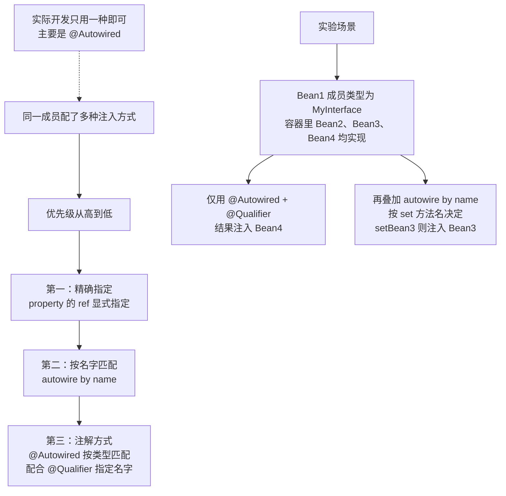

# 同一个成员配了多种注入方式，谁说了算

## 面试题考什么

Spring 依赖注入问到较真的地方，会遇到这么一问：同一个成员，如果我同时用了 @Autowired 注解、按名字匹配、还有精确指定，到底哪个生效？这个实验平时用不上，但能倒逼出一条清晰的优先级链：精确指定 > 按名字或类型匹配 > 注解方式。理解它，对 @Autowired 的匹配规则才算真的通了。

## 先给结论

同一个成员同时配置多种注入方式时，优先级从高到低是：精确指定成员依赖哪个 bean（property 的 ref 显式指定），其次是按名字匹配（autowire by name），最后是 @Autowired 这类注解方式（按类型匹配，配合 @Qualifier 指定名字）。实际开发只用其中一种就够了，主要是 @Autowired，这个实验只是用来验证优先级。



## 是什么：实验场景

有一个 Bean1，内部成员的类型是 MyInterface。容器里 Bean2、Bean3、Bean4 都实现了 MyInterface。一个接口三个实现，注入谁就有歧义了，正好用来做实验。

下面是这个实验的完整代码，三种注入方式同时加在同一个成员上（课件 `day04/bean/TestInjection.java`）：

```java
package day04.bean;

import org.springframework.beans.factory.annotation.Autowired;
import org.springframework.beans.factory.annotation.Qualifier;
import org.springframework.beans.factory.config.RuntimeBeanReference;
import org.springframework.beans.factory.support.AbstractBeanDefinition;
import org.springframework.beans.factory.support.RootBeanDefinition;
import org.springframework.context.annotation.AnnotationConfigUtils;
import org.springframework.context.support.GenericApplicationContext;

// 测试如果对同一属性进行的 @Autowired 注入、AUTOWIRE_BY_NAME、精确指定注入名称, 优先级是怎样的
public class TestInjection {
    public static void main(String[] args) {
        GenericApplicationContext context = new GenericApplicationContext();
        AnnotationConfigUtils.registerAnnotationConfigProcessors(context.getDefaultListableBeanFactory());
        context.registerBean("bean1", Bean1.class, bd -> {
            // 优先级最高的：精确指定注入 bean 的名称 <property name="bean3" ref="bean2"/>
            bd.getPropertyValues().add("bean3", new RuntimeBeanReference("bean2"));
            // 优先级次之的：通过 AUTOWIRE_BY_NAME 匹配
            ((RootBeanDefinition) bd).setAutowireMode(AbstractBeanDefinition.AUTOWIRE_BY_NAME);
        });
        context.registerBean("bean2", Bean2.class);
        context.registerBean("bean3", Bean3.class);
        context.registerBean("bean4", Bean4.class);

        context.refresh();
    }

    static class Bean1 {
        MyInterface bean;

        // 优先级最低的：@Autowired 匹配
        @Autowired @Qualifier("bean4")
        public void setBean3(MyInterface bean) {
            System.out.println(bean);
            this.bean = bean;
        }
    }

    interface MyInterface {
    }

    static class Bean2 implements MyInterface {
    }

    static class Bean3 implements MyInterface {
    }

    static class Bean4 implements MyInterface {
    }
}
```

代码里三处注入来源一眼可见：`getPropertyValues().add("bean3", new RuntimeBeanReference("bean2"))` 是精确指定，`setAutowireMode(AbstractBeanDefinition.AUTOWIRE_BY_NAME)` 是按名字匹配，`@Autowired` 加 `@Qualifier("bean4")` 是注解方式。三者同时作用在 `setBean3` 这一个成员上，谁生效看运行结果即可。

第一种配置：在 set 方法上加 @Autowired，要注入一个 MyInterface 类型的对象。容器里符合条件的 bean 有三个，光靠类型无法区分，所以用 @Qualifier 按名字指定，指定注入 Bean4。运行结果是注入了 Bean4，符合预期。

第二种配置：再加一个按名字匹配的设置。可以通过编程方式，在 BeanDefinition 上设置装配类型为 autowire by name。这个名字匹配不是按成员变量名，而是按成员方法：取 set 方法名，去掉前面的 set，首字母变小写，剩下的名称作为 bean 的名字去匹配。这里故意把 set 方法起名叫 setBean3，所以按名字匹配的结果应该是 Bean3，而不是 @Autowired 指定的 Bean4。

运行结果是 Bean3 被注入。说明同时配置时，按名字匹配的优先级更高，@Autowired 那套配置相当于作废了。

第三种配置：再精确指定一下这个成员（同样按 set 方法的名称来指定），给它一个属性，值是一个引用，指向 Bean2。这等价于 XML 配置里的 `<property name="bean3" ref="bean2">`。按名字匹配本该注入 Bean3，现在又精确指定要注入 Bean2。运行结果是 Bean2。

## 为什么是这样：优先级链

三轮实验串起来，优先级由高到低清清楚楚：

1. **精确指定**：明确写出这个成员依赖哪个 bean，最高优先级。它等价于 XML 里的 property ref，或者编程方式直接设置属性引用。
2. **按名字匹配**：autowire by name，用 set 方法名推导出的名字去容器里找同名 bean。
3. **按类型匹配**：@Autowired 注解的方式，先按类型找，同类型多个时靠 @Qualifier 指定名字，优先级最低。

这个实验里没法验证按类型匹配的优先级，因为三个 bean 类型完全一样，只有靠 @Qualifier 的名字才能区分，它自然落在最后一档。

## 深入细节：autowire by name 的名字从哪来

一个容易搞错的细节：按名字匹配的名字不是成员变量名，而是成员方法（set 方法）名推导出来的。规则是取 set 方法名，去掉前缀 set，首字母小写，剩下的作为 bean 名字去容器里匹配。所以 setBean3 对应名字 bean3，跟成员变量叫什么无关。

对照上面代码里的 Bean1，成员变量叫 `bean`，set 方法却叫 `setBean3`：

```java
    static class Bean1 {
        MyInterface bean;

        // 优先级最低的：@Autowired 匹配
        @Autowired @Qualifier("bean4")
        public void setBean3(MyInterface bean) {
            System.out.println(bean);
            this.bean = bean;
        }
    }
```

按名字匹配时用的是方法名推导出的 `bean3`，所以命中的是容器里的 Bean3；如果误以为用的是成员变量名 `bean`，就会推导出完全错误的结论。

这个规则也解释了实验设计为什么要把方法名写成 setBean3：成员类型相同的情况下，只有方法名能决定按名字匹配命中哪个 bean，这样才好和 @Autowired 指定的 bean4 形成对照。

## 面试怎么答

先给结论再举例，顺序如下：

1. **优先级**：精确指定 > 按名字匹配（autowire by name）> 按类型匹配（@Autowired 注解）最低。
2. **机制**：@Autowired 默认按类型注入，同类型多个实现时用 @Qualifier 按名字区分；autowire by name 用 set 方法名推导出的 bean 名字匹配，不是成员变量名。
3. **实际用法**：开发里不会同时用三种方式，用一种就够，主流是 @Autowired，必要时配 @Qualifier。

追问大概率是「@Autowired 和 @Resource 的区别」：@Autowired 是 Spring 的注解，默认按类型，配合 @Qualifier 按名字；@Resource 是 JSR 规范注解，默认按名字，按名字找不到才回退到按类型。这是与本篇优先级链直接相关的标准知识，答出来能补上完整图景。

## 常见误区

以为按名字匹配用的是成员变量名。实际用的是 set 方法名推导出来的名字，成员名和 set 方法名不一致时，注入结果会和直觉相反。
