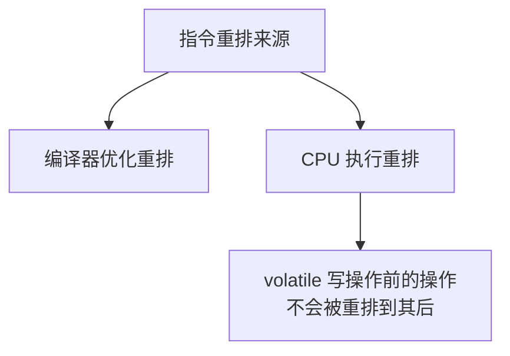

# volatile 与有序性：用 JCStress 把指令重排序压出来

## 面试官考什么

volatile 的三件事里，原子性和可见性都能自己写个小程序复现，唯独有序性不行：指令重排序导致的错误现象必须经过大量压测才能暴露。面试问到这一层，考的是你能不能说清重排序长什么样、怎么验证它，以及为什么 volatile 能挡住它。

## 先给结论

有序性问题要用 OpenJDK 提供的 JCStress 压测工具来暴露，它对两个线程的方法做上亿次反复调用，收集结果与预期结果比对。经典的双变量案例里，`x = 1; y = 1;` 与 `r1 = y; r2 = x;` 交错执行，只可能出现 (0,0)、(1,1)、(0,1) 三种结果；如果压测出 (1,0)，就说明发生了指令重排序，因为不改变代码执行顺序的话，这个结果永远不可能出现。给共享变量加上 volatile 之后，这类重排序被禁止。



## 是什么：压测长什么样

压测工具是 JCStress，专门做多线程压测，在 pom.xml 里加依赖：

```xml
<dependency>
    <groupId>org.openjdk.jcstress</groupId>
    <artifactId>jcstress-core</artifactId>
    <version>0.14</version>
</dependency>
```

测试类上标 `@JCStressTest`，被 `@Actor` 标注的方法在压测时各由一个线程执行。这个案例里有两个 actor 方法，就起两个线程，分别跑 actor1 和 actor2，调用次数极多，每一轮测试一秒钟，能跑多快跑多快、能跑多少次跑多少次。简单测过一次，一秒内这个测试用例能跑上亿次。

预期结果用 `@Outcome` 声明，多组预期之间用逗号分隔：

```java
@Outcome(id = {0, 0}, "1, 1", expect = Expect.ACCEPTABLE, desc = "ACCEPTABLE")
@Outcome(id = {1, 0}, expect = Expect.ACCEPTABLE_INTERESTING, desc = "INTERESTING")
```

两个 actor 方法分别是赋值和读取：

```java
@Actor
public void actor1() {
    x = 1;
    y = 1;
}
```

```java
@Actor
public void actor2(II_Result r) {
    r.r1 = y;
    r.r2 = x;
}
```

`II_Result r` 这个参数是用来收集结果的对象，实际运行结果存在它的 r1、r2 两个成员变量里，拿来和 `@Outcome` 注解里声明的预期值做比对。r1 对应预期值里逗号前面的那个，r2 对应逗号后面的那个。

## 为什么：三种意料之中，一种意料之外

把这两段代码的逻辑摆在一起看：

```text
x = 1;
y = 1;
r1 = y;
r2 = x;
```

两个共享变量 x、y，初值都是 0。线程一给它们赋值，线程二读取它们的值。

先自己排一排可能的结果组合：

- 线程一先跑完：x、y 都是 1，线程二读到的 r1（y）和 r2（x）就都是 1，得到 (1,1)。这是第一种。
- 线程二先跑完：赋值还没发生，读到的是初值，得到 (0,0)。这是第二种。
- 两个线程交错，x 先赋值、y 还没来得及赋值时线程二执行读取：y 读到初值 0，x 读到新值 1，得到 r1 为 0、r2 为 1，也就是 (0,1)。这是第三种。

这三种都在意料之中。那有没有可能出现 (1,0)？把顺序组合来组合去，只要不改变代码的执行顺序，(1,0) 永远出不来。

除非调整线程一两行代码的顺序，或者调整线程二两行代码的顺序。比如把 y 的赋值挪到 x 的赋值前面，线程一先写 y，此时 x 还没赋值，线程二读到 r1（y）为 1、r2（x）为 0，正是 (1,0)。再比如线程二的两行读取重排，先读 x 后读 y，x 此时还是 0，y 已经被赋值为 1，同样得到 (1,0)。

也就是说，(1,0) 这种结果只有指令重排序才会产生，属于意料之外的情况，JCStress 就是专门负责把它压出来的。压测结果里确实出现了这个组合，虽然占比很小，但足以证明重排序在真实环境里会发生。

## 深入细节：为什么 volatile 能挡住重排序

volatile 除了保证可见性，还禁止特定类型的指令重排序：写 volatile 变量之前的普通读写不会被重排到它后面，读 volatile 变量之后的普通读写不会被重排到它前面。落到这个案例上，两个变量加上 volatile，赋值顺序和读取顺序就被固定住了，(1,0) 这个组合不再出现。

这也是为什么 volatile 的语义经常被概括为「可见性加有序性」：前者靠读写直连主内存，后者靠禁止重排序。原子性它不管，那是锁和原子类的活。

## 面试怎么答

按「现象、验证、原理」三段答：

1. **现象**：有序性问题不像原子性、可见性那样能靠一个小程序复现，指令重排序要大量压测才暴露。
2. **验证**：用 JCStress，`@JCStressTest` 标注测试类，`@Actor` 标注被并发调用的方法，`@Outcome` 声明预期结果；双变量案例里 (0,0)、(1,1)、(0,1) 可接受，(1,0) 只有重排序才可能出现。
3. **原理**：volatile 禁止特定类型的指令重排序，加上之后这类结果不再出现。

追问常落在两个点：一是「为什么原子性、可见性能自己复现，有序性不行」，答案是前者错误现象稳定出现，后者是概率事件，需要上亿次量级；二是「volatile 能不能保证线程安全」，答案是不能，它管可见性和有序性，管不了复合操作的原子性。

## 常见误区

把「单线程里看起来顺序执行的代码」当成多线程下的实际执行顺序。这个案例的价值就在于证明：只要不影响单线程语义，编译器和 CPU 都可能调整代码的执行顺序，两个线程的交错加上重排序，会产出单看代码根本推不出来的结果组合。
