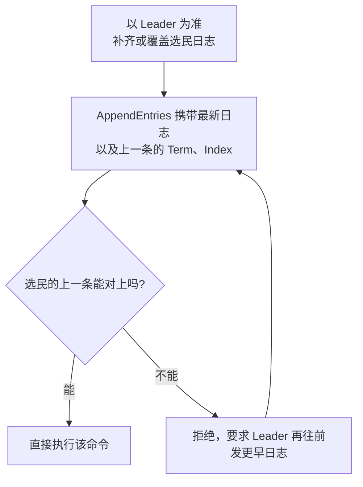

# Raft 保证安全之二：选民日志的一致性

## 面试题考什么

Raft 保证安全的第一个方面是 Leader 日志的完整性，第二方面就是选民（Follower）日志的一致性。面试追问到这层，通常是问「Leader 怎么把日志同步给 Follower」「AppendEntries 里为什么要带上一个日志的信息」。这两个问题的答案都在本篇里，理解它能答出 Raft 一致性检查的设计动机，而不只是背概念。

## 先给结论

选民的一致性以 Leader 为准：Leader 会对选民的日志做补充或覆盖，选民比 Leader 少就补充，多出来的部分无效就覆盖，总之朝 Leader 看齐。实现方式是 AppendEntries 请求同时携带最新日志的 Term、Index、Command 以及上一条日志的 Term、Index。选民拿上一个日志的信息和自己比对，对得上就接受最新的，对不上就请求携带更早的信息继续比对，直到找到一个能对上的点，才知道该从哪条开始补。

## 是什么：以 Leader 为准

一致性指的是与 Leader 一致。Leader 在每次向选民发送 AppendEntries 请求时，把最新的日志信息全部带上：日志的任期号、索引号、对应的命令，还有上一条日志的任期号和索引号。选民按照这些信息进行同步。

补充或覆盖的规则很直白：选民的日志比 Leader 少，就补充；选民的日志比 Leader 多出来了，多出来的部分肯定是无效的，需要覆盖。总之以 Leader 为准，朝 Leader 看齐。

## 为什么：只发最新的一条不够

有人会问，直接发最新那条不就行了，为什么还要发上一条？

因为选民缺的往往不止一条。看右侧的图：Leader 这边有四条日志，选民这边有三条。这时候 Leader 不光要把第 4 条日志发给选民，还要把第 3 条也发过去。第 3 条的作用是对照：让选民看看自己当前最新的那条，能不能和请求里带的上一条对上。能对上，说明选民只缺一条，把索引 4 的日志补上就完事。

如果选民缺失的日志比较多，发过来的第 4 条加上第 3 条还是对不上，说明缺得多。那就继续往前携带更早的信息：第 4 条、第 3 条、第 2 条依次发过来，一直到选民这边的某一条能和发过来的某一条对上为止。比如第 2 条对上了，选民才发现自己缺的是第 3 条和第 4 条，于是执行补齐第 3、第 4 两条日志。

这里要抓住索引号的作用：索引号保证了日志的顺序，中间不能缺失，一旦缺失就能被这个比对过程检查出来。没有上一个日志的信息，选民无从判断自己是缺一条还是缺十条。

## 深入细节：为什么不一次全发

既然要逐层往前找，为什么不干脆一次把所有日志全发过去？答案在网络开销上：日志信息如果特别大，全量发送占用的网络带宽太大了。

所以 Raft 采用逐层递进的方式：先发上一条，对不上再发上上一条，还不对就继续往前。这样就不必把全部日志都发给选民，而选民只要找到一个能对上的点，就知道自己缺失了哪些、应该补充哪些。

配合图上的示意更直观：一个简化的 Leader 与 Follower 交互图里，Leader 的日志是 `[1, 2, 3, 4]`，Follower 同步前是 `[1, 1]`，同步后变成 `[1, 1, 2, 3]`，中间用箭头表示 AppendEntries 请求的发送方向。这就是一次补充与覆盖的完整过程。

## 面试怎么答

被问到 Raft 怎么保证安全，把两方面一起给出会更完整：

1. **Leader 侧**：Leader 被认为拥有最完整的日志；提交过的命令，未来 Leader 也必须持有，靠投票环节的 Term、Index 比对保证。
2. **选民侧**：以 Leader 为准，对选民日志补充或覆盖。
3. **机制**：AppendEntries 携带最新日志的 `<Term, Index, Command>` 和上一条日志的 `<Term, Index>`；选民比对上一个日志的信息，对得上则接受、对不上则继续往前比对，直到找到匹配点。

追问大概率是「为什么 AppendEntries 要带上一个日志」：因为选民可能缺不止一条，上一条信息是用来定位缺口起点的；不带的话选民无法判断自己该从哪条补起。另一个常见追问是「为什么不一次发全部日志」：日志量大时全量发送占用带宽太高，逐层递进更省。

## 常见误区

以为日志同步就是「Leader 把最新日志发过去，Follower 直接追加」。真实的同步有比对、有回退、有覆盖：Follower 上多出来的日志可能被判定无效并被覆盖，追加之前必须先找到 Leader 与 Follower 日志真正对齐的位置。
