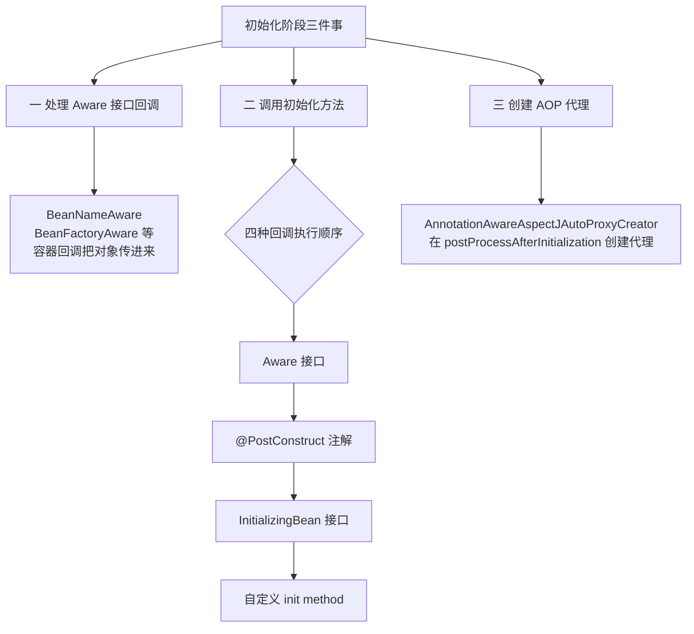

# Bean 的初始化阶段：Aware、初始化方法与 AOP 代理

## 面试题考什么

Spring Bean 的生命周期是面试必问，问到创建 bean 的阶段，前几步是创建实例、依赖注入，接下来就是初始化。这一阶段具体做了什么、三种初始化方式的执行顺序、初始化方法谁先谁后，都是高频追问点。本篇把初始化阶段的三件事和顺序问题一次讲清。

## 先给结论

初始化阶段主要做三件事：处理一些 Aware 接口回调、调用初始化方法、创建 AOP 代理。初始化方法有三种定义方式：@PostConstruct 注解、实现 InitializingBean 接口、在 BeanDefinition 里指定初始化方法名。四种回调的执行顺序是：Aware 接口 → @PostConstruct 注解 → InitializingBean 接口 → 自定义 init method，也就是 4、2、1、3。AOP 代理由 AnnotationAwareAspectJAutoProxyCreator 这个后处理器在初始化最后一步的 postProcessAfterInitialization 里创建。



## 是什么：初始化阶段的三件事

第一件事，处理一些 Aware 接口。Aware 接口分内置和扩展两类，面试时不用区分那么细，直接说「会先处理一些 Aware 接口」即可。比如 BeanNameAware、BeanFactoryAware，只要 bean 实现了这些接口，初始化阶段容器就会回调接口中的方法，把对应的对象传进来：实现了 BeanFactoryAware，容器就会通过回调把 BeanFactory 对象传给 bean。

第二件事，调用初始化方法。

第三件事，如果 bean 和切面表达式匹配上了，容器会帮它创建 AOP 代理。

## 为什么：三种初始化方式，两套后处理器

三种初始化方法的定义方式：

1. **@PostConstruct 注解**：在方法上标注这个注解，标明该方法属于初始化方法。这个注解其实是通过一个 bean 后处理器来调用的，就是依赖注入阶段见过的 CommonAnnotationBeanPostProcessor。它当时用来解析 @Resource 注解，除此以外还能识别 @PostConstruct 以及 @PreDestroy 这两个与初始化、销毁相关的注解。
2. **实现 InitializingBean 接口**：Spring 提供的接口，接口里的 afterPropertiesSet 方法就是初始化方法，容器会回调它。
3. **在 BeanDefinition 里指定**：用 XML 时通过 bean 标签的 init-method 属性指定初始化方法名；用 @Bean 注解时通过 initMethod 属性指定。

创建 AOP 代理同样是通过一个后处理器完成的，名字叫 AnnotationAwareAspectJAutoProxyCreator，专门用来创建代理。它在初始化的最后一步，也就是 postProcessAfterInitialization 这个方法里帮我们创建 AOP 代理。

也就是说，解析注解和创建代理这两件扩展功能，分别是靠两个不同的 bean 后处理器实现的。

## 深入细节：四种回调的执行顺序

用一段代码把顺序跑出来：

```java
public class TestInitialization {
    public static void main(String[] args) {
        GenericApplicationContext context = new GenericApplicationContext();
        context.registerBean(CommonAnnotationBeanPostProcessor.class);
        context.registerBean(beanName: "bean1", Bean1.class, bd -> bd.setInitMethodName("initMethod"));
        context.refresh();
    }
}

static class Bean1 implements InitializingBean, BeanFactoryAware {
    @Override
    public void afterPropertiesSet() throws Exception {
        System.out.println(1);
    }

    @PostConstruct
    public void init() {
        System.out.println(2);
    }

    public void initMethod() {
        System.out.println(3);
    }

    @Override
    public void setBeanFactory(BeanFactory beanFactory) throws BeansException {
        System.out.println(4);
    }
}
```

Bean1 同时实现了 BeanFactoryAware 和 InitializingBean，还有 @PostConstruct 标注的 init，以及由 BeanDefinition 指定的 initMethod。其中 `bd.setInitMethodName("initMethod")` 这行配置，等价于 XML 里的写法：

```java
// <bean init-method="initMethod">
```

调用 refresh 时会初始化所有单例（refresh 的第 11 步），走到 Bean1 创建流程的初始化步骤，这些方法就依次执行了。控制台输出 4、2、1、3：

1. 先执行 Aware 接口回调（setBeanFactory，输出 4）。
2. 再执行注解标注的初始化方法（@PostConstruct 的 init，输出 2）。
3. 再执行 InitializingBean 接口定义的初始化方法（afterPropertiesSet，输出 1）。
4. 最后执行 BeanDefinition 里指定的初始化方法（initMethod，输出 3）。

## 面试怎么答

按「三件事 + 三种方式 + 一个顺序」答：

1. **三件事**：处理 Aware 接口回调、调用初始化方法、创建 AOP 代理。
2. **三种初始化方式**：@PostConstruct 注解（由 CommonAnnotationBeanPostProcessor 解析）、实现 InitializingBean 接口的 afterPropertiesSet、BeanDefinition 里指定的 init-method 或 @Bean 的 initMethod。
3. **顺序**：Aware → @PostConstruct → InitializingBean → 自定义 init method，对应输出 4、2、1、3。
4. **代理时机**：AnnotationAwareAspectJAutoProxyCreator 在 postProcessAfterInitialization 中创建 AOP 代理，也在初始化阶段，是最后一步。

追问常落在两个方向：「@PostConstruct 是谁调用的」，答案是 bean 后处理器 CommonAnnotationBeanPostProcessor，不是容器直接反射调用的；「初始化和实例化的区别」，实例化是构造方法创建对象，初始化是对象创建完、依赖注入完之后执行的那些回调。

## 常见误区

把三种初始化方式当成平级的、顺序随意。实际有明确的先后：注解方式最靠前，接口方式居中，自己指定的 init method 最后执行。如果三种都用了，别指望按代码书写顺序跑。
