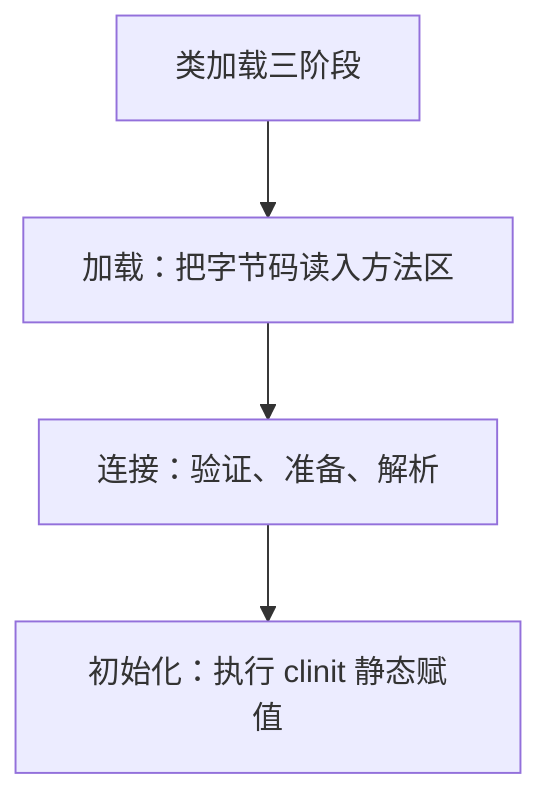

# 类加载的三个阶段：加载、链接、初始化

## 面试题考什么

「类加载过程」和「类加载器的双亲委派」经常一起问。类加载过程这块，考的是三个阶段的划分，以及每个阶段具体做了什么，尤其是「准备」和「初始化」两个阶段的差异，几乎必被追问：静态变量到底什么时候赋值。本篇先把三个阶段讲清楚，后面还有单独的例子讲解析、静态代码块和懒惰执行。

## 先给结论

类加载分三个阶段：加载、链接、初始化。加载是把类的字节码载入方法区并创建类对象，父类未加载时先加载父类，且是懒惰执行；链接分验证、准备、解析三个小步骤，准备阶段只给静态变量分配空间并设默认值，赋值语句要等到初始化阶段才执行；初始化阶段执行静态代码块和非 final 静态变量的赋值，赋值与静态代码块会合并成一个类初始化方法执行，同样懒惰执行。final 静态变量是例外，它在链接阶段就已经赋好值，初始化阶段不会再重复赋值。

## 是什么：加载阶段

加载阶段做的事很直白：把类的字节码载入方法区，并创建一个「类名.class」对象，也就是俗称的类对象。

为什么还要创建类对象？因为方法区中类的字节码是用 C++ 的数据结构表示的，Java 代码不能直接访问它。想在 Java 里知道这个类有哪些成员、哪些方法，就得通过这个类对象，调用它相应的方法（也就是反射相关的那些方法）来获取。

两个存放位置要分清：类的字节码存在方法区；类对象在现在的 JVM 实现中是存在堆里的，不在方法区。

加载还有两条规则。一是如果类的父类没加载，先加载父类，也就是先有父亲再有儿子；实现接口同理，先加载接口再加载当前类。二是加载动作是懒惰执行的，真正用到这个类时才触发加载，没用到就不会提前把字节码载入方法区。

## 为什么：链接阶段的三小步

链接阶段分成三个小步骤。

**验证**：验证这个类是否符合 class 文件规范，对字节码的合法性、安全性做检查。

**准备**：为类中的静态变量分配空间，并设置这些静态变量的默认值。这里有个关键点：如果给静态变量写了赋值语句，这些赋值语句不会在准备步骤执行，准备只负责分配空间，赋值留到最后的初始化阶段。

**解析**：将常量池中的符号引用解析为直接引用。这条先记住，后面有单独的例子解释。

## 深入细节：初始化阶段与 final 的例外

初始化阶段执行静态代码块和静态变量的赋值：链接阶段只是给静态变量分配了空间，初始化阶段才真正赋值。而且赋值动作和静态代码块会合并成一个方法来执行，这个方法就是类的初始化方法。

有一个小细节值得单独记：非 final 的静态变量，其赋值是在静态代码块（也就是那个合并出来的类初始化方法）里执行的；但 final 的静态变量不一样，它实际上在链接阶段就已经赋好值了，不会在初始化阶段重复赋值。这是 final 静态变量在编译期就能确定、会被当作常量处理的直接结果。

最后，初始化和加载一样是懒惰执行的，必须到了万不得已、真正用到时才进行；没用到就不会初始化。

## 面试怎么答

按「三阶段 + 三小步 + 一个差异」答：

1. **加载**：字节码入方法区，创建堆里的类对象；父类（接口）优先加载；懒惰执行。
2. **链接**：验证（规范、合法性、安全性检查）、准备（静态变量分配空间并设默认值）、解析（符号引用转直接引用）。
3. **初始化**：执行静态代码块与非 final 静态变量赋值，二者合并成类初始化方法；懒惰执行；final 静态变量在链接阶段已赋值，不参与初始化。

追问基本集中在两个点：「`static int a = 1` 什么时候变成 1」，答案是准备阶段分配空间并置默认值 0，初始化阶段才赋成 1；「`static final int b = 1` 呢」，答案是在链接阶段（准备）就赋好值了。另外「类对象在哪」也常被问，答案是堆里，字节码在方法区。

## 常见误区

把「准备」和「初始化」混为一谈，认为静态变量在分配空间时就拿到了代码里写的值。实际上准备阶段只给默认值（0、null、false 这些），代码里写的赋值要等初始化阶段才执行，这也是很多「静态变量读取到意外默认值」问题的根源。

## 课件配图
> 以下配图取自阶段七课件对应讲义，与上文讲解一一对应，可作为图文对照辅助理解。
**类加载**（课件讲义图示）

