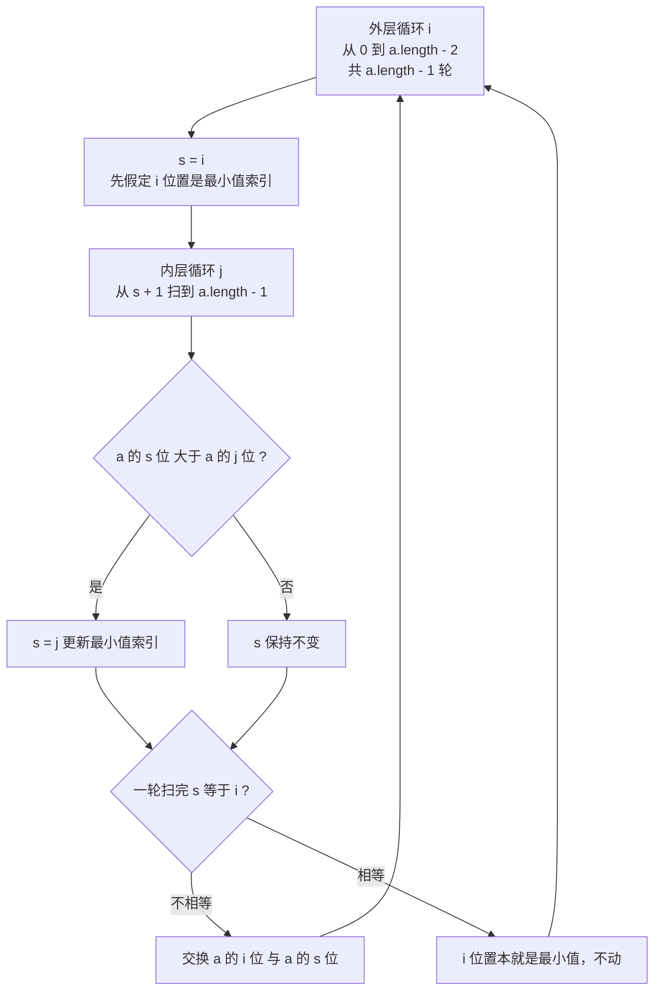

# 选择排序的代码实现：两个循环加一次交换

## 面试题考什么

上一篇讲了选择排序的思路和演示，这一篇落到代码。面试官让你手写选择排序，考的是两件事：外层循环为什么是 length 减 1，以及内层那个记录最小值索引的变量怎么用。想清楚这两个变量的语义，代码几乎是顺着写出来的。

## 先给结论

外层循环跑数组长度减一次，代表需要经历这么多轮选择；变量 i 表示本轮最小元素要交换到的目标索引，变量 s 表示当前找到的最小元素的索引，初值取 i。内层循环从 i+1 扫到末尾，用 `a[s] > a[j]` 比出更小的值就更新 s；一轮扫完，如果 s 不等于 i 才交换，相等说明 i 位置本来就是最小值，不用动。



## 是什么：先想清楚两个变量

数组长度是 8，需要经历多少轮选择？7 轮。经过 7 轮选择，前 7 个最小的元素都放进了有序部分，剩下的最后一个不用再选，它肯定已经是最大的。所以需要经历数组长度减一轮选择，数组就有序了。体现到代码上就是一个外层循环，循环数组长度减一次。

接下来是两个关键变量的语义：

- **i**：代表每轮选择时，最小元素要交换到的目标索引。第一轮要把最小元素交换到索引 0，第二轮把次小的交换到索引 1，依次类推，这些 0、1、2 就是 i。
- **s**：代表本轮找到的最小元素的索引。一开始假定第 i 个元素是最小的，所以 s 的初值就是 i；往后逐个比较，发现更小的就把 s 更新成那个元素的索引。

## 为什么：比较与交换怎么写

s 的初值确定后，就写比较的代码。s 要和它后续的所有元素比较，于是再来一个内层循环，初始值从 s+1（也就是 i+1）开始，把 s 索引的元素和 j 索引的元素两两比较，j 一直循环到数组最后一个元素，也就是 `j < a.length`。

比较的逻辑：如果 `a[s] > a[j]`，说明 j 位置的元素更小，把 j 更新成新的 s。

内层循环结束后，最小元素对应的索引 s 就找到了，把 s 和 i 两个位置的元素交换即可。这里可以做一个小优化：如果 s 和 i 相等，说明 i 位置本来就是这一轮的最小值，不用交换，所以只在 s 不等于 i 时才 swap。

## 深入细节：完整代码

```java
package day01.sort;
import java.util.Arrays;
import static day01.sort.BubbleSort.swap;

public class SelectionSort {
    public static void main(String[] args) {
        int[] a = {5, 3, 7, 2, 1, 9, 8, 4};
        selection(a);
    }

    private static void selection(int[] a) {
        for (int i = 0; i < a.length - 1; i++) {
            int s = i; // 代表每轮选择最小元素要交换到的目标索引
            for (int j = i + 1; j < a.length; j++) {
                if (a[s] > a[j]) {
                    s = j; // 代表最小元素的索引
                }
            }
            if (s != i) {
                swap(a, s, i);
            }
        }
        System.out.println(Arrays.toString(a));
    }
}
```

swap 是交换数组两个元素的辅助方法，这里直接从 BubbleSort 里静态导入复用。把每轮选择的结果打印出来，可以对照着看执行过程：第一次选择把最小的 1 选中，第二次选择之后有序部分又多一个，第三次选择多出个 3，有序部分越来越多、无序部分越来越少，最终达到排好序的效果。

## 面试怎么答

手写时按三个问题自问自答，代码就不会写错：

1. **几轮**：数组长度减一轮，所以外层 `i < a.length - 1`。
2. **这轮要干嘛**：在 `[i, length-1]` 里找最小值索引 s，初值 i，用 `a[s] > a[j]` 比较更新。
3. **找到了怎么办**：s 不等于 i 才交换，`swap(a, s, i)`。

追问一般是复杂度：两层循环，比较次数固定为 n(n-1)/2，时间复杂度 O(n²)，最好最坏都一样；交换最多 n 减 1 次；空间复杂度 O(1)。

## 常见误区

把外层循环写成 `i < a.length`。多跑一轮既没必要，也会让 s 和 i 的语义在最后一轮变得多余（只剩一个元素，交换没有意义）。另一个常见错误是内层循环起点写成 i，那样会拿自己和自己比一次，虽然不影响结果，但属于无效比较。
