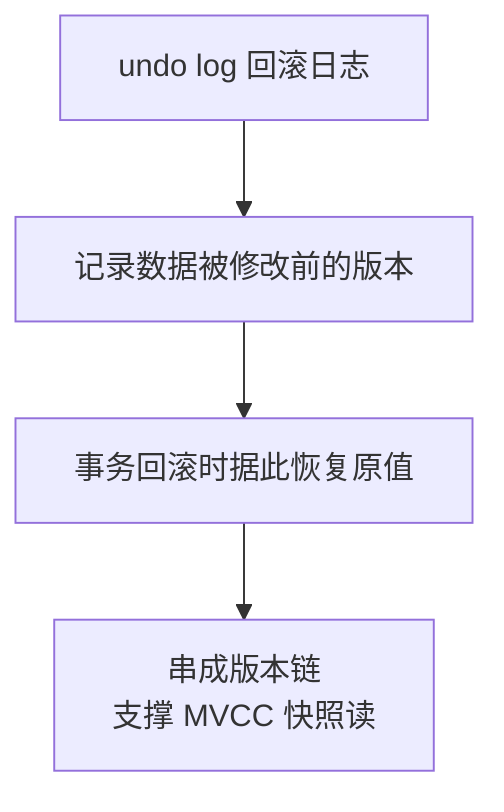

# undo log：回滚靠它，快照读也靠它

## 面试题考什么

InnoDB 的两个日志，undo log 和 redo log，是 MySQL 面试的分水岭题。问 undo log 时，面试官想听到的不只是「用来回滚」，还有它支撑 MVCC 快照读这一层。能把「一行数据多个版本 + 回滚指针 + 事务 ID 比对」这条链讲清楚，这道题就稳了。

## 先给结论

undo log 是 InnoDB 独有的日志，另外的引擎没有。它有两个作用：一是回滚数据，以行为单位记录每次变更，让一行数据有多个版本并存，需要回滚时找历史版本恢复；二是实现多版本并发控制（MVCC），也就是快照读，让查询可以访问历史版本，既支撑可重复读隔离级别，又让查询不受锁的影响。快照读不是真的拍了张照片，而是顺着回滚指针在回滚段里找到对自己可见的那个历史版本。

## 是什么：回滚数据

InnoDB 支持事务，事务里的回滚操作就是靠 undo log 实现的。实现方式不复杂：以行为单位，把这行数据的每次变更操作都记录下来。

记录下来的直接结果是，一行数据会有多个版本并存，不光有现在的版本，还有历史版本。一旦有回滚需求，到 undo log 里找到历史版本，把数据恢复到事务开始时的那个版本就可以了。

## 为什么：快照读也依赖它

第二个作用是多版本并发控制，说白了就是实现前面讲过的快照读。

与快照读相对的是当前读：当前读每次查询到的都是最新提交的数据。快照读则让查询操作可以访问历史版本的数据。快照读的意义有两个：一是实现可重复读（repeatable read）这个隔离级别；二是让查询操作与其他增删改操作之间不互斥，查询不受锁的影响，因为它读的是历史版本。

### 一个例子

图里有三个事务，按开始时间有单调递增的事务编号：红色事务最先开始，编号 100；绿色晚一些，编号 101；蓝色最后开始，编号 102。

时间线上：红色事务最先开始，`start transaction with consistent snapshot`，一开始就建了快照；绿色事务执行了一次更新，把 1 号记录的余额更新成 2000；蓝色事务也执行完了一次更新，把 1 号记录余额更新成 3000。最后红色事务在绿、蓝两个事务都执行完之后，执行了一次查询。这个查询没有加 for update 之类的锁，是一次快照读。

那它读到什么？不是最新提交的 3000，也不是之前提交的 2000，而是这两个事务之前的状态，也就是最初的 1000。

### 怎么做到

每条记录除了数据本身，还有两个重要信息：

- **db trx id**：哪个事务对这条记录做了修改。表里最新的数据是蓝色事务（102）改成的 3000。
- **db roll ptr**：回滚段指针，指向这条记录上一个版本的地址。

顺着指针找，上一个版本在 undo log 的回滚段里：id=1、余额=2000，改它的是绿色事务（101）；再往上，上上个版本是余额=1000，关联的事务编号是 99（不是这三个事务之一，属于更早的事务），如果再没有更多回滚记录，它的 roll ptr 就不再指向任何记录。

红色事务做快照读时，把自己当前的事务编号与记录上的事务编号比对，只认事务 ID 小于等于自己的那条记录：

1. 最新版本 db trx id 是 102，大于 100，对红色事务不可见，跳过。
2. 沿回滚指针找上一个版本，101 仍大于 100，还是不可见，继续往前。
3. 找到上上个版本，db trx id 是 99，小于等于 100，这条记录才是对红色事务可见的。

于是读到的是历史版本里的 1000。事务 ID 比当前事务 ID 大的版本一律不可见，一路往前找到第一个可见的为止。

## 深入细节：快照不是照片

这一点值得单独强调：快照读里的「快照」并不是真的把数据复制了一份。它只是访问回滚段，顺着 roll ptr 链条找到合适的历史版本。所谓一致性读，靠的就是这条版本链加上事务 ID 的可见性判断。

也正因为如此，undo log 不能无限保留：事务提交后不再需要的 undo log 会被 purge 线程清理，长事务会让版本链变长、回滚段无法回收，这正是「避免长事务」这个建议背后的原因之一。

## 面试怎么答

按「两个作用 + 一条链 + 一个判断」答：

1. **两个作用**：回滚数据（以行为单位记录变更，多版本并存）；实现 MVCC 快照读（一致性读），支撑可重复读，并让读写不互斥。
2. **一条链**：每行记录有 db trx id（修改它的事务 ID）和 db roll ptr（指向上一版本的回滚指针），历史版本串成版本链存在回滚段里。
3. **一个判断**：快照读时拿自己的事务 ID 与各版本的 db trx id 比对，只认小于等于自己的版本，顺着 roll ptr 一路往前找到第一个可见的。

追问通常是与 redo log 对比：undo log 保证原子性（回滚）和 MVCC，redo log 保证持久性（崩溃恢复），两者都是 InnoDB 独有，分工不同。

## 常见误区

把快照读理解成「把数据复制了一份存起来」。实际上没有复制，只有版本链和可见性判断，查询时顺着回滚指针回溯。另一个常见误区是以为 undo log 只在回滚时才用得上：绝大多数情况下，它是在支撑快照读，回滚只是少数场景。

## 课件配图
> 以下配图取自阶段七课件对应讲义，与上文讲解一一对应，可作为图文对照辅助理解。
**undo log 与 redo log**（课件讲义图示）

