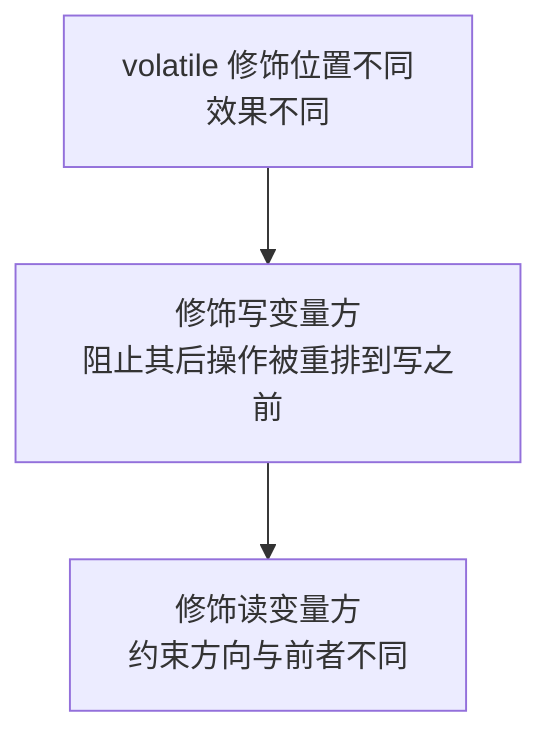

# volatile 加在 x 上还是 y 上：位置决定效果

## 面试题考什么

上一篇压测留了个悬念：同样是两个共享变量，volatile 加在 y 上能禁止重排序，加在 x 上却不行。这个问题非常有区分度，因为它考的不是「volatile 有什么用」，而是 volatile 写和 volatile 读各自约束了哪一侧的顺序。能把这层说清楚，说明你真的理解了 happens-before 里的 volatile 规则。

## 先给结论

三个用例的差别只在 volatile 修饰的位置：都不加时 (1, 0) 会出现；y 加 volatile 时 (1, 0) 不再出现；x 加 volatile 时 (1, 0) 仍然出现。原因是 volatile 写会禁止它前面的普通写重排到它后面，volatile 读会禁止它后面的普通读重排到它前面。y 是 volatile 时，写侧的 `x = 1` 被固定在 `y = 1` 之前，读侧的 `r2 = x` 被固定在 `r1 = y` 之后，两头锁死；x 是 volatile 时，被约束的是另一侧，y 的写入与读取顺序依然自由，重排序照样发生。



## 是什么：三个用例只差一个关键字

三个用例的代码结构完全一样，只有变量声明不同。

**Case1，两个变量都是普通变量**：

```java
@State
public static class Case1 {
    int x;
    int y;
    @Actor
    public void actor1() {
        x = 1;
        y = 1;
    }
    @Actor
    public void actor2(II_Result r) {
        r.r1 = y;
        r.r2 = x;
    }
}
```

**Case2，y 是 volatile**：

```java
@State
public static class Case2 {
    int x;
    volatile int y;
    @Actor
    public void actor1() {
        x = 1;
        y = 1;
    }
    @Actor
    public void actor2(II_Result r) {
        r.r1 = y;
        r.r2 = x;
    }
}
```

**Case3，x 是 volatile**：

```java
@State
public static class Case3 {
    volatile int x;
    int y;
    @Actor
    public void actor1() {
        x = 1;
        y = 1;
    }
    @Actor
    public void actor2(II_Result r) {
        r.r1 = y;
        r.r2 = x;
    }
}
```

压测结果上一篇已经跑过：Case1 的 (1, 0) 会出现；Case2 把 (1, 0) 声明为 FORBIDDEN，跑完没有任何错误，说明它被彻底禁止了；Case3 的 (1, 0) 照样出现。

## 为什么：volatile 约束的是哪一侧

先看 (1, 0) 是怎么产生的。要得到 r1（读 y）为 1、r2（读 x）为 0，必须同时满足：y 已经被写成 1，而 x 还没被写成 1。这只有两种情况：要么写线程把两个赋值的顺序调换了（先 y 后 x），要么读线程把两个读取的顺序调换了（先 x 后 y）。不改顺序的话 (1, 0) 永远出不来。

再看 volatile 的两条规则：

1. **volatile 写之前的普通读写，不允许重排到 volatile 写之后。**
2. **volatile 读之后的普通读写，不允许重排到 volatile 读之前。**

Case2 里 y 是 volatile。`y = 1` 是 volatile 写，它前面的普通写 `x = 1` 不许跑到它后面，写侧顺序被固定成先 x 后 y；`r1 = y` 是 volatile 读，它后面的普通读 `r2 = x` 不许跑到它前面，读侧顺序被固定成先 y 后 x。两条路都被堵死，(1, 0) 不可能出现。

Case3 里 x 是 volatile。被保护的是「x 写之前的普通写不能跑到 x 写之后」，也就是 `x = 1` 之前的动作不能越过它；而 `y = 1` 在 `x = 1` 之后，这条规则管不到它，写线程照旧可以把 y 的赋值挪到 x 前面。读侧同理，`r2 = x` 是 volatile 读，它约束的是「读 x 之后的普通读不能跑到读 x 之前」，而真正需要被约束的 `r1 = y` 在读 x 之前，规则同样管不到。于是重排序照常发生，(1, 0) 照样出现。

一句话总结：volatile 保护的是「与它自己相邻的那侧顺序」，加在错误的变量上，等于把屏障放错了位置。

## 深入细节：怎么判断该加在哪

规律可以这么记：在这类「先写两个共享变量、再读两个共享变量」的场景里，要防止读写两侧的相对顺序被打乱，volatile 应该加在「写序列里最后写的那个」以及「读序列里最先读的那个」变量上。本例写序列是 x 然后 y，最后写的是 y；读序列是先读 y 然后读 x，最先读的是 y。两边指向同一个变量 y，所以 y 加 volatile 就能同时锁住写尾和读头。

如果两个序列指向不同的变量，那就需要两个都加 volatile，或者干脆用锁。这也是为什么实际工程里遇到这类问题，最省心的做法不是纠结加哪个变量，而是用 synchronized 或 Lock 把整段包起来。

## 面试怎么答

分四步答：

1. **现象**：两个共享变量，volatile 加在 y 上能禁止重排序，加在 x 上不行。
2. **规则**：volatile 写之前的普通读写不能重排到写之后；volatile 读之后的普通读写不能重排到读之前。
3. **解释**：y 是 volatile 时，写侧 `x = 1` 被固定在 `y = 1` 前、读侧 `r2 = x` 被固定在 `r1 = y` 后，两边锁死；x 是 volatile 时，被约束的是另一头，y 的顺序依旧自由。
4. **规律**：volatile 应加在「写序列最后写的」与「读序列最先读的」变量上；不确定时用锁更稳妥。

## 常见误区

以为给任意一个共享变量加上 volatile，整段代码的顺序就都被保护了。volatile 的屏障是有方向、有边界的，它只约束与自己相邻的那侧操作。放错位置等于白加，压测里 (1, 0) 会照常出现。
