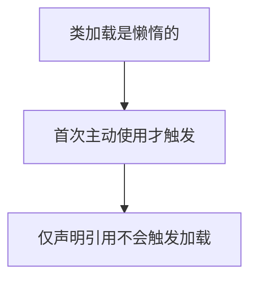

# 用 JHSDB 亲眼验证：类加载确实是懒惰的

## 面试题考什么

类加载「懒惰执行」这句话几乎人人会背，但被追问「怎么证明」时就答不上了。这篇用 JDK 自带的调试工具把内存状态摆出来看，从「内存里有没有这个类」这个可观测的事实出发，同时把「访问类对象」和「创建对象」分别触发了哪一步也分清楚，这三点都是面试里的加分项。

## 先给结论

用 JHSDB 的 Class Browser 观察内存可以验证：没用到 Student 类之前，内存里查不到 Student，类没有被加载；执行 `Student.class` 访问类对象之后，内存里能查到 Student，说明类加载被触发了，但这一步不会触发类的初始化；创建 Student 对象时不会再触发第二次加载，但会触发类的初始化。类的元数据在方法区，类对象 Student.class 在堆内存。



## 是什么：实验怎么设计

准备一个 Student 类，它没有特殊之处，只是有一些静态变量、用 final 修饰的静态变量，以及一个静态代码块。重点是那个静态代码块，它会打印一行字，用来标记「初始化到底有没有发生」。

```java
public class Student {
    static int a = 0x77;
    static {
        System.out.println("Student.class init");
    }
    static int b = 0x88;

    static final int c = 0x99;
    static final int m = Short.MAX_VALUE + 1;
    static final Object n = new Object();

    int d = 0x55;
    int e = 0x66;
}
```

测试代码里有两处关键代码：

- 第一处是 `Student.class`，也就是使用这个类的类对象。使用类对象会触发类的加载，这算第一次用到它。
- 第二处是创建 Student 对象。创建对象同样会触发类加载，但类加载只会执行一次，前面访问类对象时已经加载过了，这里不会再触发第二次；不过创建对象比访问类对象多做了一件事，它会触发类的初始化，而访问类对象并不会触发初始化。

为了观察关键代码执行前后的内存状态，用 `System.in.read` 让程序停在中间：它接收控制台输入的一个字符，没输入之前代码就停在这一行不动，输入一个字符后才继续向下运行。这样就能把前后两段代码暂停住，分两次观察内存。

把两段关键代码和三个断点放在一起，测试类长这样：

```java
public class TestLazy {
    private Class<?> studentClass;

    public static void main(String[] args) throws IOException {
        System.out.println("未用到 Student");
        System.in.read();

        System.out.println(Student.class);   // 关键代码1，会触发类加载
        System.out.println("已加载 Student");
        TestLazy testLazy = new TestLazy();
        testLazy.studentClass = Student.class;
        System.in.read();

        Student stu = new Student();        // 关键代码2，会触发类初始化
        System.out.println("已初始化 Student");
        System.in.read();
    }
}
```

运行时对照控制台输出就能验证：程序停在第一个 `System.in.read` 时，Student 还没进内存；回车后只打印出 Student.class 的类对象信息，**没有** 打印 `Student.class init`，说明此刻只加载未初始化；再回车创建 Student 对象，这时 `Student.class init` 才第一次出现，也就是初始化确实推迟到了创建对象这一刻。

## 为什么：从内存里找答案

观察内存状态要用 JDK 自带的调试工具，较新版本 JDK 提供的工具叫 JHSDB。直接输入命令名会提示有很多参数，这里用 hsdb 参数启动，因为它是带图形界面的调试工具（UI debugger），比基于命令行的调试工具对初学者友好一些。

工具启动后把代码也运行起来。程序停在 `System.in.read` 这一行时，用调试工具连上去查看内存状态：

1. 从菜单里选择关联到一个 Java 虚拟机进程，需要输入进程号。进程号可以用另一个 JDK 工具 jps 列出来，找 TestLazy 前面那个数字就是它的进程号。
2. 关联上之后，用 Tools 里的 Class Browser 查看类的信息，它会把当前 JVM 中加载的所有类列出来。
3. 在 Class Browser 里输入 student 作为关键词搜索，此时提示并没有找到名字叫 Student 的类，说明内存里还没有 Student 的任何信息。

此时一回车，程序越过 `System.in.read` 继续运行，触发类加载。这里有个小插曲：回车后程序像是卡住了，其实是调试工具的问题，必须先断开连接，Java 代码才会恢复运行，然后停在下一处 `System.in.read`。

重新关联上去，再用 Class Browser 搜 student，这次有了。说明类的元数据已经加载到内存中，其中元数据在方法区，而 Student.class 这个类对象在堆内存。

## 深入细节：加载与初始化的分界

这个实验最有价值的部分是它把「加载」和「初始化」两步区分开了：

- 访问 `Student.class` 这类使用类对象的动作，会触发加载，但不触发初始化。
- 创建 Student 对象会触发初始化（静态代码块和静态变量赋值在这一步执行）。

这也印证了前面讲过的结论：加载和初始化都是懒惰执行的，但触发条件不同。用类对象、创建实例、`Class.forName`、访问静态成员等都会触发加载；而初始化要等到真正「主动使用」时才发生，比如 new 一个对象、读写类的非 final 静态变量、调用静态方法等。

至于类对象为什么在堆里而不在方法区，那是下一个例子要验证的内容。

## 面试怎么答

被问到「类加载是懒惰的，怎么证明」，按「工具、步骤、观察结果」答：

1. **工具**：JDK 自带的 JHSDB（用 hsdb 参数启动图形界面），配合 jps 拿进程号，用 Class Browser 观察当前 JVM 已加载的类。
2. **步骤**：用 `System.in.read` 把程序停在关键代码前后；先在未使用类时查看，再在使用 `Student.class` 之后查看。
3. **结果**：未使用时搜不到 Student，使用后能搜到，证明类加载是懒惰的；访问类对象只触发加载，创建对象才触发初始化。
4. **存放位置**：类的元数据在方法区，类对象在堆内存。

追问一般是「哪些操作会触发初始化」：创建实例、访问类的静态变量（非 final）、调用静态方法、`Class.forName`、子类初始化会先触发父类初始化等；而访问类对象、访问 final 静态常量这类不会触发初始化。

## 常见误区

把「用到类」笼统理解成一定会触发初始化。这个实验清楚地分开了两件事：访问 `Student.class` 时类已经在内存里了，但静态代码块还没执行；只有真正创建对象时初始化才发生。混淆加载与初始化，是类加载相关问题里最常见的错误。
