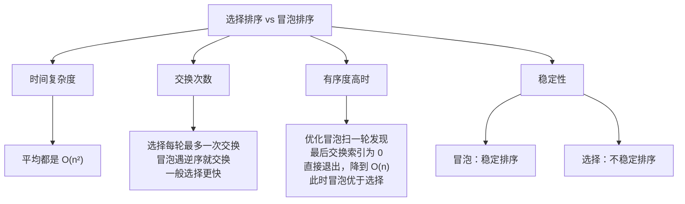

# 选择排序 vs 冒泡排序：谁快，谁稳定

## 面试题考什么

两个 O(n²) 的排序摆在一起比较，是面试里的经典追问：既然复杂度一样，为什么一般说选择排序更快？那什么时候冒泡反而更好？还有一道必答题，稳定排序和不稳定排序到底差在哪。这篇一次讲完。

## 先给结论

两者平均时间复杂度都是 O(n²)。一般情况下选择排序快于冒泡，因为它每轮最多只交换一次，而冒泡每轮只要遇到逆序就交换，交换次数多得多。但在集合有序度高（尤其已经有序）时，冒泡优于选择：优化过的冒泡一轮扫下来发现最后一次交换索引为 0，就知道整个集合已有序，时间复杂度降到 O(n)，而选择排序无法判断集合是否有序，做不到这个优化。稳定性上，冒泡是稳定排序，选择是不稳定排序。



## 是什么：选择排序的文字描述与优化

文字描述：将数组视为两个子集，排序的和未排序的；每一轮从未排序的子集中选出最小的元素，放入排序子集；重复以上步骤，直到整个数组有序。

选择排序的优化方式体现在交换上。为了减少每轮的交换次数，它不是「遇到一个更小的就交换一次」，而是一开始仅仅把最小元素的索引记下来，在每轮选择的最后才交换一次：

```java
private static void selection(int[] a) {
    for (int i = 0; i < a.length - 1; i++) {
        int s = i; // 代表每轮最小元素要交换到的目标位置
        for (int j = s + 1; j < a.length; j++) {
            if (a[s] > a[j]) {
                s = j;
            }
        }
        if (s != i) {
            swap(a, s, i);
        }
    }
    System.out.println(Arrays.toString(a));
}
```

这样每轮选择最多只发生一次交换，这是它比较优秀的地方。

## 为什么：交换次数决定了谁更快

冒泡的写法是这样的：

```java
public static void bubble(int[] a) {
    int n = a.length - 1;
    while (true) {
        int last = 0; // 表示最后一次交换的位置
        for (int i = 0; i < n; i++) {
            if (a[i] > a[i + 1]) {
                swap(a, i, i + 1);
                last = i;
            }
        }
        n = last;
        if (n == 0) {
            break;
        }
    }
}
```

冒泡每一轮里，只要前一个元素比后一个大就发生一次交换。十个元素的极端情况（每个元素都比后一个大），第一轮冒泡就要发生九次交换。比较次数两者差不多，但交换次数选择明显更少，所以一般情况下选择排序更快。

不过这不是绝对的。考虑集合有序度高的情况，比如集合一上来就是有序的：优化后的冒泡经过一轮扫描，发现这一轮要交换的索引是 0，就能判断出整个集合已经有序，没有必要继续后面的冒泡，时间复杂度降为 O(n)。而选择排序的算法决定了它判断不出集合是否已经有序，做不了这个优化，仍然要老老实实跑完 n 减 1 轮。所以在有序度高时，冒泡优于选择。

## 深入细节：稳定与不稳定

最后一个重点是稳定性：冒泡属于稳定排序算法，选择属于不稳定排序算法。

怎么理解？看一个扑克牌的例子。扑克牌排序可以按花色排（黑红梅方），也可以按牌面数字排（A K Q J）。演示代码里对同一套牌分别用两种算法排序：

```java
public static void main(String[] args) {
    // 演示选择排序
    System.out.println("不稳定排序");
    Card[] cards = getStaticCards();
    selection(cards, Comparator.comparingInt(Card::getNumber).reversed());
    System.out.println(Arrays.toString(cards));

    // 演示冒泡排序
    System.out.println("稳定排序");
    cards = getStaticCards();
    bubble(cards, Comparator.comparingInt(Card::getNumber).reversed());
    System.out.println(Arrays.toString(cards));
}
```

初始都是同一套六张牌。先按花色排序，结果是黑桃在前、红桃在后。在这个基础上再按数字排：七排前面，两个五排中间，然后是四，最后两个二。

用选择排序时，按花色排完是黑二在红二前面、黑五在红五前面；接着按数字排，黑五仍在红五前面没变，但原来「黑二在红二前」变成了「红二在前、黑二在后」。相同数值的元素，多次排序后原本的顺序被打乱了，这就是不稳定排序。

用冒泡排序时，按花色排完的结果一样；再按数字排，黑五仍在红五前面，黑二仍在红二前面。多次排序不会打乱相同元素之间的原有顺序，这就是稳定排序。

稳定和不稳定没有谁更好，只是各自有适用场景：需要保持相等元素原有次序时（比如先按一个字段排、再按另一个字段排的多级排序），必须选稳定排序。

## 面试怎么答

按「复杂度、快慢、稳定性」三层答：

1. **复杂度**：两者平均都是 O(n²)。
2. **快慢**：一般情况选择更快，因为每轮最多交换一次，冒泡每轮可能交换多次；但集合有序度高时冒泡更优，它能在一轮内发现集合已有序并退出，达到 O(n)，选择做不到。
3. **稳定性**：冒泡稳定，选择不稳定；选择排序的交换动作会把前面的元素直接换到后面，可能打乱相等元素的相对次序。

追问一般是「什么场景必须用稳定排序」：多级排序（先按花色再按数字）这类要保持前一次排序结果的场景，以及需要保持记录原有相对次序的业务排序。

## 常见误区

只答「选择排序比冒泡快」，不提有序度高时冒泡更优。另一个误区是以为不稳定只是理论问题，实际上多级排序场景下，不稳定的算法会让前一次排序的结果失效，这是会直接影响业务的。
