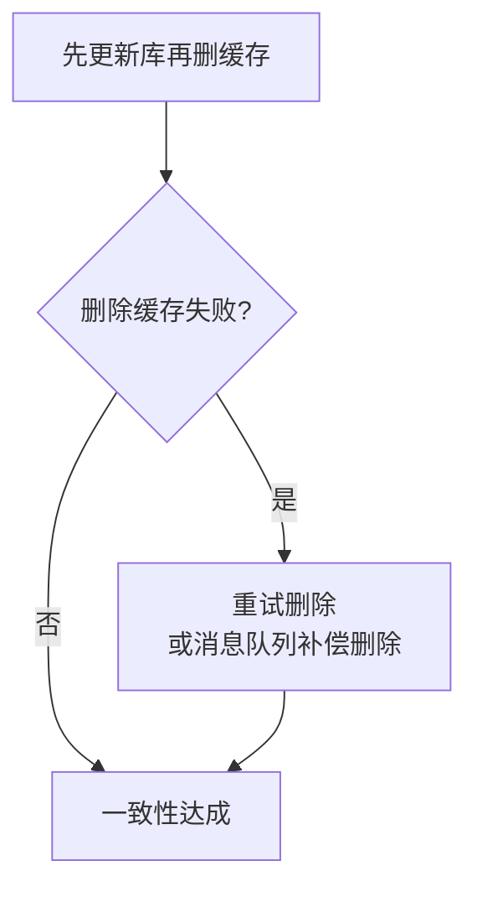

# 先更新库再清缓存也有例外：旧值被回填的那一瞬间

## 面试题考什么

上一篇说「先更新库再清缓存能保证最终一致」，这话还有个例外。面试官追问「这个方案有没有漏洞」，考的就是你对并发时序的分析是否彻底。能主动说出这个例外并解释它为什么概率极低，是这道题的上乘答法。

## 先给结论

先更新库再清缓存仍然存在一个例外：如果查询线程 A 恰好遇上缓存缺失（到期失效或首次查询），它查到数据库的旧值之后、把旧值写回缓存之前，更新线程 B 完成了更新库和清空缓存两步，那么 A 最后写入缓存的就是旧值，之后所有查询都会一直读到旧值，属于最终也不一致。不过这个窗口极短，发生概率非常小，一般可以不加考虑；再退一步，缓存 key 都有失效时间，旧值到期后自然会被纠正。

## 是什么：例外的时序

这回考虑查询客户端 A 自己的多条指令之间穿插了别的客户端指令的情况，前提还有一个：A 要查的这个 key 在缓存中刚好没有（可能是缓存数据失效了，也可能是第一次查）。

时序如下：

1. A 查询，缓存中没有，于是去查数据库。
2. A 查到的是旧值 x=1。
3. 在 A 把这个旧值放入缓存之前，B 客户端执行了更新：把最新的 x=2 更新到库里，并且清空了缓存。
4. A 还剩最后一步没做：把刚才查到的旧值 x=1 放入缓存。
5. 由于清缓存的动作已经做完了，后续所有查询读到的都是缓存里这份旧值 x=1。

结果就是：缓存里一直是旧的 x=1，数据库里是新的 x=2，属于最终也不一致，不像上一篇那种短暂不一致会自行恢复。

## 为什么：这个例外不用太担心

原因有两个。

**第一，这个窗口非常小。** A 的「查数据库」与「把结果放入缓存」之间的空档期很小：查数据库本身是很快的操作，尤其是这类数据一般都会建索引，执行很快；放入缓存就是一个 set 操作，瞬间就能完成。既然留出的时间空档非常小，B 的两条指令刚好插进去的概率也就非常小，这是有实践支撑的。

**第二，缓存 key 不会永久有效。** 缓存中的 key 都会设置一个失效时间。就算真的写进了旧值，只要失效时间设置得不是特别长，过一段时间它失效了，下一次查询自然能从数据库拿到最新结果并重新回填。真正做缓存时，缓存 key 的过期时间一般不会设得很长。

所以结论是：先更新库再清缓存依然是推荐做法，但它确实有一个漏洞，只是出现几率比较小，一般可以不加考虑。

## 深入细节：如果要彻底堵住怎么办

顺着「窗口」这个思路，常见的补强手段有两类：

- **延时双删**：更新库、清缓存之后，隔一小段时间再删一次缓存，把可能被回填的旧值再清掉。代价是多一次删除操作和一个等待窗口。
- **给缓存设置合理的过期时间**：这是最便宜的兜底，也是课程里强调的那一条，即使出现脏数据，也能靠过期自动纠正。

真要追求强一致，那就回到加锁那条路：把「查询 + 回填」与「更新库 + 清缓存」这两组操作用分布式锁保护起来，代价是吞吐下降，一般业务不会这么干。

## 面试怎么答

按「承认例外、说清时序、解释概率、给出兜底」四步答：

1. **承认例外**：先更新库再清缓存也不是万无一失。
2. **时序**：A 缓存缺失 → 查到旧值 → B 更新库并清缓存 → A 回填旧值 → 后续查询一直读到旧值，最终也不一致。
3. **概率**：查库与回填之间的窗口极短（查库快、set 也快），B 插队的概率非常小。
4. **兜底**：缓存 key 有失效时间，旧值到期后自动纠正；需要更稳可以延时双删，追求强一致则加锁。

追问一般是「那是不是该用延时双删」，答案是看业务容忍度，多数场景靠过期时间兜底就够了，别为了极小概率事件把架构搞复杂。

## 常见误区

把「先更新库再清缓存」当成零风险的银弹。它只是把不一致从「大概率永久」降到「极小概率、且能自愈」。面试里主动点出这个例外，反而比只背结论更有说服力。
