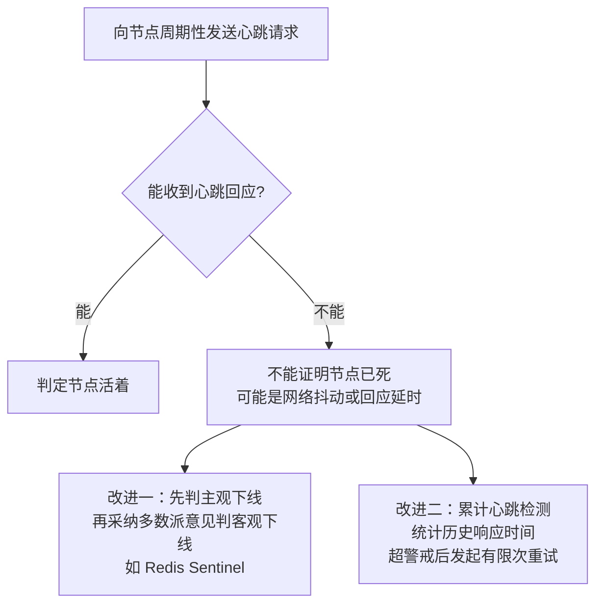

# 分布式通用设计：怎么判断一个节点还活着

## 面试题考什么

分布式系统的通用设计题里，这一道出现频率很高：集群里怎么知道某个节点还活着？难点不在于「用心跳」，而在于后半句：收不到心跳回应，能不能判定节点死了。答案是不行，接下来怎么判定才是真正的考点。

## 先给结论

检测节点存活靠心跳机制：周期性向节点发送心跳信息，收到回应就表示节点还活着。但收不到回应不能证明节点已经死了，可能是网络抖动、响应延迟等原因，直接摘除会造成误伤。两种改进思路：一是借鉴 Redis 哨兵模式，单个哨兵判定为主观下线后，还要采纳其他哨兵的意见，达到多数派才判定客观下线，进而做主备切换；二是把周期性心跳升级为累计心跳检测，记录节点历史响应时间、设置警戒值，超时后发起有限次重试再下结论。

## 是什么：心跳与它的局限

做法很简单：向节点周期性地发送心跳信息，如果它有回应、能收到心跳回应，就表示这个节点还活着。

反过来，如果发送的心跳信息没有收到回应，能不能证明这个节点已经死了？不能。收不到心跳回应有可能是网络抖动、回应延迟等原因，回应没能及时返回。这时候直接把它从集群列表里干掉，就有可能造成误伤。

核心原则是：在「节点是不是死了」这个问题上一定要慎重，必须确保它确实死了，才能把它从集群列表中移除；没死就不能误伤。

## 为什么：两种改进思路

### 思路一：主观下线与客观下线（Redis 哨兵模式）

Redis 的哨兵模式就是这么做的：多个 Sentinel 哨兵向这些 Master 发送心跳，也就是发一个 PING、对方回一个 PONG。

如果只有一个哨兵发送的心跳没有得到回应，那只能认为是**主观下线**，也就是「我认为这个 Master 下线了」。至于 Master 是不是真的下线了，还要去看看其他 Sentinel 的意见，采纳大家的判断。只有达到多数派都通过、大家都认为这个 Master 下线了，才能判定为**客观下线**，之后才进入主备切换流程。

为什么要这么麻烦？因为如果仅凭一个哨兵说下线就直接主备切换，万一对方其实还活着，影响就太大了。

### 思路二：累计心跳检测

另一种思路是把周期性的心跳检测升级成累计性的心跳检测机制。做法是每次发送请求和接收响应时都做记录：正常情况下一次心跳的请求响大约花多长时间，把这些节点的历史响应时间都记下来。

如果发现超过警戒值了，比如这次响应迟迟没有返回、已经超过它历史的最高值，这时候也不能直接判定节点死了，而是再发送有限次的重试请求，做进一步的判定。

## 深入细节：两类思路的差别

两种思路其实是两个维度：

- **主观/客观下线**是空间维度：用多个独立观察者的共识来消除单点误判，代价是要维护哨兵集群和投票机制。
- **累计心跳检测**是时间维度：用历史数据建立基线，用重试来过滤偶发抖动，代价是要维护响应时间统计。

生产系统里两者往往结合使用：既有多个探测者，又基于历史响应时间判断，并且给出有限次重试的机会。无论哪种，共同点是「判定死亡要慎重」，宁可多等一会儿，也不要误杀一个还活着的节点，因为误摘除的代价（流量打到剩余节点、可能触发雪崩）通常远高于多等几秒。

## 面试怎么答

按「心跳、局限、两种改进、原则」答：

1. **心跳**：周期性发送心跳，收到回应即存活。
2. **局限**：收不到回应不等于死亡，可能是网络抖动或延迟，不能直接摘除。
3. **改进一**：Redis 哨兵模式，主观下线（单个哨兵判断）+ 客观下线（多数派通过）才做主备切换。
4. **改进二**：累计心跳检测，记录历史响应时间、设警戒值，超时后有限次重试再判定。
5. **原则**：必须确认确实死亡才摘除，避免误伤。

追问一般是 Redis 相关的细节：主观下线是单个 Sentinel 的判断，客观下线需要多数 Sentinel 认同，只有客观下线后才会触发故障转移；Sentinel 数量一般配奇数个以便形成多数派。

## 常见误区

把「心跳超时」直接等同于「节点死亡」。这是分布式系统里最典型的误判来源：网络问题和节点故障在探测方看来表现完全一样，必须靠多观察者共识或重试来区分，否则一次网络抖动就可能引发一次不必要的主备切换。

## 课件配图
> 以下配图取自阶段七课件对应讲义，与上文讲解一一对应，可作为图文对照辅助理解。
**分布式通用设计**（课件讲义图示）

**讲义配图**（课件讲义图示）

