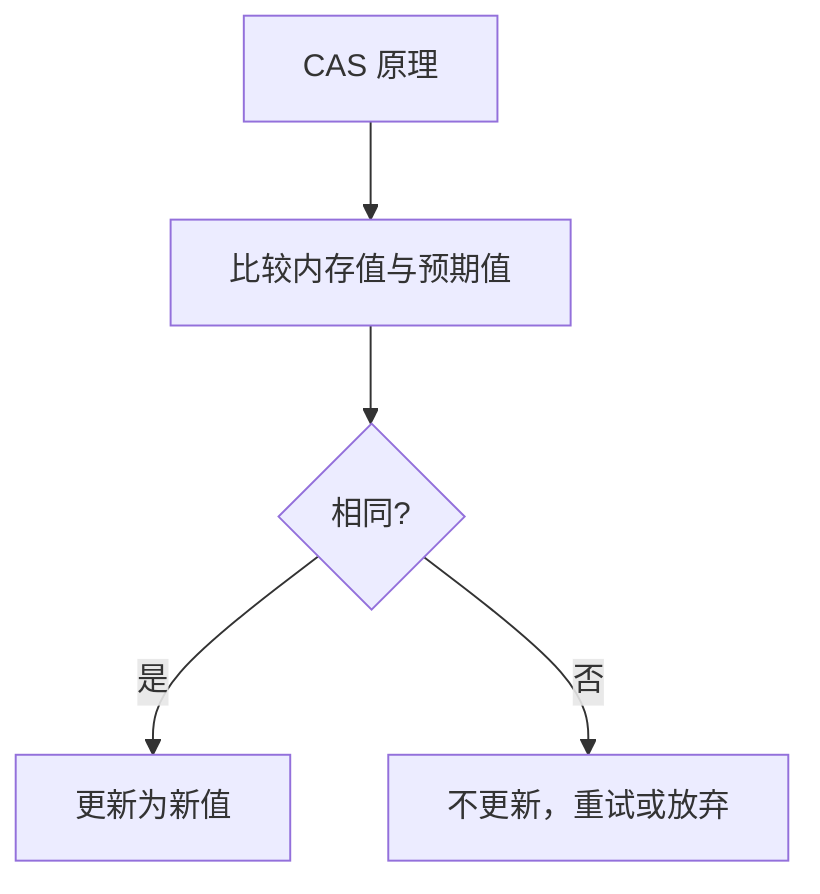

# 用 Unsafe 与 CAS 演示乐观锁

## 开场

悲观锁和乐观锁的区别，光讲概念很容易变成背定义。面试官真正想听的是你能不能落到代码层面：乐观锁到底靠什么指令保证原子性，为什么它需要配合重试循环，为什么它还要 volatile。这一篇就从最底层的 `Unsafe` 和 CAS 讲起。

## 先给结论

乐观锁的典型代表是 `AtomicInteger`，而 `AtomicInteger` 的底层是 `Unsafe`。`Unsafe` 在乐观锁这件事上只提供一个关键能力：修改共享变量时保证这个修改是原子操作。它的核心是一组以 `compareAndSet` 打头的方法，也就是 CAS（Compare-And-Swap，比较并交换）：拿旧值和共享变量的当前值比一下，一样就修改成功，不一样说明被别的线程改过，本次修改失败。CAS 只保证原子性，要看到共享变量的最新值还得靠 volatile，所以 CAS 通常和 volatile 配合使用；要让失败的操作最终生效，还得把它放进循环里不断重试。



## 是什么：Unsafe 与字段偏移量

`Unsafe` 是 JDK 内部使用的一个底层类，名字就说明了它的定位：它提供的是不安全、不推荐业务代码直接使用的底层能力，比如直接操作内存、直接修改对象的字段。它对乐观锁的意义只有一条：保证修改共享变量这个动作是原子的。

假设要修改一个 `Account` 对象里的 `balance` 成员变量。用 `Unsafe` 修改之前，得先知道这个成员变量在对象里的偏移位置。获取方式是固定写法：告诉 `Unsafe` 你要修改哪个类型、这个类型里的哪个变量，它就算出偏移量。偏移量只需要计算一次，之后每次调用都复用它。

```java
public class SyncVSCas {
    static Unsafe U = Unsafe.getUnsafe();

    static long BALANCE = U.objectFieldOffset(Account.class, "balance");

    static class Account {
        volatile int balance = 10;
    }
}
```

`objectFieldOffset` 的第一个参数是字段所属的类，第二个参数是字段名，返回值就是这个字段相对于对象起始地址的偏移量。

## 为什么：CAS 为什么要先比较

准备好偏移量，就可以调用 `Unsafe` 里以 `compareAndSet` 打头的一组方法了。这组方法有 `compareAndSetInt`、`compareAndSetBoolean`、`compareAndSetByte` 等，选哪个取决于你要修改的共享变量是什么类型。`balance` 是 int，所以调 `compareAndSetInt`。

这个方法需要四个参数：

1. 要修改的共享变量属于哪个对象，这里是 `account`；
2. 这个字段的偏移量，也就是前面算好的 `BALANCE`；
3. 旧值，也就是修改前读到的值；
4. 新值，也就是想要改成的值。

```java
public static void main(String[] args) {
    Account account = new Account();
    int o = account.balance;   // 旧值：10
    int n = o + 5;             // 新值：15
    boolean r = U.compareAndSetInt(account, BALANCE, o, n);
    System.out.println(r);
    System.out.println(account.balance);
}
```

先在旧值 10 的基础上加 5 得到新值 15。如果修改过程中没有别的线程干扰，那么「在 10 的基础上加 5」就是正确的，修改可以成功。但如果期间有另一个线程已经把这个共享变量改成了 100，这时候还把 15 写进去，就会把人家最新的 100 覆盖掉，这显然不行。

所以 `compareAndSet` 在真正写入之前，会把你传进来的旧值和共享变量的当前值做一次对比：

- 两者一致，说明期间没有别的线程动过，修改成功；
- 两者不一致，说明别的线程已经改过了，你手里的旧值作废，本次修改失败。

成功与失败用返回值表示：`true` 表示这次修改没有别的线程干扰、修改成功；`false` 表示别的线程已经改过，本次修改失败。这也是「比较并交换」这个名字的由来：先比较，比较通过才交换。

## 深入细节：一次成功与一次失败

**成功的情况**：初始值是 10，单线程环境下在 10 的基础上加 5。因为没有别的线程干扰，返回 `true`，`account.balance` 最终变成 15。

**失败的情况**：可以用调试器的断点来模拟另一个线程的干扰。断点停在 `compareAndSetInt` 之前，此时当前线程读到的旧值 `o` 是 10，新值算出来是 15。就在这时候，通过调试器把 `account.balance` 手动改成 100，模拟另一个线程抢先修改了共享变量。再放行，当前线程还想把 15 写进去，但当前值已经是 100 了，跟旧值 10 不一致，所以这一次 CAS 返回 `false`，修改失败，`balance` 保持为那个线程改成的 100。

失败的修改不是「写进去一半」，而是直接作废，这一点很重要：CAS 失败时对共享变量没有任何副作用。

## 让修改最终成功：CAS 配重试循环

失败之后怎么办？期望的结果是「在原有基础上加 5」，那么既然别人已经把它改成 100 了，正确的做法就是在 100 的基础上加 5 得到 105，而不是继续执着于 10 加 5。做法是把 CAS 放进循环：

```java
static void cas(Account account) {
    while (true) {
        int o = account.balance;          // 每次重新读最新值
        int n = o + 5;                    // 在最新值基础上加 5
        if (U.compareAndSetInt(account, BALANCE, o, n)) {
            break;                        // 修改成功，退出循环
        }
        // 失败则继续下一轮，重新读值、重试
    }
}
```

循环里每轮的套路是：先读最新的 `balance` 作为旧值，在它基础上算出新值，然后尝试 CAS。返回 `true` 就 `break` 退出；返回 `false` 说明期间又被人改了，那就进入下一轮，重新读一个更新的值再算再试。

再用断点复现一次：第一轮读到旧值 10，算出 15，还没来得及 CAS，调试器把 `balance` 改成 100，于是第一轮 CAS 失败，返回 `false`，不进 `break`，进入下一轮循环；这一轮读到的是最新值 100，在 100 的基础上加 5 得到 105，此时若没有其他线程干扰，旧值 100 与当前值 100 一致，CAS 成功，`balance` 变成 105，循环退出。这就是用「不断重试」配合 CAS 达到正确赋值的目的。

顺带把调试时看到的现象解释一下：单步执行时每走一轮循环，`balance` 就从 10 变 15、20、25、30 一直往上加 5，直观体现了「循环里每次都在最新值基础上加 5」。

## 注意事项：CAS 要配合 volatile

`compareAndSet` 确实提供了原子性，但它只保证「比较并交换」这一个动作不可被打断。要让当前线程每次循环都能读到共享变量的最新值，还需要可见性保证，这就要靠 volatile 修饰共享变量。所以 CAS 操作一般要和 volatile 一起使用：volatile 负责可见性，CAS 负责原子性，两者合起来才能正确实现无锁的并发修改。

另外补充一点实际使用时的坑：`Unsafe.getUnsafe()` 内部会检查调用类的类加载器，普通业务代码直接调用会抛 `SecurityException`，因为它只允许 JDK 内部的引导类加载器加载的类使用。学习或做实验时通常通过反射拿到 `theUnsafe` 字段来获取实例。这也说明 `Unsafe` 本身不是给业务代码用的，日常开发请直接用 `AtomicInteger`、`AtomicReference` 这些封装好的类。

## 面试怎么答

「乐观锁的底层是怎么实现的？」

> 乐观锁的底层是 CAS，Java 里 `AtomicInteger` 这些原子类的底层是 `Unsafe` 提供的 `compareAndSet` 系列方法。以修改一个对象的 int 字段为例，先用 `objectFieldOffset` 拿到字段偏移量，再调 `compareAndSetInt(对象, 偏移量, 旧值, 新值)`。它会拿你传的旧值和字段当前值比较，一致才写入并返回 true，不一致就返回 false 表示本次修改失败。CAS 只保证这次比较并交换是原子的，失败后要配合循环重试：重新读最新值、重新计算、再试，直到成功。另外共享变量要用 volatile 修饰来保证可见性，所以 CAS 通常和 volatile 一起用。

追问：「CAS 失败之后数据会不完整吗？」

> 不会。CAS 要么成功把新值写进去，要么什么都不做并返回 false，不存在写一半的中间状态。这也是它可以放心放进重试循环的前提。

追问：「CAS 有什么典型问题？」

> 最典型的是 ABA 问题：一个值从 A 被改成 B 又改回 A，CAS 比较时发现还是 A，就认为没人动过，但实际上中间发生过变化。解决方式是加版本号，Java 里对应的是 `AtomicStampedReference`。另外在竞争很激烈时，重试循环会一直空转，CPU 开销反而可能高于直接加锁。

## 常见误区

- 以为 CAS 能直接保证线程安全而无视可见性。CAS 只管原子性，共享变量的可见性要由 volatile 保证。
- 以为一次 CAS 就够了。只要有并发，CAS 就可能失败，生产代码必须配重试循环，只调一次等于把失败丢掉了。
- 以为失败后可以复用原来的新值继续重试。别人已经改过值了，新值必须基于最新值重新计算。
- 以为 `Unsafe` 是业务代码该用的东西。它是 JDK 内部工具类，日常开发应该用 `java.util.concurrent.atomic` 包下的原子类。
