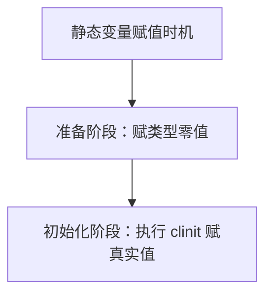

# 验证类静态变量在初始化时赋值

## 开场

类加载分三个阶段：加载、链接、初始化。前一篇证明了类加载是懒惰的，这一篇回答紧接着的问题：静态变量的值到底在哪个阶段被写进去？口说无凭，用调试工具直接看类对象内存里的值，是最有说服力的证明方式。

## 先给结论

非 final 的静态变量，赋值动作发生在**初始化阶段**，而不是加载、链接阶段。用 HSDB 观察就能验证：类刚被加载时，`static int a`、`static int b` 在类对象里还是 0；等 `new` 触发类初始化之后，它们才变成 0x77（119）和 0x88（136）。而被 `final` 修饰的静态变量 `c` 不一样，它在链接阶段的准备环节就已经被赋好值 0x99（153）了。



## 是什么：演示用的两个类

主程序用 `System.in.read()` 把流程卡住，方便我们分阶段观察：

```java
public class TestLazy {
    public static void main(String[] args) throws IOException {
        System.out.println("未加载 Student");
        System.in.read();
    
        System.out.println(Student.class); // 关键代码：触发类加载
        System.in.read();
    
        Student stu = new Student(); // 关键代码：触发类初始化
        System.out.println("已初始化 Student");
        System.in.read();
    }
}
```

被观察的 `Student` 类里放了静态变量、静态代码块和实例变量：

```java
package day03.loader;

public class Student {
    static int a = 0x77; // 非final静态变量
    static {
        System.out.println("Student.class init"); // 静态代码块
    }
    static int b = 0x88; // 非final静态变量
    static final int c = 0x99; // final静态变量
    int d = 0x55; // 实例变量
    int e = 0x66; // 实例变量
}
```

## 为什么：加载和初始化是两件事

程序先打印「未加载 Student」，然后停在 `System.in.read()`。接着执行 `System.out.println(Student.class)`，这一步只是拿到 `Student` 的类对象并打印，它触发了类的加载，但**不会**触发初始化。

此时用 HSDB 连上进程，找到 `Student` 的类对象，去看它里面的静态变量：`a`、`b` 都还没有值（是 0）。原因就是前面讲过的：静态变量的赋值动作不在加载、链接阶段完成，要等到最后的初始化阶段。

但也有例外：`c` 被 `final` 修饰，它已经赋好值了。因为 `static final` 修饰的基本类型或字符串常量属于编译期常量，它的值在链接阶段的准备环节就直接写入了，不必等到初始化。

## 深入细节：放行之后看到了什么

验证的关键是不能让程序结束，否则进程没了、地址也变了，还得重新找一遍。所以做法是把调试器从进程上 detach 掉，让程序继续往下跑，然后再用同一个进程号 attach 回去。类对象的地址没变，因为程序一直没停。

重新连上之后再去看那几个静态变量，`a` 和 `b` 已经有值了，分别是 119 和 136。这两个数是这么来的：调试工具里显示的是十六进制的 77 和 88，把 0x77 换算成十进制是 119，0x88 换算成十进制是 136。

```text
0x77 = 119
0x88 = 136
0x99 = 153
```

为什么这次就有值了？因为程序继续执行到了 `new Student()`，创建对象会触发类的初始化。初始化的过程中会完成静态变量的赋值动作，同时也会执行静态代码块里的代码，所以控制台上看到了「Student.class init」这行输出。

需要补充一个容易混淆的点：静态变量赋值和静态代码块不是「先执行代码块再赋值」的关系，它们在初始化阶段按**源码中出现的先后顺序**依次执行。在 `Student` 这个类里，顺序是 `a` 赋值、静态代码块、`b` 赋值。

## 面试怎么答

「静态变量在类加载的哪个阶段被赋值？怎么证明？」

> 非 final 的静态变量在初始化阶段才赋值，加载和链接阶段它们还是零值。可以用 HSDB 验证：写一段程序，先用 `Student.class` 触发加载并 `System.in.read()` 卡住，此时 attach 上去看类对象里的 `a`、`b` 都还是 0；再放行执行 `new Student()` 触发初始化，重新 attach 上去看，值就变成 0x77、0x88 了。而被 `static final` 修饰的编译期常量，在链接阶段的准备环节就已经赋好值，不用等初始化。

追问：「`Student.class` 和 `new Student()` 在触发时机上有什么区别？」

> `Student.class` 这种类字面量的写法只触发加载，不会触发初始化；`new Student()` 会触发初始化，因为创建对象属于对类的主动使用。`Class.forName()` 默认也会触发初始化，它的第二个参数可以控制是否初始化。

追问：「还有哪些操作会触发类初始化？」

> 大体上是「主动使用」的六种情况：创建实例、访问类的静态变量或静态方法、反射调用、初始化子类时父类先初始化、启动类（含 main 方法的类）、以及 JDK 动态语言支持相关的场景。反过来，通过子类引用父类的静态字段、通过数组定义引用类、访问编译期常量，这些都不会触发初始化。

追问：「`static final` 一定在准备阶段赋值吗？」

> 不一定。只有编译期能确定值的常量（基本类型和字符串，且用常量表达式初始化）才会在准备阶段赋值；如果 `static final` 的值要到运行期才能确定，比如 `static final int x = new Random().nextInt()`，那它仍然要等到初始化阶段才赋值。

## 常见误区

- 以为类一加载静态变量就有值。加载只负责把字节码读进内存并生成类对象，赋值是初始化阶段的事。
- 以为所有 `static final` 都在准备阶段赋值。必须是编译期常量才行，运行期才能确定的值依然在初始化阶段赋值。
- 以为静态代码块一定在静态变量赋值之前执行。实际顺序取决于它们在源码里出现的先后。
- 演示时让程序跑到结束再去看内存。进程一退，类对象和地址都没了，只能从头再来一遍。
