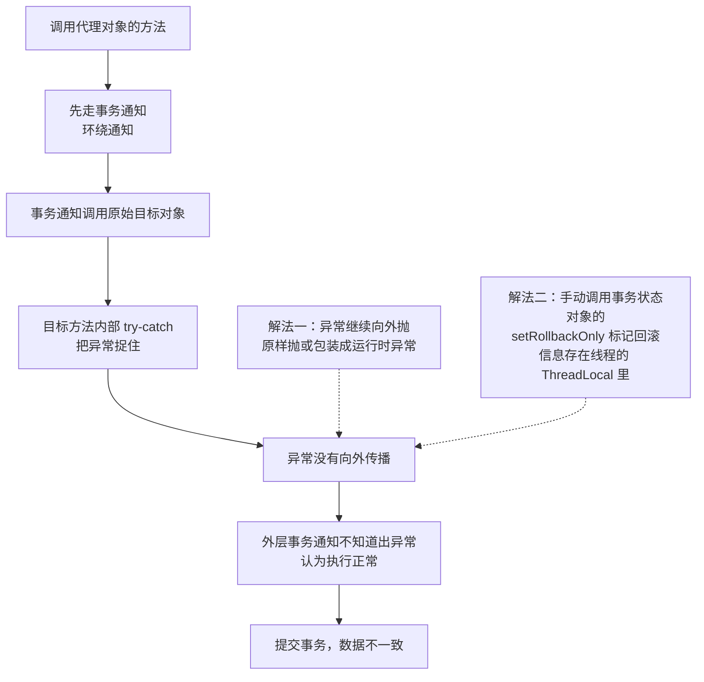

# Spring 事务失效场景二：try-catch 把异常吞在了最里层

面试题：Spring 事务失效的几种场景及原因，这是第二种。

第一种场景是「检查异常不在默认回滚范围」，改个 rollbackFor 就好。第二种更贴近日常编码习惯：业务方法内部自己 try-catch 把异常捉住了。异常到不了事务通知，事务照样提交。这篇讲清代理结构、原因和两种解法。

## 先给结论

- 场景：Service2 的 transfer 已配 rollbackFor，但业务代码自己用 try-catch 把异常捉住，结果是事务开始、执行两条 SQL、第三条没执行，日志仍然显示提交，数据不一致。
- 原因：声明式事务拿到的是代理对象，代理调用方法时先走事务通知（环绕通知），再由事务通知调用原始目标对象。目标方法在最里层，异常被自己捉住后，外层事务通知不知道发生了异常，认为正常，于是提交。
- 解法一：异常继续向外抛（原样抛或包装成运行时异常），让事务通知收到。
- 解法二：不抛异常，手动调用事务状态对象的 setRollbackOnly 标记回滚，信息存在线程的 ThreadLocal 里，外层事务通知拿得到。

## 深入细节：问题复现与定位

Service2 的代码和场景一一样，中间位置抛出检查异常，这回已经加了 rollbackFor，按说没问题。改动点只有一个：把业务代码用 try-catch 块包围起来，自己把异常捉住。有同学喜欢这么干，尤其是检查异常，捉住之后 throws 就不用加了。

跑一下测试代码，异常出现了，但看日志：事务开始了，执行了前两条 SQL，第三条 SQL 没执行（这时候异常已经出现），按理应该回滚，日志上显示的仍然是提交。不信的话可以到数据库查，第一个账户减钱了，第二个账户没加钱，数据不是原子一致的。日志其实已经把问题说明白了，不用来回切换窗口。

原因要从声明式事务的实现原理说。声明式事务下，你在容器中拿到的 bean 并不是原始的目标对象，而是一个代理对象。代理对象调用 transfer 的时候，才会去调用事务通知，由事务通知帮你夹带事务的控制：提交还是回滚，由事务通知内部决定，它内部再去调用你的原始目标对象。事务通知是环绕通知，原始目标方法在调用的最里层被嵌套着。

那么问题来了：最里层的方法自己把异常捉住了，外层的事务通知知不知道发生了异常？它不知道。既然不知道出现异常，它认为这个情况是正常的，最终就提交了事务。

关键点就一句：异常必须抛出去，外层的调用者（事务通知）才知道出错了。不抛，事务通知根本不会检查，也就不会回滚。

## 深入细节：两种解法

**解法一：异常原样抛出。** 把异常抛出去，事务通知自然收到，正确回滚。有同学嫌 throws 麻烦，可以把异常包装成运行时异常（未检查异常）再抛，这样不用强制加 throws。无论哪种，核心都是把异常送到外层。

**解法二：手动标记回滚。** 不抛异常也行。事务通知提供了一个静态方法，可以拿到当前事务状态对象，这个对象能设置事务将来是回滚还是提交。发现应该回滚时，调用 setRollbackOnly 告诉外层调用者「我必须回滚」，效果和抛异常类似。这个信息设置在当前线程的 ThreadLocal 中，所以最外层的事务通知也能拿到。

验证解法二：仍然出现异常，但日志显示事务回滚了。通过事务状态对象调用 setRollbackOnly，一样能让事务通知走回滚分支。

总结第二种失效场景：业务方法内自己加了 try-catch，导致事务不能回滚。原因是事务通知只有捉到目标抛出的异常，才能进行后续的回滚处理；目标自己处理掉异常，事务通知无法知悉。解法就是上面两种：异常抛出，或者 setRollbackOnly。

## 面试怎么答

1. **先描述场景**：业务方法内 try-catch 自行处理异常，事务不回滚。
2. **再讲原理**：容器拿到的是代理对象，事务通知是环绕通知，目标方法在最里层；异常被吞在最里层，事务通知收不到，判定正常，提交事务。
3. **给解法**：异常继续上抛（可包装成运行时异常）；或调用事务状态对象的 setRollbackOnly。
4. **点出本质**：事务通知的回滚决策完全依赖「是否收到异常」，吞异常等于屏蔽了信号。

常见追问：

- **问**：为什么事务通知在最外层？
  **答**：代理对象的方法入口就是事务通知，它先开启事务、再调用目标，目标返回或抛异常都由它兜底，所以天然在最外层。
- **问**：setRollbackOnly 为什么外层能拿到？
  **答**：事务状态绑定在当前线程的 ThreadLocal 上，同一线程内的外层事务通知读同一个状态。

## 常见误区

- **误区一**：在业务方法里无脑 try-catch「求稳」。求稳的结果是事务悄悄提交，数据裂开。
- **误区二**：catch 块里只打印不抛。打印是给人看的，事务通知只认异常，不认日志。
- **误区三**：只知道抛异常这一种解法。手动 setRollbackOnly 在「必须本地处理异常但仍要回滚」的场景很有用，答得出是加分项。
