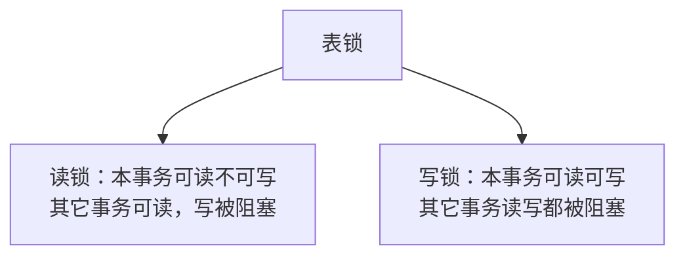

# 表级锁之表锁：lock tables 的共享与排他

面试题：MySQL 的表级锁有哪些？

表级锁以 InnoDB 为例分两个小类：表锁和元数据锁。这篇讲表锁：语法、共享锁与排他锁的区别、实际演示，以及它为什么在 InnoDB 里用得少。内容不难，属于必须知道但很少深考的题型。

## 先给结论

- 表锁语法：加锁用 lock tables 表名 read 或者 write，解锁统一用 unlock tables。
- read 加的是共享锁：其他客户端仍能查询，但不能写。
- write 加的是排他锁：其他客户端读和写都不能做。
- 表锁粒度粗、并发低，InnoDB 支持行锁所以很少用表锁；MyISAM 只支持表锁，没得选。

## 深入细节：语法与两种锁

不同数据库引擎的表级锁种类不太一样，这里以 InnoDB 为例。表级锁的第一个小类是表锁，加锁语法是 lock tables 加上表名加上 read 或 write，解锁统一用 unlock tables。

加锁时有两个关键字。read 代表加共享锁：当前客户端加了共享锁之后，其他客户端仍然能做查询的读操作，但不能做写操作。write 代表加排他锁：当前客户端加了排他锁之后，其他客户端无论是读还是写都不能做。

## 深入细节：两个客户端演示

准备两个客户端。客户端一先看有哪些表，库里就一张 t 表。给 t 表加一把共享的表级锁：lock tables 跟上表名，然后 read。加上之后切换到客户端二，查询这张表的数据，可以，共享锁不挡读。但客户端二想修改就不行了，执行一条插入，立刻被阻塞。这就是共享锁：别人可以读，但是不能写。

用 unlock tables 解锁。解开之后再加排他锁，把 read 改成 write。加上排他锁之后，客户端二即使只想做一个查询，也被阻塞住。同一把锁，read 和 write 的差别就是这么大。

语法上还可以一次对多张表加锁：表名后面用逗号跟上第二张表的名字，指定它是共享还是排他，再逗号第三张表，依此类推。演示里只对一张表加锁，用法本身是支持多表的。

表锁的缺点是力度较粗。在 InnoDB 引擎里很少使用这种表锁，因为 InnoDB 支持行锁，有更细粒度的选择。力度细意味着并发高，力度粗意味着并发低，大部分情况还是推荐用行锁。但在 MyISAM 引擎里，大部分场景只支持表锁、不支持行锁，所以只有表锁可用。

表锁了解到这个程度就够了：语法、共享与排他的区别、粒度粗并发低、InnoDB 基本不用而 MyISAM 只能用它。

## 面试怎么答

1. **先给语法**：lock tables 表名 read/write 加锁，unlock tables 解锁，支持一次锁多张表。
2. **再讲两种锁**：read 是共享锁，挡写不挡读；write 是排他锁，读写全挡。
3. **讲定位**：粒度粗、并发低，InnoDB 有行锁所以很少用，MyISAM 只有表锁可用。
4. **区分元数据锁**：表锁是显式的，MDL 是隐式的，两者同属表级锁但机制不同。

常见追问：

- **问**：共享锁和读操作为什么不互斥？
  **答**：读读之间不冲突，共享锁的设计目的就是允许多个读者并存，只挡写入方。
- **问**：InnoDB 什么时候还会用到表锁？
  **答**：特殊场景如全库逻辑备份的 flush tables with read lock，或没有索引字段触发的行锁升级，日常 DML 都走行锁。

## 常见误区

- **误区一**：把表锁和元数据锁混为一谈。表锁显式加解锁，MDL 由 DML/DDL 隐式添加。
- **误区二**：以为 InnoDB 完全不用表锁。特殊管理操作仍会用到，只是业务并发不走它。
- **误区三**：只记语法不讲锁粒度。面试官想听的是「为什么 InnoDB 不待见表锁」，答案在并发度。

## 课件配图
> 以下配图取自阶段七课件对应讲义，与上文讲解一一对应，可作为图文对照辅助理解。
**锁**（课件讲义图示）

