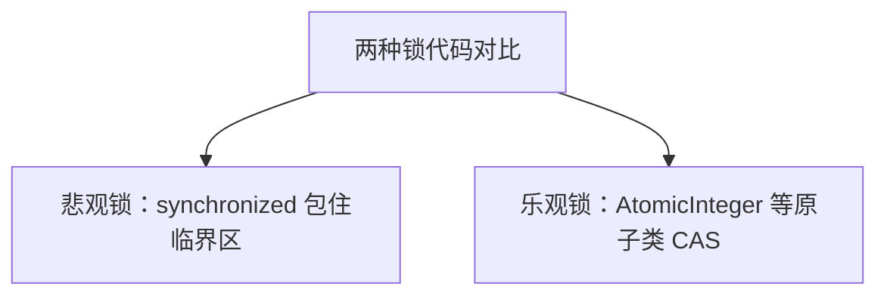

# 悲观锁 vs 乐观锁：从代码执行看线程安全

面试题：悲观锁和乐观锁分别怎么保证线程安全？

理论篇讲了两种锁的核心思想，这篇用代码把差异落到执行流程上：同一个「一加一减」的账户操作，synchronized 靠互斥挡住交错，CAS 靠重试消化交错。看完这两段代码，两种锁的性格就一目了然。

## 先给结论

- 悲观锁（synchronized）：多行代码加锁后作为整体执行，同一时刻只有一个线程能进临界区，其他线程阻塞到锁的等待队列。
- 乐观锁（CAS）：不加锁，线程并行执行，指令交错照样发生；靠「比较并交换」检测共享变量是否被改过，改了就重试，拿最新值重新算。
- 两者最终结果都正确，差别在过程：一个把交错消灭在门外，一个让交错发生再用校验兜底。
- synchronized 保证的是「三行代码整体完成」，CAS 保证的是「最终写回的值一定基于最新值」。



## 深入细节：synchronized 的执行流程

准备一个 sync 方法，把一个 Account 对象传进去，方法内起两个线程操作同一个对象：t1 对余额做减 5，t2 做加 5。故意把加减拆成三行代码，就是为了看多行代码会不会产生指令交错。这里用 synchronized 的方式保证这三行代码不会交错：对 Account 对象加锁后，同一时刻只有一个线程能获得锁、执行 synchronized 代码块里的内容，另一个线程只能在块外等待。

用 Debug 演示。t1 先获得锁，进入 synchronized 代码块，读取余额旧值 10，这时 CPU 时间片用完，切换到 t2。如果 t2 里的代码能执行，就会发生指令交错：t2 也读到旧值 10，各自运算后写回，线程安全问题就出现了。

但 t2 运行不了。t1 是锁的持有者，已经在 synchronized 块内持有了 Account 这把锁，t2 即使分到了 CPU 时间，也被锁挡住。调试器里能看到 t2 的状态打印成了 Monitor，也就是以前见过的 Block 阻塞状态，它已经到 synchronized 对应对象的阻塞队列去等待了。所以 t2 根本不会对 t1 的代码产生干扰。CPU 继续回到 t1，执行完后续代码、释放锁，t2 才恢复运行，获得锁进入自己的 synchronized 代码块。最终结果是正确的。

```java
public static void sync(Account account) {
    Thread t1 = new Thread(() -> {
        synchronized (account) {
            int old = account.balance;
            int n = old - 5;
            account.balance = n;
        }
    }, name: "t1");

    Thread t2 = new Thread(() -> {
        synchronized (account) {
            int o = account.balance;
            int n = o + 5;
            account.balance = n;
        }
    }, name: "t2");

    showResult(account, t1, t2);
}
```

## 深入细节：CAS 的执行流程

乐观锁用 CAS 访问的方式，代码是一个循环不断重试：先读旧值，在旧值基础上做加减，然后通过 compareAndSetInt 赋值，成功就 break 退出，失败就继续尝试。

```java
public static void cas(Account account) {
    Thread t1 = new Thread(() -> {
        while (true) {
            int o = account.balance;
            int n = o - 5;
            if (Unsafe.compareAndSetInt(account, BALANCE, o, n)) {
                break;
            }
        }
    }, name: "t1");

    Thread t2 = new Thread(() -> {
        while (true) {
            int o = account.balance;
            int n = o + 5;
            if (Unsafe.compareAndSetInt(account, BALANCE, o, n)) {
                break;
            }
        }
    }, name: "t2");

    showResult(account, t1, t2);
}
```

这种情况下指令交错会发生，因为它不加锁，谁都可以执行。同样用 Debug 看：t1 读到共享变量 10，还没来得及减 5，切换到 t2。t2 的代码能执行，没有锁挡它，t2 做了加 5 操作，此时没有别人干扰，它拿到的旧值和当前最新值一致，CAS 成功，余额变成 15，退出循环。

回到 t1：它要是在 10 的基础上减 5，结果是 5，覆盖掉刚才的 15 显然不对。但是没有关系，t1 执行 CAS 时，拿到的旧值 10 和 balance 当前的最新值 15 已经不一致了，这次 CAS 失败。失败没关系，进入下一轮循环，读取最新值 15，在 15 的基础上减 5 得 10，这次没有别的线程干扰，CAS 成功。一加一减，最终结果正确。

两个例子的对比很清晰：synchronized 用互斥的方式让多行代码作为整体执行，这期间其他线程只能阻塞等待；CAS 根本没有什么互斥，大家并行执行，指令交错也无所谓，它靠比较并交换检查更新时值有没有被别人改过，没被改才能更新成功，被改了就重试，拿最新值重新操作。

## 面试怎么答

1. **先讲机制差异**：synchronized 是互斥，CAS 是比较并交换加重试。
2. **再讲执行流程**：synchronized 下拿不到锁的线程直接阻塞，临界区零交错；CAS 下交错随便发生，靠旧值比对发现冲突。
3. **点出代价**：synchronized 有线下的上下文切换成本；CAS 让线程一直空转重试，需要多核 CPU 支撑。
4. **收尾**：两者都能保证最终正确，选择看并发压力和冲突频率。

常见追问：

- **问**：CAS 失败之后线程在干什么？
  **答**：在循环里自旋重试，重新读取最新值、重新计算、重新 CAS，直到成功，全程不阻塞。
- **问**：为什么 CAS 要配合 volatile？
  **答**：CAS 保证原子性，volatile 保证可见性，读到的旧值必须是最新的，否则比对失去意义。

## 常见误区

- **误区一**：以为 CAS 线程完全不受影响。冲突激烈时重试次数飙升，CPU 全耗在空转上，吞吐反而下降。
- **误区二**：把 synchronized 的阻塞当成失败。阻塞等待是设计的一部分，锁释放后线程会被唤醒继续竞争。
- **误区三**：只背结论不讲流程。面试官问「指令交错时 CAS 怎么发现」，答不出「旧值和最新值不一致导致失败」就是没懂。
