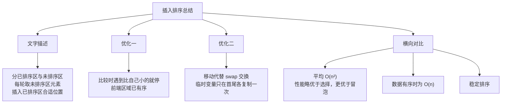

# 插入排序总结：两个优化加三个优点

面试题：插入排序的效率怎么样，有什么优化？

插入排序的演示和实现都过了，这篇做收束：把文字描述、两个优化点、和冒泡选择排序的横向对比一次讲完。面试被问「插入排序怎么样」，答案要同时包含优化思路和对比结论。

## 先给结论

- 文字描述：数组分成已排序和未排序两个区域，每轮从未排序区取出一个元素插入排序区，重复直到整体有序。
- 优化一：待插入元素与已排序区比较时，一旦遇到比自己小的元素就停，前面区域有序，不用再比。
- 优化二：用元素移动代替 swap 交换，借临时变量只在插入开始和结束各复制一次，移动次数远少于交换。
- 对比结论：平均时间复杂度都是 O(n²)，但插入排序大部分情况下性能略优于选择排序，更优于冒泡；数据有序时插入排序 O(n)；插入排序是稳定排序。

## 是什么：文字描述

插入排序同样把数组分成两个区域：一个已排序的区域，一个未排序的区域。每一轮从未排序区中取出一个元素，插入到排序区中去。插入不是随便放，顺序要你自己保证：待插入元素与已排序区的元素逐个比较，比它大的往后移动、把位置让出来，直到遇到一个比它小的元素，它前面的位置就是插入位置。完成这个插入，然后重复以上步骤，整个数据就有序了。

## 深入细节：两个优化

**优化一：遇到小的就停。** 待插入元素与已排序区比较时，比如待插入的 5 比较到 3，遇到比自己小的元素，就表示已经找到了插入位置，不需要再跟比 3 更小的元素比较。因为插入的前提就是已排序区整体有序，3 前面的元素只会更小。这是插入排序自带的优化。

**优化二：移动代替交换。** 插入排序直接移动元素，不用冒泡那种 swap 函数来交换，这能减少元素移动次数。算笔账：数组 4123，把 1 往已有序的 2、3、4 前面插。冒泡的做法是相邻交换，4 和 1 交换一次、4 和 2 一次、4 和 3 一次，共交换三次；但每次 swap 都要借助临时变量，一次交换实际是三次移动（i 的值给临时变量、j 的值给 i、临时变量的值给 j），三次交换等于九次移动。

插入排序的做法：先把 1 放进临时变量 t；1 跟 4 比，4 比 1 大，4 移动到 1 原来的位置，一次移动；1 再跟 3 比，3 移到刚才 4 的位置，一次移动；1 再跟 2 比，2 再移一次，一共三次移动；加上临时变量在插入开始和结束各一次复制，总共五次。同样是达到有序效果，移动次数远少于冒泡的九次。插入排序全程不碰 swap 函数，只有元素移动，临时变量的复制只出现在插入的开始和结束，所以移动次数非常少。这两个优化在代码里都有体现。

**横向对比。** 插入排序、选择排序、冒泡排序的平均时间复杂度都是 O(n²)，都属于比较慢的排序。但三者里头插入排序相对优秀：大部分情况下性能略优于选择排序，自然也更高于冒泡，冒泡排序一般性能是最低的。插入排序还有一个和冒泡相同的特点：面对有序集合，时间复杂度降为 O(n)，因为它能判断出集合已经有序，无需进行后续循环。最后，插入排序是稳定排序，相同元素不会改变相对位置。

## 面试怎么答

1. **先背文字描述**：两个区域，每轮取一个插入排序区，大的让位，遇到小的落位。
2. **再答两个优化**：遇到比自己小的就停；用移动代替交换，临时变量只复制两次。
3. **补对比**：同为 O(n²) 但插入一般快于选择、更快于冒泡；有序数据 O(n)；稳定排序。
4. **可以算账**：用 4123 的例子说明交换三次等于移动九次，插入只要五次，体现理解深度。

常见追问：

- **问**：插入排序什么情况下最快？
  **答**：数据已经有序或接近有序时，每轮只比较一次就退出，整体 O(n)。
- **问**：为什么插入排序是稳定的？
  **答**：插入时遇到相等元素就停在它后面，相同元素的相对顺序不会被交换打乱。

## 常见误区

- **误区一**：以为插入排序一定要用 swap。优化版只用移动加一个临时变量，交换次数和移动次数的账要会算。
- **误区三**：只记 O(n²) 不说有序场景。有序数据 O(n) 是插入排序能进「较优简单排序」的关键理由，和冒泡一样是亮点。
