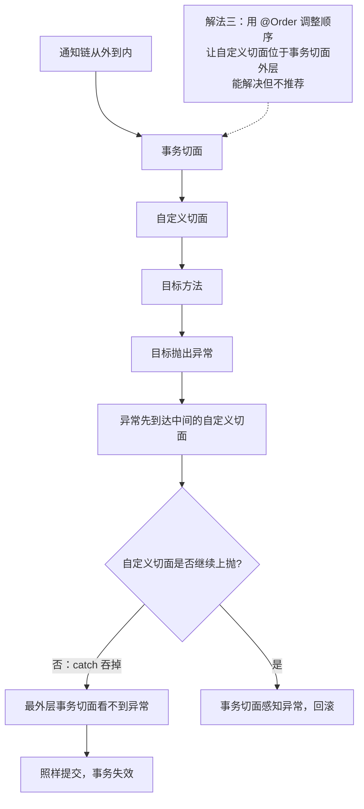

# Spring 事务失效场景三：切面顺序不对，异常传不到事务切面

面试题：Spring 事务失效的几种场景及原因，这是第三种。

前两种失效场景（检查异常不回滚、try-catch 吞异常）都聚焦业务方法本身。第三种更隐蔽：业务代码没毛病，但你自己加的切面把异常挡在了半路，最外层的事务切面根本看不到异常，照样提交。这篇把调用链和三种解法讲清楚。

## 先给结论

- 场景：Service3 的 transfer 已经用 rollbackFor 正确处理了检查异常，但容器里额外加了一个自定义切面 MyAspect，运行后异常出现，事务仍然 commit。
- 原因：通知链从外到内是「事务切面 → 自定义切面 → 目标方法」。目标方法抛出的异常先到达中间层的自定义切面，自定义切面 try-catch 抓住异常后没有继续向上抛，最外层的事务切面不知道发生了异常，认为执行正常，于是提交事务。
- 解法一（推荐）：异常继续向上抛出，让外层调用者感知到。
- 解法二：手动调用 setRollbackOnly 标记回滚，信息存在当前线程的 ThreadLocal 里，外层事务通知拿得到。
- 解法三：调整切面顺序，让自定义切面位于事务切面外层（@Order 控制优先级），异常先到自定义切面再到事务切面。能解决问题，但不推荐。



## 是什么：问题是怎么冒出来的

Service3 的 transfer 方法写法是规范的，检查异常也用 rollbackFor 处理好了，按理不会有问题。这次动的是测试代码：在容器里新加了一个 MyAspect 切面类，里面有一个环绕通知，也会增强 transfer 方法。这个环绕通知做的事很简单，就是打印一些日志，然后通过 ProceedingJoinPoint 的 proceed 方法去调用下一个通知或者目标方法，有下一个通知就调下一个通知，没有就调目标方法。

加上这个切面之后再调用 transfer，异常出现了，但看日志，事务还是 commit 了。业务方法既没吞异常，检查异常也处理了，为什么还提交？问题就出在这个新加的切面上。

## 深入细节：从执行顺序定位原因

从日志能看出通知链的执行顺序：首先进入的是事务切面，先打印跟事务相关的日志；然后才进入自定义切面；自定义切面内层调用的才是目标方法。也就是说，调用关系是最外层为事务切面，中间一层是自定义切面，最里层才是目标方法。

想清楚这个结构，问题就定位了：目标方法抛出异常，异常先抛给谁？先抛给中间层的自定义切面，不可能直接抛给最外层的事务切面。而中间层自定义切面的代码写错了：try-catch 抓住异常之后，没有把异常再次向上抛出，只是打印了一下。这是很多同学容易犯的错误，尤其是「需要捕获异常又有返回值」的情况，习惯把异常一捉了之。

结果就是，异常在中间这层已经被捉住了，又没有继续向上抛，最外层的事务切面根本不知道发生了异常，认为程序执行过程中没有异常，于是照常提交事务。

Service3 的 transfer 方法本身是这样的：

```java
@Transactional(rollbackFor = Exception.class)
public void transfer(int from, int to, int amount) throws FileNotFoundException {
    int fromBalance = accountMapper.findBalanceBy(from);
    if (fromBalance - amount >= 0) {
        accountMapper.update(from, balance - 1 * amount);
        new FileInputStream(name: "aaa");
        accountMapper.update(to, amount);
    }
}
```

**解法一：异常继续向上抛出。** 处理不了的异常，要么原样抛出，要么包装成运行时异常再抛出，这样外层才拿得到。自定义切面里正确写法类似这样：

```java
catch (FileNotFoundException e) {
    e.printStackTrace();
    throw new RuntimeException(e);
}
```

**解法二：手动标记回滚。** 不抛异常也行，调用事务通知提供的静态方法拿到当前事务状态对象，设置回滚：

```java
TransactionInterceptor.currentTransactionStatus().setRollbackOnly();
```

这个信息设置在当前线程的 ThreadLocal 中，所以最外层的事务通知也能拿到，得知需要回滚，就会执行回滚操作而不是提交。

**解法三：调整切面顺序。** 目标方法的异常先到中间层切面，那把事务切面调到比自定义切面更靠里就行了。事务切面的优先级由配置决定，默认是 Ordered.LOWEST_PRECEDENCE，最低优先级。自定义切面如果不显式指定优先级，也是最低，而 Spring 排序时两个都最低也照样把事务切面排在前面。解决方法是手动给自定义切面指定一个高一点点的优先级，比如比最低优先级大一点点。注意优先级数字越小越高，LOWEST_PRECEDENCE 是整数的最大值，减一就比它高：

```java
@Aspect
@Order(Ordered.LOWEST_PRECEDENCE - 1)
public Object around(ProceedingJoinPoint pjp) throws Throwable {
    LoggerUtils.get().debug("Log: {}", pjp.getTarget());
    try {
        return pjp.proceed();
    } catch (Throwable e) {
        e.printStackTrace();
        return null;
    }
}
```

调整后自定义切面在最外层，中间是事务切面，里层是目标方法。异常先到自定义切面（虽然它没正确处理），再到达事务切面，事务切面拿到异常就能正确回滚。

测试代码的容器装配长这样：

```java
ApplicationContext context = new GenericApplicationContext();
AnnotationConfigUtils.registerAnnotationConfigProcessors(context.getDefaultListableBeanFactory());
ConfigurationPropertiesBindingPostProcessor.register(context.getDefaultListableBeanFactory());
context.registerBean(MyAspect.class);
context.registerBean(MyConfig.class);
context.refresh();
Service3 bean = context.getBean(Service3.class);
bean.transfer(from, to, amount);
```

配置类本身没有特殊之处：

```java
@Configuration
@EnableTransactionManagement
@EnableAspectJAutoProxy(exposeProxy = true)
@ComponentScan("day04.tx.app.service")
@MapperScan("day04.tx.app.mapper")
@ConfigurationProperties("jdbc")
public class AppConfig {
    @Bean
    public DataSource dataSource() { return new HikariDataSource(); }
}
```

虽然第三种方法能解决问题，但还是推荐前两种，尤其是第一种：处理不了的异常应该继续向上抛出，否则异常信息就丢失了，调用者无法做出正确判断。调整顺序只是让事务切面碰巧能收到异常，并没有修复「吞异常」这个坏味道。

## 面试怎么答

1. **先描述场景**：事务切面和自定义切面同时增强同一个方法，自定义切面捕获异常后没有继续抛出。
2. **再画调用链**：事务切面在最外层，自定义切面中间，目标方法最里层；异常先到自定义切面就断了，事务切面收不到，认为正常，提交事务。
3. **给解法**：首选异常继续上抛；其次 setRollbackOnly；也可以调整 @Order 让自定义切面到最外层，但不推荐。
4. **点出本质**：事务切面判定是否回滚的依据是「有没有收到异常」，收不到就提交。

常见追问：

- **问**：事务切面为什么在最外层？
  **答**：事务通知的优先级默认是 Ordered.LOWEST_PRECEDENCE，自定义切面不指定优先级时也是最低，Spring 排序仍把事务切面排前面，所以默认结构就是事务在最外。
- **问**：setRollbackOnly 为什么对外层可见？
  **答**：事务状态存在当前线程的 ThreadLocal 里，同一线程内的外层事务通知自然拿得到。

## 常见误区

- **误区一**：以为给方法加了 @Transactional 就万事大吉。外层任何一个切面吞掉异常，事务都会悄悄提交。
- **误区二**：用调整切面顺序当首选方案。它能跑，但吞异常的代码还在，换个人接手就是坑。
- **误区三**：只记住「事务失效」的结论，讲不出「异常到不了事务切面」这条链路。面试官追问一句就挂。
