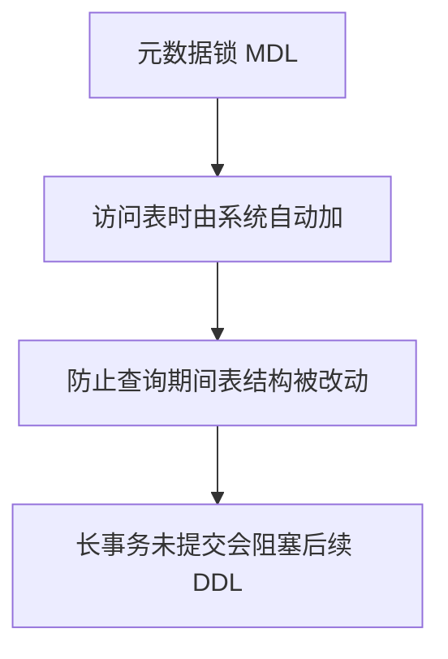

# 表级锁之元数据锁：防止 DML 与 DDL 打架

面试题：MySQL 的表级锁有哪些？元数据锁是干什么的？

表级锁在 InnoDB 下分两个小类：表锁和元数据锁。表锁要显式加解锁，元数据锁则是隐式的，执行别的 SQL 时顺带加上。它的使命只有一个：避免增删改查和表结构变更互相打架。这篇把机制、演示和排查手段讲清楚。

## 先给结论

- 元数据锁（Meta Data Lock，简称 MDL）是表级锁的一种，隐式加锁：执行其他 SQL 时顺带加上，没有专门的加锁语句。
- 作用是避免 DML（增删改查）与 DDL（创建表、修改表、删除表等表定义语句）冲突，保证同一事务内表结构一致。
- 执行 lock tables、执行 alter table 等 DDL、执行增删改查，都会加元数据锁，只是锁类型不同，有的互斥、有的可以共享。
- DML 之间的元数据锁互不排斥，但与 DDL 的元数据锁互斥。
- 可以通过 MySQL 8 的 performance_schema.metadata_locks 表查看元数据锁信息，方便调试。



## 是什么：没有元数据锁会出什么事

表锁需要显式执行加锁语句才会生效，显式执行解锁语句才会释放。元数据锁不一样，它是隐式执行的，通常执行其他一些 SQL 时顺带就加上了，没有一条专门的「我要加一个元数据锁」这样的语句。

它要防的场景很直观：假设查询时表有三列，同一事务里有人把表结构改成四列，就会出现前十条记录还是三列、后十条记录变成四列的怪事。这显然不行。元数据锁就是用来避免增删改查这类 DML 与表定义语言这类 DDL 冲突的。

## 深入细节：什么时候加锁，怎么排查

**加锁时机。** 执行 lock tables 时会顺带加元数据锁；执行 alter table 这样的 DDL 时会加；执行查询、新增、修改、删除这些增删改查语句时也会加。不同场景加的锁类型有所不同，有的是互斥的，有的是可以共享的。

**一个演示。** 元数据锁要结合事务来看。在客户端一执行 begin 开始一个事务（begin 是 start transaction 的缩写），然后执行一条简单的查询。这条查询会为 t 表加上元数据锁，意思是事务执行期间 t 表挂上了元数据锁，其他客户端不能随便修改这张表的结构，不能说突然加一列减一列。

此时在客户端二执行 alter table 修改 t 表结构，新增一个日期类型的新列，会发现它阻塞住了。这就是事务中的元数据锁在起作用。等到客户端一执行 commit 结束事务，元数据锁被释放，客户端二的 alter table 立刻执行成功。整个过程保证了同一个事务内表结构是一致的，不能乱动。

**如何查看。** MySQL 8 开始提供 performance_schema 库，里面的 metadata_locks 表会记录元数据锁的信息，方便调试。执行下面这条语句可以查看：

```sql
SELECT object_type, object_schema, object_name, lock_type, lock_duration
FROM performance_schema.metadata_locks;
```

先开启一个事务但什么都不做，查这张表，看不到 t 表相关信息，说明此时还没加锁。然后在事务里执行一条增删改查语句，比如 select * from t，再查 metadata_locks，会多出一条记录：t 表上有一个元数据锁，类型是共享读锁（SHARED_READ），持续时间是 TRANSACTION，也就是事务不结束锁就一直有效。事务结束后再查，t 表上的元数据锁就解开了。通过这种方式，可以排查有哪些表被加上了元数据锁。

**兼容性。** 有一点要了解：执行 DML 的语句之间，元数据锁是不互斥的。一个事务执行查询加一把元数据锁，另一个事务也执行查询加第二把，两把锁互不排斥，可以并存；但它们与 alter table 的元数据锁之间是互斥的，不能同时运行。

回到表锁部分，语法很简单，加锁用 lock tables，解锁用 unlock tables：

```sql
LOCK TABLES t READ;
LOCK TABLES t WRITE;
UNLOCK TABLES;
```

事务操作的基本写法：

```sql
BEGIN;
SELECT * FROM t;
COMMIT;
```

查询 metadata_locks 的结果长这样，可以看到 t 表持有一把 SHARED_READ 类型的锁，持续时长是 TRANSACTION：

```text
TABLE  performance_schema  metadata_locks  SHARED_READ  TRANSACTION
TABLE  test               t                 SHARED_READ  TRANSACTION
```

元数据锁掌握这些就够了，重点是记住它的作用：避免增删改查与表结构变更冲突。

## 面试怎么答

1. **先定位**：元数据锁是表级锁的一种，MDL，隐式加锁，不需要专门语句。
2. **再讲作用**：防止 DML 与 DDL 冲突，保证同一事务内表结构一致，举「三列变四列」的例子。
3. **讲清时机**：lock tables、alter table、增删改查都会加，类型有共享有互斥。
4. **加分项**：DML 之间的 MDL 不互斥、与 DDL 互斥；能用 performance_schema.metadata_locks 排查。

常见追问：

- **问**：为什么加锁语句查不到元数据锁？
  **答**：MDL 是隐式的，由执行 DML 或 DDL 时自动加，要排查得查 performance_schema.metadata_locks。
- **问**：事务里的一条查询为什么能挡住 alter table？
  **答**：查询加的是持续整个事务的 SHARED_READ 锁，与 alter table 的排他锁互斥，事务不提交，alter 就一直阻塞。

## 常见误区

- **误区一**：以为元数据锁要手动加。它全程隐式，手动加的只是表锁。
- **误区二**：以为锁只加到语句结束。DML 加的元数据锁持续到事务结束，长事务会长时间阻塞 DDL，这是线上事故的常见源头。
- **误区三**：把元数据锁和行锁混为一谈。MDL 是表级的结构保护，行锁保护的是数据行，两者互不替代。
