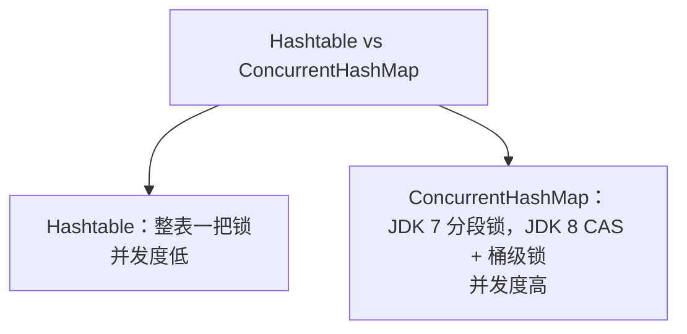

# Hashtable vs ConcurrentHashMap：并发度的天壤之别

面试题：对比一下 Hashtable 和 ConcurrentHashMap。

这是 Java 集合篇的高频题。答案的主干就一句话：两者都线程安全，但并发度差了一个数量级。能把锁的粒度从「整表一把锁」讲到「1.8 之前的分段锁」再到「1.8 的头节点锁」，这道题就答满了。

## 先给结论

- 共同点：Hashtable 和 ConcurrentHashMap 都是线程安全的 Map 集合，且键和值都不能为 null。
- Hashtable：并发度很低，整个 Hashtable 对应一把锁，同一时刻只有一个线程能操作它，其他线程都到锁对象的阻塞队列里等待。
- ConcurrentHashMap（1.8 之前）：Segment 加数组加链表的结构，每个 Segment 对应一把锁，多个线程访问不同的 Segment 不会冲突，Segment 的数量决定并发度。
- ConcurrentHashMap（1.8 开始）：不再使用 Segment，数据结构与普通 HashMap 类似（数组加链表或红黑树），把数组的每个头节点作为锁，访问不同头节点不会冲突，数组容量决定并发度。

## 是什么：共同点与锁粒度

两者都是线程安全的 Map，这是定位。还有一个容易忽略的小点：它们的键和值都不允许为 null。单线程的 HashMap 就允许 null 键和 null 值，这是并发容器和普通容器的差别之一。

真正的分水岭在锁的粒度。

## 深入细节：三个版本的锁结构

**Hashtable：一把锁管全表。** Hashtable 的并发度很低，因为它把整张表当成一个保护对象，同一时刻只有一个线程能操作。其他线程不是被拒绝，而是到锁对象的阻塞队列去等待。所有读写全部串行，多核 CPU 完全用不上。

**ConcurrentHashMap 1.8 之前：Segment 分段锁。** 这一版使用 Segment 加数组加链表的数据结构，每个 Segment 充当一把锁。多个线程来访问时，只要访问的 Segment 不同，就不会冲突，并发度因此提高。换句话说，Segment 的数量决定了 ConcurrentHashMap 的并发度，也就是同一时刻有多少个线程能访问它。

**ConcurrentHashMap 1.8 开始：头节点锁。** 1.8 之后 Segment 不再使用，数据结构跟普通 HashMap 一样，是数组加链表或者红黑树。这一版把数组的每个头节点作为锁，多个线程访问的头节点不同，自然就不会冲突。数组容量决定了并发度：数组容量是 16，就有 16 个头节点，最多允许 16 个线程并发访问，前提是它们访问的头节点不一样。

到这里，这道题的标准答案已经完整。往下的演示（并发 put、扩容时的 forwardingNode、扩容时的 get 和 put）属于展开细节，面试答到锁结构这一层就足够了。

## 面试怎么答

1. **先答共同点**：都是线程安全的 Map，键值都不能为 null。
2. **再答 Hashtable**：整表一把锁，同一时刻只有一个线程能操作，其他线程进阻塞队列等待，并发度低。
3. **然后答 ConcurrentHashMap 的两个版本**：1.8 之前 Segment 加数组加链表，Segment 即锁，Segment 数量决定并发度；1.8 开始数组加链表或红黑树，头节点即锁，数组容量决定并发度（默认 16 个桶就是最多 16 个线程各占一个头节点）。
4. **收尾点题**：从整表锁到分段锁再到头节点锁，锁粒度越来越细，并发度越来越高。

常见追问：

- **问**：为什么 ConcurrentHashMap 不允许 null 值和 null 键？
  **答**：并发环境下无法区分「键不存在」和「键对应的值是 null」，get 返回 null 会有二义性，可能把「没查到」误判成「查到了空值」，所以直接禁止 null，用 containsKey 来确认存在性。
- **问**：1.8 的头节点锁会不会有线程老在同一个桶上撞见？
  **答**：会，如果多个线程恰好操作同一个桶，还是要排队。所以容量只是并发上限，实际并发度取决于 key 的分布。

## 常见误区

- **误区一**：只答「ConcurrentHashMap 线程安全」就收尾。不加锁粒度对比，这道题等于没答。
- **误区二**：以为 1.8 之后还在用 Segment。Segment 在 1.8 已被移除，换成头节点锁加 CAS。
- **误区三**：把 ConcurrentHashMap 的并发度说成「无限」。它有上限，由 Segment 数或数组容量决定。
