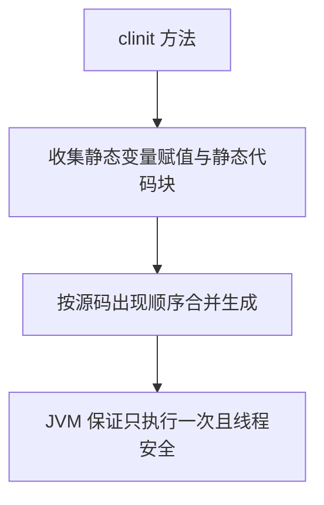

# 类初始化方法：静态代码块的底层原理

面试官问静态代码块的执行时机，大部分人都能答出「类初始化时执行」。再往深挖一层：静态变量的赋值语句和静态代码块，在字节码里到底长什么样？为什么 final 修饰的静态变量是个例外？这篇从字节码角度把原理讲透。

## 先给结论

- 编译器会把所有静态变量的赋值语句和静态代码块中的语句，按出现顺序从上到下合并成一个方法，这个方法的学名叫 `<clinit>`，即类的初始化方法。
- `<clinit>` 是静态方法，在类的初始化阶段被调用，静态变量赋值、打印、创建对象这些动作都发生在这里。
- 唯一的例外：用 final 修饰且类型是基本类型的静态变量。它们的赋值不会出现在 `<clinit>` 里，而是在声明变量时就直接固定了值，相当于常量。
- final 修饰但类型是引用类型的静态变量不享受这个例外，赋值动作照样进 `<clinit>`。



## 是什么：从字节码看静态代码块

想看字节码，用一个之前见过的工具 `javap`，加三个参数 `-c`、`-v`、`-p`，后面跟上字节码文件名，也就是 `Student.class`。它会把编译器生成的字节码翻译成人类可读的形式。

往上翻，找到一个名字叫 `static` 的地方，就找到位置了。从标记上看得出，它是一个静态方法。

这个方法是这么来的：编译器把静态变量的赋值语句、静态代码块里的语句，全部合到一起，按源码里出现的顺序由上至下排列。比如 `static int a = 0x77;` 的赋值出现在最上面，合并后它就在方法的第一行。

## 深入细节：逐段读懂 `<clinit>`

不用对 JVM 指令很熟，跟着看一遍就明白。以 Student 类为例：

**第一段，给静态变量 a 赋值。** 前两条指令准备了一个常数 119，也就是十六进制的 0x77，然后用 `putstatic` 把它赋给静态变量 a。这两条字节码就对应源码里的第一个赋值动作。

**第二段，静态代码块的打印。** 接下来三条指令对应 `System.out.println("Student.class init")`：先用 `getstatic` 拿到静态变量 System.out，再准备一个字面字符串 `"Student.class init"`，最后调用 PrintStream 的成员方法 `println`，把字符串当参数传进去。System.out 对象的实际类型是 PrintStream，所以调用的是 PrintStream 里的 println。

**第三段，给静态变量 b 赋值。** 一条指令准备数值 136，也就是十六进制的 0x88，然后 `putstatic` 赋给 b。

**第四段，final 基本类型静态变量缺席。** 找一圈会发现，用 final 修饰的静态变量 c 和 m 并没有出现在这个方法里。它俩的共同特性是：基本类型加 final 修饰。它们的赋值不在 `<clinit>` 中。

**第五段，final 引用类型静态变量在场。** 最后几条指令创建了一个 Object 对象，也就是 `new Object`，先用 `new` 创建实例，`dup` 复制栈顶引用，`invokespecial` 调用构造方法，最后用 `putstatic` 把创建好的对象赋给静态变量 n。n 和 c、m 的区别在于：它虽然也是 final，但是引用类型，引用类型的赋值动作最终还是会放进 `<clinit>`。

所以静态变量赋值（包括 final 但引用类型的）和静态代码块语句，都会按出现次序合进 `<clinit>`，在类初始化阶段统一执行。而 final 基本类型静态变量是例外，在声明时值就固定下来了，看字段的 ConstantValue 属性就知道，比如 c 的值 153 就是十六进制 0x99，m 的值 32768 就是 Short.MAX_VALUE 加 1，声明即常量，不需要额外的赋值动作。

至于 c 和 m 的数值范围为什么设得不一样，是为了下一个知识点做的铺垫，到时候再讲。

## 面试怎么答

1. **先给机制**：编译器把静态变量赋值和静态代码块按顺序合并成 `<clinit>` 方法，类初始化阶段调用。
2. **再讲例外**：final 修饰的基本类型静态变量不进 `<clinit>`，声明时通过 ConstantValue 固定值，相当于编译期常量。
3. **区分引用类型**：final 的引用类型静态变量仍要进 `<clinit>`，因为对象创建是运行时动作。
4. **验证手段**：`javap -c -v -p Student.class` 看字节码，面试提一句这个工具是加分项。

常见追问：

- **问**：静态代码块和静态变量赋值的先后由什么决定？
  **答**：由源码中的出现顺序决定，编译器按从上到下的顺序合并进 `<clinit>`。
- **问**：为什么 final 基本类型静态变量可以不占 `<clinit>`？
  **答**：它的值在编译期就能确定，直接以 ConstantValue 属性写在字节码里，使用时相当于常量，不需要运行时赋值。

## 常见误区

- **误区一**：以为静态变量赋值发生在类加载阶段。加载只是把字节码读进来，赋值动作在初始化阶段由 `<clinit>` 完成。
- **误区二**：认为所有 final 静态变量都是声明即固定。只有基本类型（以及字符串常量等编译期常量）享受这个待遇，引用类型的 final 静态变量照常进 `<clinit>`。
- **误区三**：把 `<clinit>` 和构造方法混为一谈。`<clinit>` 是类级别的初始化，只执行一次；构造方法是实例级别的，每 new 一次执行一次。

## 课件源码参考

> 以下示例出自课件 day03 的 `TestFinal.java`，与上文讲解一一对应，可直接对照阅读。

```java
package day03.loader;

import java.io.IOException;

public class TestFinal {
    public static void main(String[] args) throws IOException {
        System.out.println(Student.c); // c 是 final static 基本类型
        System.in.read();

        System.out.println(Student.m); // m 是 final static 基本类型
        System.in.read();

        System.out.println(Student.n); // n 是 final static 引用类型
        System.in.read();
    }
}
```
