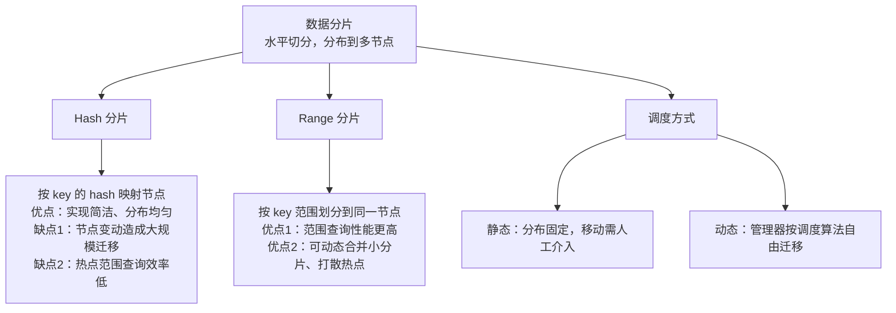

# 分布式通用设计：数据分片策略

面试题：数据量太大单机扛不住，怎么切分？有哪些分片策略？

分片是分布式存储的基本功：数据量太大、单机存不下也算不动时，把数据水平切分到多个节点。策略层面最基础的两种是哈希分片和范围分片，再往上还有静态调度和动态调度两种管理模式。这篇把四种概念一次讲清。

## 先给结论

- 分片：数据量较大时对数据进行水平切分，让数据分布在多个节点上。
- 目的有两个：突破单个节点的运算和存储上限；配合数据冗余（多副本）提高系统可用性。
- 基础策略两种：哈希分片（按 key 的哈希值映射节点）和范围分片（按 key 的范围划分节点）。
- 哈希分片实现简洁、分布均匀，但节点变动会引起数据大规模迁移，且关联数据被打散到不同节点、查询效率低；范围分片反过来，范围查询性能好、关联数据聚在同一个节点。
- 调度模式两种：静态（分片分布固定，迁移需人工介入）和动态（管理器基于调度算法自动移动数据）。

## 深入细节：哈希分片

哈希分片：每条记录挑一个字段作为 key，按这个 key 的哈希值把数据映射到不同节点上。具体做法就是把哈希值去模集群中节点的数量，得到的结果对应一个节点。

**优点：** 实现简洁，实现起来非常简单；数据分布相对均匀，不会出现数据倾斜，也就是不会一个节点数据特别多、另一个节点少得可怜。

**缺点一：节点变动导致数据大规模迁移。** 最基本的哈希取模方式下，增加或删除节点，取模的结果就不一样了，数据得移动到别的节点上，造成大规模迁移。这个问题可以用一致性哈希改进：计算出的哈希值不直接对应一个节点，而是对应一个范围，看哈希值落在哪个范围。这样能减少节点变动造成的数据迁移，但不是完全避免，仍会有少部分数据需要迁移，只是没有基本哈希算法那种大规模迁移那么夸张。

**缺点二：关联数据查询效率低。** 查询某一类热点数据，也就是相关联的数据时，因为哈希算法把这些关联数据分散到了不同节点上，要把它们凑齐得访问多个节点，查询效率不高。这个缺点不容易改进，也正是范围分片要解决的点。

## 深入细节：范围分片

范围分片（range）：在数据里挑一个字段作为 key，按这个 key 的范围进行划分。范围可以很灵活，可以根据日期范围，数字的话可以根据数字范围，让某一范围的数据存在相同的节点上。

**优点一：范围查询性能更好。** 有关系的一类数据如果落在同一个范围，就会放在同一个节点上，查询时不用到多个节点上去找，效率提高。

**优点二：可玩性高。** 范围分片可以配合动态调整：把较小的两个分片合并；把热点数据分散，比如热点数据集中在同一个分片导致压力大，就把热点数据分布到不同节点上减压。这就是动态的软拆分，配合动态范围能实现很多有用功能。

要注意不是所有分布式产品都支持动态范围调整，这跟具体产品有关，选型时要确认你用的中间件或分布式数据库是否真正支持。

## 深入细节：静态调度与动态调度

哈希分片和范围分片之上，还有两种调度方式。

**静态调度：** 一开始就把分片数相对固定下来，将来即使加了新的分片节点，数据需要迁移一般也要人工介入。也就是要事先预估好数据规模、用多少个节点，分片数基本固定。

**动态调度：** 更为灵活，有一个管理器基于各种调度算法，在各节点之间自由移动数据：小的分片可以合并，热点数据可以分散，都由管理器完成，省去人工介入，用起来更简单。同样，不是所有分布式产品都支持动态调度。

到这里，分布式数据分片的基本盘就齐了：两种策略（哈希、范围），两种调度（静态、动态）。具体的产品实现千差万别，但思路都落在这四个格子里。

## 面试怎么答

1. **先给定义**：数据量大时水平切分到多节点，突破单机上限，配合冗余提可用性。
2. **再讲两种策略**：哈希分片实现简洁、分布均匀，但节点变动迁移大、关联数据被打散；范围分片范围查询快、关联数据聚团，但可能产生热点分片。
3. **补改进手段**：哈希的迁移问题用一致性哈希缓解；范围的热点问题用动态拆分合并缓解。
4. **点出调度维度**：静态调度固定分片、迁移靠人工；动态调度管理器自动搬数据。两者与分片策略正交组合。

常见追问：

- **问**：一致性哈希解决了哈希分片的什么问题？
  **答**：节点增减时的数据大规模迁移。哈希值映射到环上区间后，增删节点只影响相邻区间的数据，迁移量从「几乎全部」降到「局部」。
- **问**：什么场景适合范围分片？
  **答**：有明显范围查询特征的场景，比如按时间归档的日志、订单，范围键查询可以直接定位到少数节点。

## 常见误区

- **误区一**：只答哈希分片。范围分片和静态/动态调度同样是基础盘，面试官要听完整坐标系。
- **误区二**：以为一致性Hash 完全消除迁移。它减少迁移量，仍有少部分数据要动。
- **误区三**：忽略产品差异。动态调度不是所有分布式数据库都支持，回答时要加一句「取决于具体产品」。

## 课件配图
> 以下配图取自阶段七课件对应讲义，与上文讲解一一对应，可作为图文对照辅助理解。
**一致性 Hash（补充）**（课件讲义图示）

