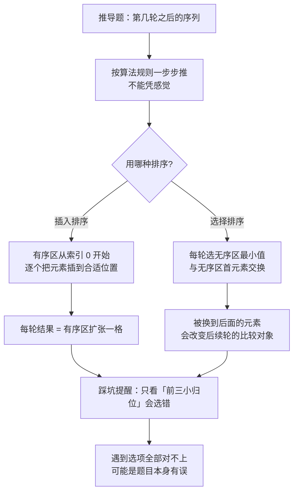

# 推导某一轮排序结果：插入排序与选择排序的真题拆解

面试题：用某排序算法对序列排序，第几轮之后的结果是什么？

排序算法的考法除了写代码，还有两种：描述实现思路，以及推导某一轮之后的结果。后者考的是对算法过程的理解，不是背结论。这篇拿两道真题手动推一遍，其中第二题还会发现一个有趣的事：大厂的题也会出错。

## 先给结论

- 排序题的两种考法：描述算法思路，以及推导「第几轮结束后的序列」。
- 推导题的关键：每一轮到底动了谁、动了多少，必须按算法规则一步步来，不能凭感觉。
- 插入排序推有序区的扩张：把未排序元素逐一插入前面的有序区，前几轮的结果由「插到哪」决定。
- 选择排序推交换：每轮选最小值和无序区首元素交换，注意被换到后面的元素会改变后续轮的比较对象。
- 粗看答案会踩坑：第二题只凭「前三小归位」会选错，认真推演会发现选项设置本身有问题。



## 深入细节：插入排序，第三轮结果

序列是 18、23、19、9、23、15，两个问题同一个序列，分别问插入排序和选择排序第三轮的结果。

插入排序：把第一个元素视为有序部分，后续元素逐一插入。

第一轮，把 23 插入有序部分，23 比 18 大，放在 18 后面，有序部分变成 18、23。

第二轮，把 19 插入有序部分，19 比 23 小、比 18 大，插到两者中间，有序部分变成 18、19、23。

第三轮，把 9 插入有序部分，9 比前面都小，移到最前面，有序部分变成 9、18、19、23。

题目只问到第三轮，此时数组是 9、18、19、23、23、15，后两个元素还没动。对照选项，这就是 D。这类题的解法就是盯住有序区的边界，每轮只关心「谁插进来、插到哪」。

## 深入细节：选择排序，第三轮结果

选择排序同样把数组视为有序和无序两个部分，每轮从无序部分挑出最小的加入有序部分。

先粗略地想：第一轮挑最小的 9，第二轮挑第二小的 15，第三轮挑第三小的 18。前三轮结束，前三项就是最小的三个数 9、15、18。如果只看到这一层，很容易选一个「9、15、18」开头的选项，但这是错的，出题人大概也只考虑了前三个数字，没考虑后面怎么交换。

认真推一遍。初始序列 18、23、19、9、23、15：

第一轮，无序部分里最小的是 9，把它交换到索引 0 的位置。交换是双向的：9 到了最前面，原来索引 0 的 18 被换到 9 原来的位置。第一轮后序列是 9、23、19、18、23、15。

第二轮，在剩余无序部分找最小的是 15，把它和索引 1 的 23 交换。交换后 15 就位，23 被换到后面。第二轮后序列是 9、15、19、18、23、23。

第三轮，在剩余部分找最小的是 18，把它和索引 2 的 19 交换。第三轮后序列是 9、15、18、19、23、23。

把这个完整序列和四个选项逐一对比，会发现没有一个选项完全匹配。那道题里「前三项是 9、15、18」的选项是错误的，因为它只对了前三个数，后面的交换全没考虑。这还是家大公司出的题，所以遇到这种题，时间充裕可以提提意见，时间不充裕就跳过，别让它影响心态。

两道题合起来的启示：推导题最可靠的方法是拿纸笔把每一轮的交换、移动完整写出来，尤其是选择排序，交换会改变后续轮的比较对象，只看「谁归位」必然翻车。

推导的时候要盯住每一轮的循环变量，下面两份实现是这样的。插入排序：

```java
// i 代表待插入元素的索引
public static void insert(int[] a) {
    for (int i = 1; i < a.length; i++) {
        int t = a[i];                    // 代表待插入的元素值
        int j = i;
        System.out.println(j);
        while (j >= 1) {
            if (t < a[j - 1]) {          // j-1 是上一个元素索引，如果 > t，后移
                a[j] = a[j - 1];
                j--;
            } else {                     // 如果 j-1 已经 <= t, 则 j 就是插入位置
                break;
            }
        }
        a[j] = t;
        System.out.println(Arrays.toString(a) + " " + j);
    }
}
```

选择排序：

```java
private static void selection(int[] a) {
    for (int i = 0; i < a.length - 1; i++) {
        // i 代表每轮选择最小元素要交换到的目标索引
        int s = i;                       // 代表最小元素的索引
        for (int j = s + 1; j < a.length; j++) {
            if (a[s] > a[j]) {           // j 元素比 s 元素还要小, 更新 s
                s = j;
            }
        }
        if (s != i) {
            swap(a, s, i);
        }
        System.out.println(Arrays.toString(a));
    }
}
```

两者轮次含义不同：插入排序第 i 轮是把 `a[i]` 插进前面已排好的区间，所以「第三轮结束」看的是 i=3 处理完的数组；选择排序第 i 轮是把最小值换到索引 i，所以「第三轮结束」看的是前三小元素都已就位的数组。推导时别把这两个 i 混为一谈。

## 面试怎么答

1. **先分类**：排序考代码（冒泡、选择）或考思路与其他算法的描述；推导题考过程理解。
2. **再讲方法**：按算法规则逐轮推，插入排序盯有序区，选择排序盯「最小值交换后换来谁」。
3. **用真题演示**：插入排序第三轮得 9、18、19、23、23、15；选择排序第三轮得 9、15、18、19、23、23。
4. **点出陷阱**：选择排序的交换是双向的，只记「最小值归位」会漏掉被换走的元素，导致推演错误。

常见追问：

- **问**：为什么选择排序推演比插入排序容易错？
  **答**：选择排序每轮涉及一次交换，两个位置都变；插入排序只有插入点附近移动，变化范围更局部。
- **问**：如果题目选项和推演结果都不符怎么办？
  **答**：以推演为准，题目可能出错。面试是交流，可以把推演过程讲出来，比蒙一个选项更有价值。

## 常见误区

- **误区一**：凭「前几小归位」猜选择排序的结果。交换换来换去，无序区的构成每轮都在变。
- **误区二**：推导时不写完整序列。只盯变化的位置，容易漏掉被交换到后面的元素。
- **误区三**：迷信大厂题。选项也会错，自己的推演过程才是最硬的答案。
