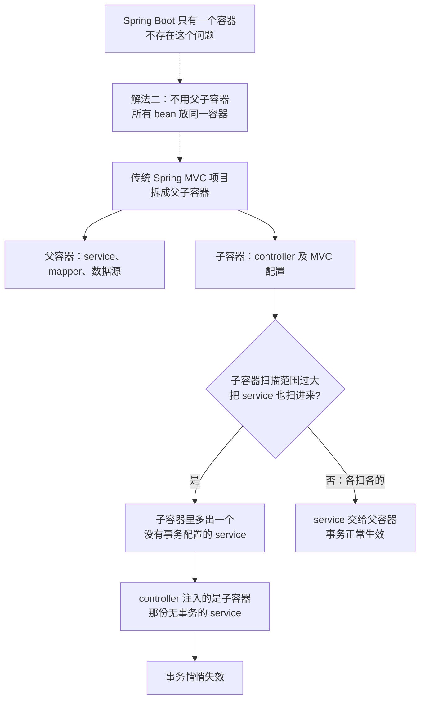

# Spring 事务失效场景五：父子容器

前面几种事务失效场景问题都出在 service 自身的写法上，这一种不一样：service 写得没问题，问题出在容器结构上。当 Spring 应用被拆成父子容器，controller 放在子容器、service 放在父容器时，事务可能悄悄失效。这是传统 Spring MVC 项目里很常见的坑，面试问「事务失效有哪些场景」时，这是一个能体现你踩过坑的回答。

## 先给结论

1. 父子容器结构下，如果子容器的扫描范围过大，把 service 也扫了进来，事务会失效。
2. 失效原因是 controller 注入到的是子容器里那个没有事务配置的 service，而不是父容器里带事务配置的 service。
3. 子容器找 bean 时优先在自己内部找，找到了就不会再去父容器找，而事务配置（声明式事务管理）只加在父容器那边。
4. 解决办法一是各扫各的，MVC 子容器只扫 controller，service 交给父容器；解决办法二是干脆不用父子容器，所有 bean 放在同一个容器。
5. Spring Boot 应用只有一个容器，不存在这个问题，它主要出现在传统 Spring MVC 整合 Spring 的项目里。



## 是什么

先看场景。service 这边实现没什么问题，正常写就行，但加入了一个环节：有一个 controller，它要调用前面的 service。controller 用依赖注入注入 service5，controller 的方法间接调用 service 的方法。

这种 controller 与 service 的调用关系，在配置上有两种选择：一种是 controller 和 service 都配置在同一个容器里；另一种是分别放在父子容器里，service、mapper、数据源相关的都放在父容器，controller 以及和 MVC 相关的一些配置放在子容器。后者是开发传统 Spring MVC 应用时经常用的做法。

区分成父子容器之后，子容器找不到某个 bean 时，会到父容器去找，从而完成 controller 对 service 的依赖注入。听起来顺理成章，但问题恰恰出在这里。

## 为什么这样设计（以及为什么会失效）

父子容器本身是为了解耦：MVC 相关的组件和业务层组件分开管理，父容器装业务基础设施，子容器装 Web 层。设计初衷没问题，出问题的是扫描范围。

原因就在子容器的配置上：子容器扫描的范围太大了，扫的是整个 app 包，而 app 包底下既有 controller，也有 service。也就是说将来子容器里同样会有那些 service。但是，声明式事务管理（开启事务注解支持的那个配置）只配在父容器里，子容器没配。

于是形成这样一个局面：controller 注入的是子容器里的 service，而不是父容器里的 service。两个容器里的 service 是可以同时存在的，而子容器找 service5 的时候会优先在自己容器里找，所以拿到的就是一个没有经过事务配置的 service5 对象。真正带事务配置的那个 service5 在父容器里，但子容器已经提前找到了，就不会再去父容器找。事务自然加不上。

## 深入细节

### 复现一下

测试代码里手动创建父子容器。父容器读取的配置类扫描的是 service 包和 mapper 包：

```java
// 父容器：读 AppConfig，扫描 service 包、mapper 包，配置数据源和事务管理器
GenericApplicationContext parent = new GenericApplicationContext();
parent.register(AppConfig.class);
parent.refresh();
```

子容器对应另一个配置类 WebConfig，它扫描的是整个 app 包，范围比父容器大，并且把父容器设为自己的 parent：

```java
// 子容器：读 WebConfig，扫描整个 app 包，parent 设为上面的 parent
GenericApplicationContext child = new GenericApplicationContext();
child.setParent(parent);
child.register(WebConfig.class);
child.refresh();

AccountController controller = child.getBean(AccountController.class);
controller.transfer(1, 2, 500);
```

跑完很遗憾：该有的事务日志并没有出现，事务没加上。controller 在调用 service 的过程中，这个方法调用根本没有加上事务。

### 修复

修复思路是不要让子容器扫到它不该扫的包，只让它扫描 controller：

```java
// WebConfig：只扫 controller 包，service 交给父容器
@ComponentScan("day04.tx.app.controller")
public class WebConfig {
}
```

再测，事务日志回来了。

### 第二种解法

如果嫌各扫各的麻烦，还有第二种解法：不用父子容器，所有 bean 放在同一个容器里，也不会有这个问题。用 Spring Boot 开发应用时本来就没有父子容器，Spring Boot 只有一个容器，所以这个坑在 Spring Boot 项目里不会出现。它主要出现在传统 Spring MVC 加 Spring 整合、需要配置父子容器的项目里。

## 面试怎么答

回答时可以这样组织：

1. 场景描述：传统 Spring MVC 项目里 Spring 容器被拆成父子容器，controller 在子容器，service 在父容器。
2. 失效原因：子容器扫描范围过大，把 service 也扫进来了，而事务配置只在父容器；子容器优先用自己的 bean，注入的是没有事务配置的 service。
3. 解决方案：子容器只扫 controller，各扫各的；或者干脆不用父子容器；Spring Boot 单容器没有这个问题。

常见追问：

- **问：为什么子容器会优先用自己的 service？** 找 bean 的顺序是先自己后父容器，自己容器里已经存在同名的 service，就不会再去父容器找。
- **问：这个场景在 Spring Boot 里有吗？** 没有，Spring Boot 就一个容器，不存在父子容器之分。
- **问：怎么避免？** 扫描包路径按层划分，Web 层配置只扫 controller，业务层配置扫 service 和 mapper，不要为了图省事直接扫根包。

## 常见误区

- **误区一：service 加了 `@Transactional` 就一定有事务。** 如果注入进来的是另一个容器里没有事务配置的同名 bean，注解形同虚设。
- **误区二：父子容器里注入的 service 一定是父容器那个。** 子容器自己也有的时候，优先用子容器的。
- **误区三：扫包范围越大越省事。** 范围过大会把不该进这个容器的组件扫进来，父子容器场景下直接引发事务失效。
