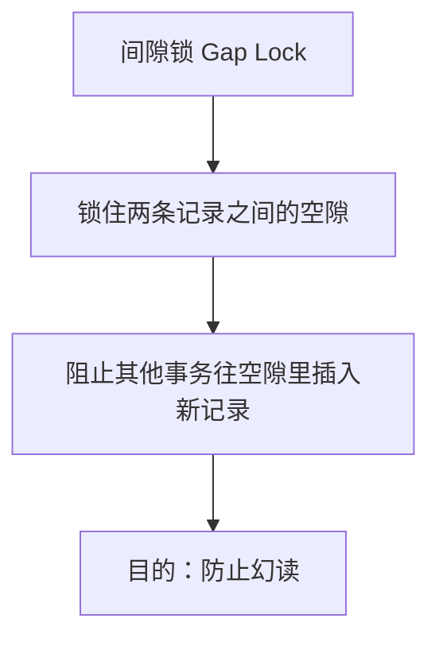

# 行级锁：间隙锁

InnoDB 的行级锁是面试的高频区，其中间隙锁最容易被忽略：很多人以为锁锁的都是「行」，实际上 RR 隔离级别下锁住的是「行加间隙」。这道题想考的是你能不能讲清三种行级锁的分工、各自工作的隔离级别，以及为什么间隙锁的存在是为了防幻读。能拿 `performance_schema.data_locks` 当证据讲，回答立刻加分。

## 先给结论

1. InnoDB 行级锁分三种：行锁、间隙锁、临键锁，MyISAM 不支持行级锁。
2. 行锁工作在 RC 和 RR 两种隔离级别下，锁定的单位是行，目的是防止其他事务对该行 update 或 delete。
3. 间隙锁只能工作在 RR 下，锁住的是间隙，防止其他事务在间隙中 insert，从而避免幻读。
4. 临键锁是行锁和间隙锁的组合，前面一个间隙、后面一行，锁住的是前开后闭的区间，某些条件下可以优化成行锁。
5. 它们锁定的其实都是索引上的行和索引上的间隙，间隙根据索引的有序性来确定。



## 是什么

行锁锁定的是行，防止其他事务对这一行进行更新或删除操作，RC 和 RR 下都能工作。

间隙锁锁定的是行与行之间的「空位」。锁住间隙的作用是防止其他事务在这个间隙里 insert 数据，这样就避免了幻读。间隙锁和临键锁都只能工作在 RR 隔离级别下，RC 下这两种锁不存在。

临键锁相当于行锁加间隙锁的组合：它的前面有个间隙，后面是行，把行和它前面的间隙加在一块，锁住的是一个前开后闭的区间。特定条件下临键锁可以优化，把前面的间隙优化掉，只留后面的行。

三种锁有一个共同点：锁定的都是索引上的行、索引上的间隙，间隙的位置依据索引的有序性来确定。光说抽象，下面用例子演示。

## 深入细节

### 先建测试数据

表结构和一个索引进阶：

```sql
create table t (id int primary key, name varchar(10), age int, key (name));
insert into t values(1, 'zhangsan', 18);
insert into t values(2, 'lisi', 20);
insert into t values(3, 'wangwu', 21);
insert into t values(4, 'zhangsan', 17);
insert into t values(8, 'zhang', 18);
insert into t values(12, 'zhang', 20);
```

表里一共有 6 条数据，id 分别是 1、2、3、4、8、12。

### 什么是间隙

间隙就是行与行之间还有没有空位。以主键索引为例：

- 1 和负无穷之间有一个间隙；
- 1 和 2 之间可以认为没有间隙，id 是整数，中间没有空位；
- 2 和 3 之间、3 和 4 之间同样没有间隙；
- 4 和 8 之间有间隙，8 和 12 之间也有间隙；
- 12 和正无穷之间还有间隙。

### 间隙锁演示

开一个事务，对一条并不存在的记录加锁：

```sql
begin;
select * from t where id = 9 for update;
select object_schema,object_name,index_name,lock_type,lock_mode,lock_data from performance_schema.data_locks where object_name='t';
update t set age=100 where id = 8;
update t set age=100 where id = 12;
insert into t values(10,'aaa',18);
```

注意 id = 9 这条记录并不存在，表里只有 8 和 12，没有 9。那这把锁加给谁了？加给了 8 和 12 之间的那个间隙，不包括 8，也不包括 12。也就是说这个间隙里不能再新增记录，要操作只能操作间隙以外的部分。

验证边界。先看 8：8 是一条记录，不属于间隙。执行 `update t set age=100 where id = 8`，语句没有出现阻塞，说明刚才的锁并没有锁住 8。再看 12，直接改，也没有被锁住。可见锁针对的既不是 8 也不是 12，而是 8 和 12 之间的间隙。

再验证间隙内部：执行 `insert into t values(10,'aaa',18)`，10 恰好落在 8 和 12 之间的间隙位置，这条 insert 就不能执行了。也就是说 insert 9、insert 10、insert 11 都不行。锁定配合间隙锁，正好防止了幻读的发生。

### 用 data_locks 看锁

演示过程中还用到一条调试 SQL，查 `performance_schema.data_locks` 这张表，它能把表上的意向锁，以及记录上加的间隙锁、行锁、临键锁都显示出来。意向锁这里不展开，看下面这条：锁模式里出现 gap，表示这是一个间隙锁；因为用的是 for update，属于排他锁，所以这是一个间隙的排他锁。这是观察锁的重要手段。

### 临键锁场景

范围查询加锁是临键锁的典型场景：

```sql
begin;
select * from t where id >= 12 for update;
select object_schema,object_name,index_name,lock_type,lock_mode,lock_data from performance_schema.data_locks where object_name='t';
update t set age=100 where id = 12;
insert into t values(13,'aaa',18);
```

`id >= 12` 锁住的不只是 12 这一行，还包括 12 到正无穷之间的间隙，合起来就是临键锁锁住的前开后闭区间。这套 SQL 是留给临键锁和记录锁的测试脚本，可以自己跑一遍，配合 data_locks 观察锁模式的变化。

## 面试怎么答

回答时可以这样组织：

1. 先分类：行锁、间隙锁、临键锁三种，分别说明锁定对象和工作的隔离级别。
2. 行锁 RC、RR 都能用，锁行，防 update/delete；间隙锁和临键锁只在 RR 下有，锁间隙防 insert 从而防幻读。
3. 临键锁是行加间隙的组合，锁前开后闭区间，可优化为行锁。
4. 强调三种锁锁的都是索引上的行和间隙，间隙由索引有序性决定。
5. 有余力可以讲演示：对不存在的 id 加 for update，锁落在相邻记录之间的间隙，边界行能改、间隙内 insert 被阻塞，用 `performance_schema.data_locks` 可以看到 gap 锁模式。

常见追问：

- **问：为什么 RC 下没有间隙锁？** RC 下不需要靠间隙锁来防幻读，快照读加当前读的组合已经能处理，间隙锁和临键锁是 RR 特有的机制。
- **问：为什么 MyISAM 没有行级锁？** MyISAM 只支持表级锁，这也是 InnoDB 取代它成为默认引擎的原因之一。
- **问：锁一定加在记录上吗？** 不一定。查询条件命中不存在的记录时，锁加在相邻记录形成的间隙上。

## 常见误区

- **误区一：行级锁只锁行。** RR 下往往是行加间隙一起锁（临键锁），单独的行锁或间隙锁是它的组成部分。
- **误区二：对不存在的 id 加锁没有效果。** 锁落在相邻记录之间的间隙上，照样能阻止这个范围内的 insert。
- **误区三：间隙位置随便定。** 间隙由索引的有序性决定，主键 1、2 相邻就没有间隙，4、8 之间才有。
