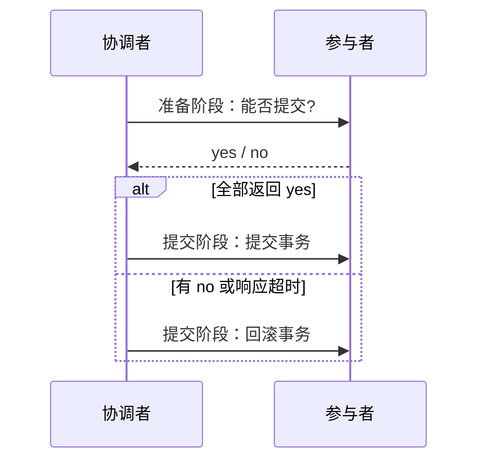

# 分布式事务：2PC 两阶段提交

分布式事务是后端面试的高频大题，而 2PC 是所有方案里最经典、也最容易被拿来当「反面教材」的一版。面试问分布式事务，通常从「你知道哪些方案」开场，然后顺着 2PC 追问流程和缺点。这道题要拿分，关键是能把两个阶段的交互讲清楚，并且说得出它为什么在生产环境里用得少。

## 先给结论

1. 2PC 把事务的提交部分分成两个阶段：准备阶段和提交阶段；前面的增删改照常执行，不在两阶段之内。
2. 角色有两个：事务协调器（总控）和事务参与者（不同节点，各自执行多条增删改）。
3. 准备阶段，协调器发准备提交请求，参与者做完写日志、锁定资源等提交前的所有操作，唯独不做提交，然后向协调器返回 yes。
4. 所有参与者都返回 yes，协调器进入提交阶段，通知大家提交；只要有一个返回 no 或者响应超时，协调器就通知所有参与者回滚。
5. 2PC 有四个主要缺点：阻塞型协议、过于保守、数据不一致、协调者单点问题，所以整体实用性不高，实际采用相对较少。

## 是什么

分布式事务要解决的问题是：多个参与者分别在不同的节点上执行多条增删改，要保证这些操作作为一个整体运行，具备原子性，要么全部成功，要么全部回滚。

两阶段提交是其中一种实现方案。先认识两种角色：

- 事务协调器：相对于事务的总控，负责发号施令；
- 事务参与者：分布在不同的节点上，分别执行多条增删改操作。

注意一个细节：被分成两阶段的是「提交」部分，不是前面的增删改。增删改该怎么做就怎么做，做完之后才进入提交的两阶段。

## 深入细节

### 成功提交流程

参与者 A 把自己的增删改执行完了，参与者 B 也执行完了，接下来开始提交。事务协调器先发送准备提交请求，参与者 A 和 B 接到之后，各自做提交前的所有操作，包括写日志、锁定资源等等，唯独提交没有做。如果他们都成功了，就由参与者向协调器返回 yes。

协调器这边发现所有参与者都返回了 yes，说明没问题，于是进入第二个阶段，也就是提交阶段：通知参与者 A 和 B 执行提交操作。A 和 B 分别执行提交，最后返回 ack，协调器收到所有人的 ack 后，事务结束，提交成功。

### 失败回滚流程

还有一种情况：准备阶段有参与者返回了 no，或者响应超时。响应超时虽然不代表一定有问题，但协调器一旦发现这两种情况之一，就在接下来的提交阶段通知所有参与者回滚事务，因为它认为有问题了。

对照流程看：准备阶段里参与者 A 返回了 yes，但参与者 B 返回了 no。协调器认为有一个参与者出现故障，为了保证原子性，应该撤销所有操作。于是它向 A 和 B 都发出回滚请求。因为参与者 A 还没有执行提交，所以它还有机会把自己的操作撤销。等到第二个阶段，A 和 B 的回滚结果都返回给协调器之后，协调器就可以结束这个事务了。

### 四个缺点

2PC 的问题比较多，主要有四个。

第一，阻塞型协议。如果一个参与者迟迟没有返回响应，比如第一阶段就没返回，其他参与者全都必须等待。等待期间这些参与者占用的资源一直被锁定，并发性和吞吐量都提不上去。

第二，过于保守。任何一个节点的失败都将导致事务回滚。将来参与者越多，失败的概率就越大，只要多个参与者里有一个失败，整个事务就得回滚。

第三，数据不一致。主要发生在阶段二：协调器本以为所有参与者都返回了 yes、大家都能提交，但如果它只把提交信息发给了部分参与者，有一部分参与者没拿到最终要提交的信息，就会造成数据不一致。这个几率并不小：可能是网络原因导致某个参与者没收到提交请求，也可能是协调器发了一部分提交请求之后自己挂了，后续参与者就没办法接到提交请求。

第四，协调者单点问题。如果协调者在第二阶段出现故障，参与者这边是不会超时的，这是 2PC 的实现方式决定的。参与者会一直等，不知道等来的是提交请求还是回滚请求，始终处于阻塞状态，资源被锁定得不到释放。

这四个问题，阻塞、保守、不一致、单点，都会造成 2PC 的实用性不太高。当然，很多分布式数据库产品对 2PC 做了各种优化，以保证它在生产环境的可用性，但总体来讲，这种方案采用的相对较少。

## 面试怎么答

回答时可以这样组织：

1. 先给定义：2PC 分准备和提交两个阶段，引入事务协调器和事务参与者两个角色。
2. 走一遍成功流程：协调器发准备请求，参与者写日志、锁资源但不提交，返回 yes；协调器见全员 yes 后通知提交，参与者执行 commit 并回 ack。
3. 走失败分支：任一参与者返回 no 或超时，协调器通知全员回滚。
4. 主动谈缺点：阻塞、保守、不一致（阶段二只发了一部分提交请求）、协调者单点（阶段二故障后参与者不超时一直阻塞）。
5. 收尾：实际生产采用较少，分布式数据库产品有各种优化版本。

常见追问：

- **问：为什么参与者不会超时？** 这是 2PC 协议的设计，参与者等待协调器的下一步指令时不设超时，避免在未确认全局决定的情况下自行动作，代价就是协调者故障时全员阻塞。
- **问：阶段二怎么会数据不一致？** 提交指令只到达了一部分参与者，另一部分既没提交也没回滚，与已提交方产生不一致。
- **问：怎么缓解？** 协调者做高可用（备份协调者接管）、参与者侧对锁资源加超时兜底、选用经过优化的实现，但都是缓解，根治要靠后续的其他分布式事务方案。

## 常见误区

- **误区一：两阶段指的是整个事务分两段执行。** 分的只是提交部分，增删改照常先执行完。
- **误区二：准备阶段就提交了。** 准备阶段只做写日志、锁资源这些提交前的准备，提交本身留到阶段二。
- **误区三：返回 no 只影响自己。** 只要有一个 no，协调器会让所有参与者回滚，保证原子性。
