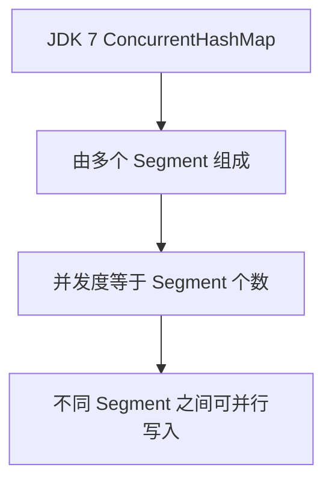

# ConcurrentHashMap v7：演示并发度

Java 7 版本的 ConcurrentHashMap 用的是分段锁设计，面试问 CHM 基本绕不开它。这道并发度的演示题，想看你是否理解 Segment 数组、HashEntry 小数组、链表三层的结构关系，以及构造方法里三个参数分别控制什么。能把「并发度固定、小数组才扩容」讲清楚，就说明真的看懂过分段锁。

## 先给结论

1. Java 7 ConcurrentHashMap 底层是 Segment 数组加 HashEntry 数组加链表：外层是 Segment 数组，每个 Segment 里套一个 HashEntry 小数组，小数组等价于普通 HashMap 的数组结构，索引冲突就拉成链表。
2. Segment 的个数决定并发度，默认 16，线程访问不同的 Segment 加不同的锁，因此可以真正并发。
3. 构造方法三个参数：容量、负载因子、并发度，并发度改掉，Segment 数组的初始容量就跟着变。
4. 容量决定里面 HashEntry 小数组的初始大小，计算方式是容量除以并发度，结果有最小值 2。
5. Segment 数组不能扩容，构造时指定并发度后就固定了；负载因子影响的是小数组，元素个数超过四分之三时小数组扩容。

## 是什么

Java 7 版本的 ConcurrentHashMap，底层数据结构是 Segment 加数组加链表。单说不够形象，可以这样对应：

- 蓝色的外层大数组就是 Segment 数组；
- Segment 数组的每个元素里面套一个小数组；
- 小数组的类型叫 HashEntry，它等价于原来普通 HashMap 中的数组结构；
- HashEntry 中出现索引冲突，就构成链表。

大概就是「Segment 套 HashEntry 数组，HashEntry 数组拉链表」的关系。

## 深入细节

### 并发度由 Segment 个数决定

ConcurrentHashMap 的 Segment 个数决定了最多有多少线程能够并发访问它。因为一个线程访问的 Segment 不同，相当于加的锁也不一样，所以不同 Segment 之间是可以并发访问的。

默认的并发度是 16，也就是 Segment 这个蓝色大数组的初始容量是 16。这个值可以改：构造方法有三个参数，第一个是容量，第二个是负载因子，第三个是并发度。把并发度改成 8，Segment 数组的初始容量就是 8；改成 32，初始容量就是 32。并发度决定了将来的并发性能。

### 容量决定小数组的初始大小

容量和并发度之间有个换算关系：容量决定里面 HashEntry 小数组的初始大小，计算方式是容量除以并发度。

如果容量比并发度还小，除出来是 0，这时会取一个最小值，小数组的最小容量是 2。

演示几个组合：

- 容量设小一点，16 除以 8 正好等于 2，小数组初始容量是 2；
- 容量设成 32，并发度 8，32 除以 8，小数组初始容量是 4；
- 容量设成 64，并发度 8，小数组初始容量就是 8。

### 负载因子只管小数组

注意，外面这个 Segment 数组是不能扩容的，一旦在构造方法里把容量指定，它的并发度就固定了。所以负载因子影响的其实还是里面那个小数组。

负载因子默认 0.75，意思是将来小数组里面元素个数超过它的四分之三时，会进行扩容。

三个参数的含义总结：并发度定 Segment 数组的初始容量，容量和并发度一起定小数组的初始大小，负载因子定小数组什么时候扩容。

## 面试怎么答

回答时可以这样组织：

1. 先画结构：Segment 数组，每个 Segment 内含 HashEntry 数组，冲突拉链表。
2. 讲并发度：Segment 个数即并发度，默认 16，不同 Segment 锁不同，可真正并发；构造方法第三参数可调。
3. 讲容量关系：小数组初始容量约等于容量除以并发度，最小为 2。
4. 讲扩容：Segment 数组不扩容，并发度构造时定死；负载因子 0.75 作用于小数组，超过四分之三扩容。

常见追问：

- **问：为什么 Segment 数组不能扩容？** 并发度在构造时确定后固定，Segment 数组的长度就不再变化，扩容只发生在小数组层面。
- **问：小数组初始容量最小为什么是 2？** 容量除以并发度为 0 时取最小值，保证每个 Segment 里的小数组不至于退化到无法承载元素。
- **问：和 Java 8 的 CHM 有什么区别？** Java 8 放弃了分段锁，改成数组加链表加红黑树，用 synchronized 加 CAS 控制并发，这是另一个话题，回答时点明版本差异即可。

## 常见误区

- **误区一：容量就是 Segment 数组的容量。** 容量决定的是小数组的初始大小，Segment 数组大小由并发度决定。
- **误区二：负载因子控制整个 Map 扩容。** 在 v7 里它只管小数组，Segment 数组不扩容。
- **误区三：并发度越大一定越快。** 并发度大可减少锁争用，但 Segment 数组本身也占空间，且容量与并发度的换算会影响小数组初始大小，需要按场景权衡。
