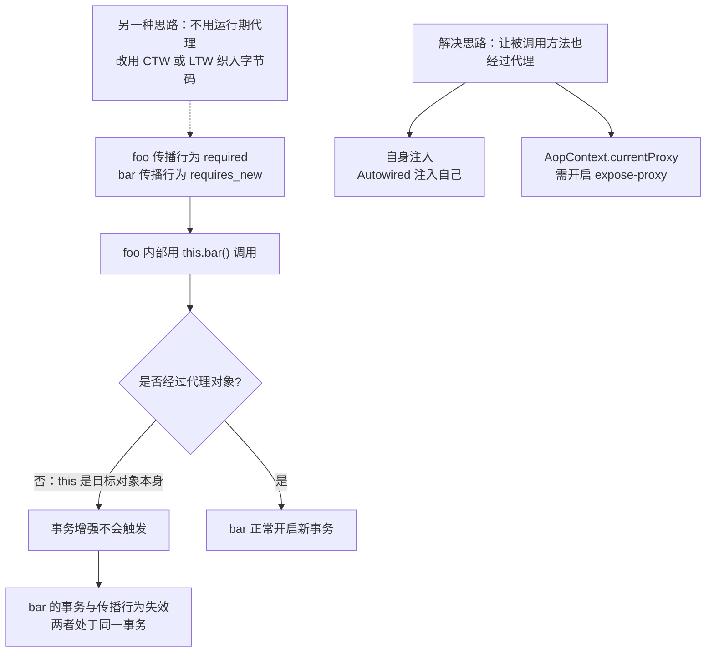

# Spring 事务失效场景六：本类方法调用

这是 Spring 事务失效系列里最隐蔽的一个：两个方法都规规矩矩加了 `@Transactional`，传播行为也配了，运行起来却只有一个事务。问题不在注解、不在配置，而在「本类方法调用不过代理」。面试问「事务失效有哪些场景」，这道题是压轴常客，答不出来会显得没真踩过坑。

## 先给结论

1. 同一个类中，一个带事务的方法直接调用另一个带事务的方法（`this.bar()`），被调用方法的事务会失效，传播行为不生效。
2. 原因：事务增强只有通过代理对象调用方法才会触发，`this` 调用走的是目标对象本身，没有经过代理，自然没有功能增强。
3. 把 `this` 的 class 打印出来可以看到是原始类型，而代理对象调用时打印出来的是 CGLIB 代理类。
4. 解决思路就一条：让被调用的方法也必须经过代理。两种拿代理的办法：自身注入（`@Autowired` 注入自己）和 `AopContext.currentProxy()`（需开启 `expose-proxy`）。
5. 还有一种改增强方式的思路：不用运行期代理，改用 CTW（编译期织入）或 LTW（加载期织入）修改字节码，本讲不展开。



## 是什么

场景里有 Service6 两个带事务注解的方法，foo 和 bar，都配置了传播行为。foo 的传播行为是默认的 `required`：如果之前没有事务，它会创建新的事务；如果已有事务，它会加入已有的事务。bar 配的是 `requires_new`：不管之前有没有事务，它总是会开启一个新的事务。

期望是两个方法各是一个事务。但实际运行结果：只创建了一个事务，获得一个连接，切换为手动提交，最后提交了一个事务。foo 和 bar 处在了同一个事务当中，bar 之前并没有像预期那样多出一段创建新事务的日志。

## 深入细节

### 问题出在代理上

事务的增强功能，只有通过代理去调用这个方法，它才会执行我们的事务通知，事务通知再调用目标，才具备事务增强。

我们通过容器拿到的 Service6 这个 bean，确实是代理对象，class 打印出来能看出是被 CGLIB 代理的。但是在 foo 方法内部间接调用 bar 方法时，这个 bar 的调用并没有经过代理。调用 bar 时省略了前面的 `this`，而这个 `this` 是目标对象本身。把 `this` 的 class 打印出来，是原始类型。既然是原始类型，它不会进行功能增强，因此调用 bar 方法时没有增强，注解上的信息也不会生效。这就是传播行为失效的原因。

对应的代码：

```java
@Transactional(propagation = Propagation.REQUIRED, rollbackFor = Exception.class)
public void foo() throws FileNotFoundException {
    LoggerUtils.get().debug("foo");
    this.bar();
}
```

```java
@Transactional(propagation = Propagation.REQUIRES_NEW, rollbackFor = Exception.class)
public void bar() throws FileNotFoundException {
    LoggerUtils.get().debug("bar");
}
```

### 解决办法一：自身注入

思路是让 bar 的调用也必须经过代理，不能由目标对象自己调用 bar，必须通过代理对象调用 bar。第一种办法是自身注入，用 `@Autowired` 把自己注入进来：

```java
@Autowired
private Service6 proxy;

@Transactional(propagation = Propagation.REQUIRED, rollbackFor = Exception.class)
public void foo() throws FileNotFoundException {
    LoggerUtils.get().debug("foo");
    System.out.println(proxy.getClass());
    proxy.bar();
}
```

自己注入自己虽然属于循环依赖，但 Spring 的循环依赖是可以解决的，解决之后这里注入的就是代理对象。通过代理对象再调用 bar 方法，就没有问题了。把代理对象的 class 打印出来，两次调用的都是代理对象。

看事务日志：调用 bar 之前，先把 foo 刚才那个事务挂起（suspend），然后获取新的连接，在新的连接上设置手动提交，开启一个新的事务。这相当于是两个事务。提交时也能看出来：第一次提交是针对 bar 方法这个连接对象做的获取连接、提交操作，下面是另一个连接对象，针对 foo 方法的连接执行提交。REQUIRES_NEW 的传播行为确实生效了。

### 解决办法二：AopContext.currentProxy()

第二种方法原理一样，只是换一种方式拿代理对象：通过 `AopContext.currentProxy()` 拿到当前代理对象，转换成实际类型 Service6，再调用它的 bar 方法：

```java
@Transactional(propagation = Propagation.REQUIRED, rollbackFor = Exception.class)
public void foo() throws FileNotFoundException {
    LoggerUtils.get().debug("foo");
    System.out.println(((Service6) AopContext.currentProxy()).getClass());
    ((Service6) AopContext.currentProxy()).bar();
}
```

注意这样需要额外一个配置：要在配置类里把代理产生时的 expose-proxy 设为 true，也就是 `expose-proxy=true`。没有设置这个，`currentProxy` 方法不会返回代理对象。设置完再跑，能看到两段事务信息，两个事务都生效了。

### 解决办法三：换增强方式

第三种思路是根本不用代理：把 Spring 的 AOP 功能增强方式换掉，改成 CTW（编译期织入）或 LTW（加载期织入）。它们的原理都是修改类的字节码来实现功能增强，而不是在运行期生成代理类。一种是编译时期完成，一种是加载时期完成。这条路线本讲不展开。

## 面试怎么答

回答时可以这样组织：

1. 场景：同类中方法 A 调用方法 B，两个方法都配了 `@Transactional`，B 的事务却不生效。
2. 原因：事务增强靠代理，`this` 调用绕过了代理，走的是原始对象，增强没有机会执行，B 上的传播行为配置自然落空。
3. 验证手段：打印 `this` 和代理对象的 class，前者是原始类型，后者是 CGLIB 代理类。
4. 解法：自身注入拿代理再调；或用 `AopContext.currentProxy()`（需 `expose-proxy=true`）；极端场景可考虑 CTW/LTW 织入。

常见追问：

- **问：注入自己算循环依赖，Spring 不是会报错吗？** 循环依赖 Spring 能解决，注入进来的就是代理对象，正好是需要的。
- **问：`AopContext.currentProxy()` 为什么默认拿不到？** 需要开启 expose-proxy 配置，不开启时它不会返回代理对象。
- **问：REQUIRES_NEW 生效时是什么现象？** 调用 bar 前当前事务被挂起，新开事务用新连接，bar 提交后原事务恢复再提交，日志里能看到 suspending 和 resuming。

## 常见误区

- **误区一：两个方法都加了 `@Transactional` 就一定各是一个事务。** 同类内部 `this` 调用不过代理，内层方法的事务增强不生效。
- **误区二：从容器里拿到的 bean 是代理，类里所有调用就都走代理。** 只有通过代理对象发起的调用才走增强，`this.xxx()` 不走。
- **误区三：`AopContext.currentProxy()` 拿来就能用。** 必须配置 expose-proxy，否则拿不到代理对象。
