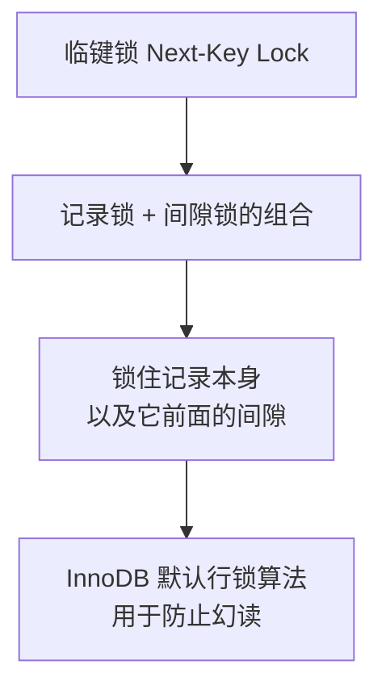

# 行级锁：临键锁

上一篇讲了间隙锁，这一篇讲它的组合形态临键锁，顺带记录锁。面试问 InnoDB 行级锁，标准答案就是这三件套：行锁、间隙锁、临键锁。这一篇要讲清临键锁的构成（行加前面的间隙）、范围查询为什么会加临键锁，以及那个重要的优化：等值查询命中的第一条记录，临键锁会退化成行锁。

## 先给结论

1. 临键锁是间隙锁加行锁的组合：一条记录加上它前面的间隙，合起来叫一个临键锁。
2. 范围查询（如 `id >= 8`）会加临键锁，锁住范围内每条记录及其前面的间隙。
3. 优化：遇到等值查询，对于第一条等值查询匹配到的记录，临键锁会优化成行锁，只锁记录，不带前面的间隙。
4. 验证手段：往被锁间隙里 insert 会失败，更新被锁记录会失败；`performance_schema.data_locks` 能直接看到锁模式。
5. 本讲例子都建立在主键索引上，二级索引上的行锁、间隙锁、临键锁更复杂，面试掌握主键索引这套够用。



## 是什么

临键锁和记录锁放在一块讲。还是先运行红色事务的三条 SQL，这回用 `select for update` 加锁，加的就不是单纯的间隙锁了，这回主要加的是临键锁。记住一个规律：一般做范围查询，就会加临键锁。

什么是临键锁？就是前面的间隙锁加上后面的行锁，合在一块。对照原始数据看划分方式：正无穷大到 12 之前的间隙，加上 12 这条记录，称为一个临键锁；12 这条记录加上它到 8 之前的那个间隙，是一个临键锁；8 这条记录加上它到 4 之间的间隙，也是一个临键锁。总之，一条记录加上它之前的间隙，合在一起叫临键锁。

## 深入细节

### 建测试数据

```sql
create table t (id int primary key, name varchar(10), age int, key (name));
```

```sql
insert into t values(1,'zhangsan',18);
insert into t values(2,'lisi',20);
insert into t values(3,'wangwu',21);
insert into t values(4,'zhangsan',17);
insert into t values(8,'zhang',100);
insert into t values(12,'zhang',100);
```

### id >= 8 加了哪些锁

```sql
select * from t where id >= 8 for update;
select object_schema,object_name,index_name,lock_type,lock_mode,lock_data from performance_schema.data_locks where object_name='t';
select * from t;
```

通过调试语句可以看出加了哪些临键锁。查询结果里有一条特殊的记录，可以认为它就是正无穷大：加了一个正无穷大记录以及它前面的间隙，作为一个临键锁。还有 12 这条记录跟它前面那个间隙作为一个临键锁。最后一个应该是 8 跟它前面的间隙作为临键锁，但是 8 这边做了优化。

什么优化？如果查询条件里遇到等值查询，对于第一条等值查询匹配到的记录，就会把临键锁优化成一个行锁。从 data_locks 里能看出区别：有的锁模式光一个排他叉，后面不带 gap，说明间隙被优化掉了，它变成了一个单纯的行锁，只锁住了 8，8 之前的那个间隙就不包括了。

### 逐条验证

再拿两条更新语句和三条插入语句验证：

```sql
update t set age=100 where id = 8;
update t set age=100 where id = 12;
```

```sql
insert into t values(7,'aaa',18);
insert into t values(10,'aaa',18);
insert into t values(13,'aaa',18);
```

先看 8 之前的间隙，也就是往 7 的位置插入一条记录。insert 执行成功了，说明并没有锁住 8 跟 4 之间的那个间隙。所以 8 只是一个行锁，不是临键锁，不包括前面的间隙。

再更新 8 行不行？不行。8 的行锁被前面窗口的事务锁着，第二个窗口想更新 8 会失败。

再测 12 的临键锁，它包括 12 本身和 12 跟 8 之间的间隙。往这个间隙插入一条记录，来一个 10，可以看到插入不行。修改 12 本身呢？也不行，也被锁住了。

最后往 12 后面的位置，也就是正无穷大到 12 之间，加一条记录，来一个 13，也不行。所以这一段相当于被正无穷大到 12 之间的临键锁挡住了。

### 小结

临键锁就是行加上它前面的间隙。有些情况下它会被优化成行锁。这里只展开了主键索引上的临键锁、间隙锁和行锁的例子；如果是二级索引，情况会更复杂。面试掌握到这里够用。

## 面试怎么答

回答时可以这样组织：

1. 定义：临键锁是行锁加前间隙锁的组合，锁的是前开后闭区间。
2. 触发场景：范围查询会加临键锁，范围内每条记录连同其前面的间隙一起锁。
3. 优化点：等值查询命中的第一条记录，临键锁退化为行锁，只锁记录不锁间隙。
4. 验证：data_locks 里看锁模式，带 gap 和不带 gap 的差别一目了然；往间隙 insert、更新记录分别验证锁的范围。
5. 边界说明：以上是主键索引口径，二级索引更复杂。

常见追问：

- **问：怎么证明 8 前面那个间隙没锁？** 往 7 的位置 insert 成功，说明 4 和 8 之间的间隙没被锁住。
- **问：为什么 8 是行锁而 12 是临键锁？** 8 是等值查询条件 `id >= 8` 中第一条匹配的记录，命中优化，临键锁退化为行锁；12 不满足优化条件，保持临键锁。
- **问：supremum 是什么？** 可以认为就是正无穷大记录，数据里最后一条记录到正无穷之间的间隙，由它和它的前间隙组成一个临键锁。

## 常见误区

- **误区一：范围查询只锁记录。** 锁的是记录加前面的间隙，临键锁就是干这个的。
- **误区二：所有记录都加一样锁。** 等值查询第一条匹配记录会优化成行锁，间隙不被锁。
- **误区三：二级索引和主键索引锁法一样。** 二级索引上的锁更复杂，面试回答时主动说明口径，避免以偏概全。
