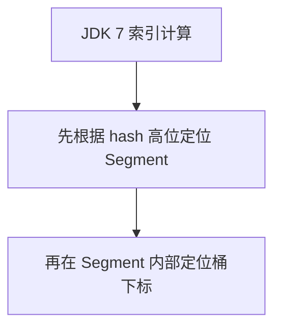

# ConcurrentHashMap v7：演示索引计算

搞清楚一个 key 放进 ConcurrentHashMap 之后到底落在哪个 Segment、哪个桶，是理解分段锁的最后一公里。源码里是一串移位加按位与，初学者容易被绕晕；这篇用可视化的方式把规则讲透：Segment 下标取二次哈希值的高位，小数组索引取低位，取几位由容量是 2 的几次方决定。

## 先给结论

1. 定位分两步：先算 key 落在哪个 Segment，再算落在该 Segment 内小数组的哪个索引。
2. 计算前要先做二次哈希：一次哈希对 2 的 n 次幂容量分散性不够，二次哈希（移位配合异或）让分布更均匀。
3. Segment 下标取二次哈希值的高几位：Segment 容量是 2 的几次方，就取高几位。容量 16（2 的 4 次方）取高四位，容量 32（2 的 5 次方）取高五位。
4. 小数组索引取二次哈希值的最低位：小数组容量是 2 的几次方，就看低几位。
5. 位运算（移位、按位与）是为目的服务的，先理解作者意图，再去看代码，就不会被绕晕。

## 是什么

有一个 key，比如 `a`，怎么知道把它放在 Segment 数组的哪个位置？计算规则可以去查资料，但资料基本都从源码角度讲：先计算 key 的二次哈希值，然后是移位操作、按位与操作，最后算出 Segment 下标。问题是从源码角度容易把初学者弄晕，因为移位、按位与大家都不是特别熟悉。

换个角度，从可视化来理解，其实非常简单。

## 深入细节

### 二次哈希先做

都知道 `a` 的原始哈希码是 97。二次哈希码的计算比较复杂，需要用移位配合一些异或，总之目的是让哈希分布得更均匀。因为容量是 2 的 n 次幂这种容量，对哈希的分散性其实并不是很好，所以一次哈希不够，还要做一次二次哈希。

### Segment 下标取高位

`a` 的二次哈希结果是 -873690096。这个数计算 Segment 下标特别简单：Segment 数组的容量如果是 2 的 4 次方，也就是 16，那就找这个数字的高四位。

-873690096 的高四位是 1100，换算成十进制是 12，因为第一个 1 对应 8，第二个 1 对应 4，8 加 4 等于 12。所以 `a` 就是按二次哈希值的高四位来定位，放到 Segment 12。验证一下，确实放到了 12。

再试 `b`。`b` 的原始哈希值是 98，二次哈希值是 -1511672622。同样因为 Segment 容量是 2 的 4 次方，找它的高四位 1010：第一个 1 是 8，第二个 1 是 2，8 加 2 等于 10。试一下，果然放到了 10。

再试一个不一样容量的。Segment 容量选 32，32 是 2 的 5 次方，那就取高五位。还是 `b`，它算出来是 -1511672622，高五位 10100：第一个 1 是 16，第二个 1 是 4，16 加 4 等于 20。put 一下，果然跑到了 20。

这就是 Segment 位置的算法。作者（ConcurrentHashMap 的设计者）的意图，就是把二次哈希的高五位或者高四位作为最终下标。移位、按位与这些运算，是为了达到这个目的服务的。先有目的，才有这样的代码，不是先有代码再去猜意思。

### 小数组索引取低位

小数组索引的计算更简单：看小数组是 2 的几次方，取二次哈希值的最低位（对应的低几位）来决定索引。

比如小数组容量是 2 的一次方，也就是 2，那就看二次哈希值的最低位。`a` 的二次哈希值是 -873690096，这个数最后一位是 0，所以它放到小数组的 0 号位置。

合起来看 `a`：高位部分决定它在哪个 Segment，低位部分决定它在小数组里的索引。前面演示过，`a` 放在 Segment 12、小数组索引 0；如果把 Segment 容量改成 32，高五位算出来是 25，它就放到 Segment 25，小数组还是放到 0。

## 面试怎么答

回答时可以这样组织：

1. 两步定位：先定 Segment，再定桶。
2. 计算前先做二次哈希，解决 2 的 n 次幂容量分散性不好的问题，让分布更均匀。
3. Segment 下标取二次哈希高位，高几位由 Segment 容量是 2 的几次方决定（16 取四位，32 取五位）。
4. 小数组索引取二次哈希低位，同样看小数组容量是 2 的几次方。
5. 点题：位运算是实现手段，理解「高位定段、低位定桶」的意图比背位运算表达式重要。

常见追问：

- **问：为什么还要二次哈希？** 容量是 2 的 n 次幂时，一次哈希的低位分布可能不够均匀，二次哈希通过移位加异或让高低位都参与混合，分布更均匀。
- **问：源码里那些移位和按位与怎么看？** 它们就是在执行「取高几位、取低几位」这个规则，比如 `(hash >>> segmentShift) & segmentMask` 之类，目的是把上文的意图落地。
- **问：换成容量 32 索引怎么变？** 取高位从 4 位变 5 位，原来在 12 的 key 会重新分布到 0 到 31 之间，比如 `a` 会到 25。

## 常见误区

- **误区一：索引是连续算出来的复杂公式，只能死记。** 规则就是高位定 Segment、低位定桶，容量决定取几位。
- **误区二：一次哈希就够了。** 2 的 n 次幂容量对一次哈希分散性不好，才有二次哈希。
- **误区三：Segment 下标和小数组索引用的是同一段位。** 一个取高位、一个取低位，分工明确。
