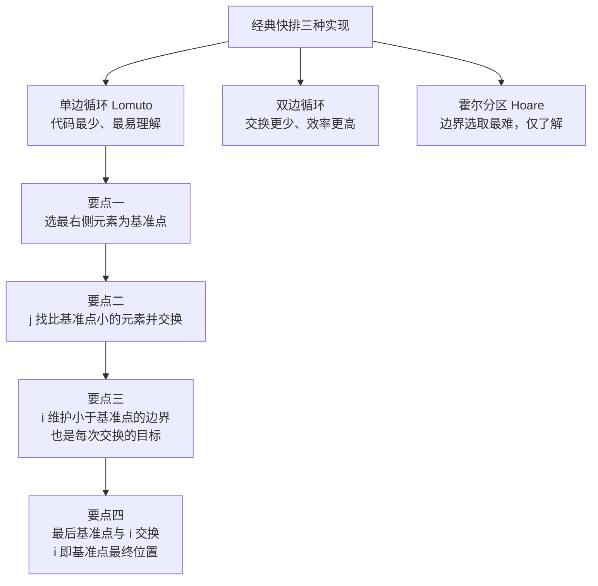

# 快速排序：单边循环（Lomuto）演示

快排的实现五花八门，不同算法书上的代码往往不一样，初学者最大的困惑就是「到底学哪一种」。这篇先给快排实现方式画个全景，再聚焦最值得先学的单边循环（Lomuto 分区方案）：基准点选谁、i 和 j 两个变量各干什么、一轮分区怎么收尾。这套要点也是面试手写快排的答题骨架。

## 先给结论

1. 经典快排实现有三种：单边循环（Lomuto 分区）、双边循环、霍尔分区（Hoare）。课程重点讲前两种。
2. 单边循环是众多快排版本中代码量最少、最容易理解的一种，推荐初学者先学；面试时代码量越少，出错机会越少。
3. 双边循环实现更复杂、理解难度略高，但平均交换次数更少，效率更高，出自经典算法书（《算法》第四版）。
4. 霍尔分区代码与双边循环几乎一样，区别在分区边界的选取，最难理解，不推荐一上来就学；Hoare 是人名，他是快排算法的创始人。
5. 单边循环四要点：选最右侧元素为基准点；j 负责找比基准点小的元素并交换；i 维护小于基准点的边界，也是每次交换的目标；最后基准点与 i 交换，i 的位置即基准点最终正确位置。



## 是什么

快排的实现方式可以说是五花八门，打开的算法书籍不一样，里面的快排实现代码很可能也不一样。比较经典的有三种：单边快排、双边快排，还有一个叫霍尔分区。课程重点讲解前两种，霍尔分区了解一下就可以。

先粗略比较。单边循环快排，英文名罗姆托分区方案（Lomuto），是众多快排版本中代码量最少也最容易理解的一种版本，推荐初学者学习，因为代码量少、不容易写错。有了基础之后再学双边循环快排。从名字上就能看出来一个单一个双，双边循环在代码实现上更复杂，理解难度也比单边循环高一点，但它的优点是效率更高，平均来讲交换次数比单边循环快排更少。双边循环出自一本经典算法书第四版。最后霍尔分区方案，代码跟双边循环几乎一样，区别主要在于分区边界的选取，它也是最难理解的，不推荐一上来就学。

提霍尔分区是因为霍尔（Hoare）其实是个人名，他是快排算法的创始人。这些资料主要依据英文版维基百科的 quick sort 条目，里面提到了两种分区算法：第一种是 Lomuto 分区方法，也就是单边循环快排，是最简单的一种；第二种是霍尔分区方案，代码更多一些，它没有提双边循环。霍尔是英国计算机科学家，在 1959 到 1960 年间发明了快排算法。

## 深入细节

### 基准点选取

每种快排实现都要选一个基准点。单边快排在基准点的选取上，一般选择最右侧的元素作为基准点元素。比如数组最右侧的元素是 4，就选 4 作为基准点，图上 PV 箭头指向的元素就是基准点元素。

### j 变量：找小的

还要理解两个变量，i 和 j。

j 的作用非常简单：不断向右移动，初始在最左侧。干什么？找到比基准点小的元素。比如一开始 j 在 0 位置，这个元素比基准点大，那它就不管，跳过去，移动到后一个元素；这个元素 3 比基准点小，它就找到了。找到小的元素，它就与 i 变量进行一个交换，达到的效果就是把小的元素尽量交换到左边。这就是 j 的作用：负责找到比基准点小的元素，一旦找到了就与 i 进行交换。

再看后面的过程：5 比 4 大不用动，7 比 4 大不用动，接下来 2 比 4 小，又找到一个比基准点小的元素，把它交换到左边。继续找，找到 1 这个元素，又比基准点小，继续把它交换到左边。这就是 j 的职责。

### i 变量：维护边界

i 这个指针维护了小于基准点元素的一个边界。从图上可以很明显地看出来：i 指向的位置，它的左侧总是比基准点元素小的元素，而 i 本身所指向的元素就是待交换的元素。

j 一旦找到了比基准点小的元素，与 i 一交换，就意味着 i 是下一次要被交换的那个指针。i 有两种含义：一种含义是它的左侧都是比基准点小的元素，我们的目的就是把小的元素交换到 i 的左边；另一个含义是它也是每次交换时的目标。

### 收尾：基准点与 i 交换

一轮分区到这里还没结束，因为基准点元素也要再做一次交换，把它交换到中间的位置，才能保证大的元素放在它的右边。所以最后一次交换发生在基准点元素与 i 元素之间。基准点跟 i 做一次交换之后，就可以把刚开始比基准点大的元素交换到 i 的右侧。这样 i 左边的是比基准点小的，i 右侧的都是比基准点大的，一轮分区就完成了。

等一轮分区完了以后，i 所指向的位置就是基准点元素所在的最终正确的位置。因为最后一次交换之后，基准点元素左边的都比它小，右边的都比它大，它的位置已经固定死了。

### 四要点总结

第一，一般选择最右侧的元素作为基准点元素。第二，j 负责去找小的元素，找到了就与 i 去交换。第三，i 是每次交换的目标索引，它的左侧总是维护了比基准点小的元素，是一个小于基准点元素的边界。第四，最后基准点元素还要与 i 元素交换，交换后 i 的位置就是基准点的最终正确位置。

单边循环的 partition 代码长这样：

```java
// 单边循环法（Lomuto）
private static int partition(int[] a, int l, int h) {
    int pv = a[h];               // 基准点取最右侧元素
    int i = l;                    // i 维护小于基准点的边界
    for (int j = l; j < h; j++) {  // j 负责找比基准点小的元素
        if (a[j] < pv) {
            if (i != j) {
                swap(a, i, j);    // 小的换到 i 边界位置
            }
            i++;
        }
    }
    if (i != h) {
        swap(a, h, i);           // 最后基准点与 i 交换，基准点归位
    }
    // 返回值代表基准点元素所在的正确索引，用它确定下一轮分区的边界
    return i;
}
```

## 面试怎么答

回答时可以这样组织：

1. 先交代选型：经典实现有单边循环（Lomuto）、双边循环、霍尔分区三种，初学者和面试推荐单边循环，代码量少、不易错。
2. 讲基准点：选最右侧元素。
3. 讲双指针分工：j 从左往右找比基准点小的元素，找到就与 i 交换；i 维护小于基准点的边界，兼作交换目标。
4. 讲收尾：j 走完后基准点与 i 交换，i 即基准点最终位置，左边小、右边大，一轮分区完成，然后对左右子区间递归。

常见追问：

- **问：为什么面试推荐单边循环？** Lomuto 代码量最少、逻辑直白，考场上写得快、错得少；时间和稳定性允许再秀双边循环。
- **问：双边循环好在哪？** 平均交换次数更少，效率更高，代价是实现和理解更复杂。
- **问：霍尔分区和双边循环的区别？** 代码几乎一样，区别在分区边界的选取；Hoare 是快排创始人的名字。
- **问：基准点必须选最右侧吗？** 单边循环的经典写法选最右侧，选其他位置需要先换到边缘，面试按经典写法来最稳。

## 常见误区

- **误区一：一轮分区结束基准点就归位了，但其他元素也有序了。** 只有基准点一个元素位置确定，左右两侧仍无序，靠递归处理。
- **误区二：i 和 j 职责一样。** j 负责找小的，i 负责标记边界和接收交换，分工完全不同。
- **误区三：基准点和 j 交换。** 最后一次交换是基准点和 i，不是 j。
