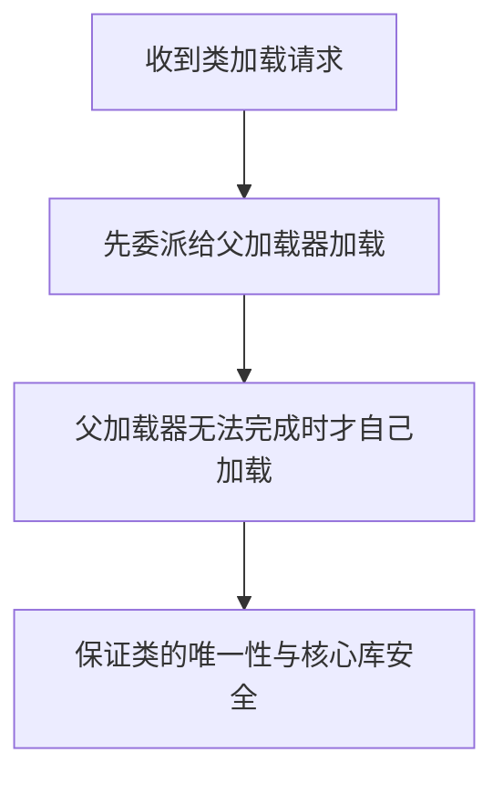

# 类加载：双亲委派

双亲委派是类加载部分的压轴概念，面试问「类加载过程」基本必追这一句。这道题要答好两层：一是委派规则本身（上级能加载就上级加载、上级找不到下级才有资格），二是以 JDK 8 为例走一遍加载器层级和扫描范围，最好再带 String 和自己写的类两个对照例子。能做到这些，回答就完整了。

## 先给结论

1. 双亲委派模式指类加载器工作时的一种方式：优先委派上级类加载器对这个类进行加载。
2. 规则一：如果上级类加载器能找到类，就由上级自己加载，加载后该类对下级类加载器也可见，下级不用重复加载。
3. 规则二：如果上级类加载器找不到这个类，下级类加载器才有资格执行加载动作。
4. JDK 8 的层级：启动类加载器（Bootstrap）在最上级，中间是扩展类加载器（Extension），最下面是应用程序类加载器（Application），自定义类加载器本例不涉及。
5. 可见性：上级加载的类对下级可见，下级加载的类对上级不可见。



## 是什么

双亲委派模式，是指类加载器工作时的一种方式：优先委派上级类加载器对这个类进行加载。如果上级类加载器能找到类，那就由上级自己去加载；加载后呢，这个类对下级的类加载器也是可见的，所以下级类加载器就不用重复去加载这个类。如果上级类加载器找不到这个类，那下级类加载器才有资格来执行加载的动作。

### JDK 8 的加载器层级

以 JDK 8 为例，类加载器之间是有层级关系的。最上级的类加载器叫 Bootstrap ClassLoader，翻译过来叫启动类加载器；中间这个叫做扩展类加载器；最下面这个是我们熟悉的应用程序类加载器。自定义类加载器暂时不用管，这个例子中并不涉及。

这些类加载器一是有层级关系，二是它们扫描的类的范围也不一样：

| 名称 | 加载的类 | 说明 |
| :--- | :--- | :--- |
| Bootstrap ClassLoader | `JAVA_HOME/jre/lib` | 无法直接访问 |
| Extension ClassLoader | `JAVA_HOME/jre/lib/ext` | 上级为 Bootstrap，显示为 null |
| Application ClassLoader | `classpath` | 上级为 Extension |
| 自定义类加载器 | 自定义 | 上级为 Application |

启动类加载器只会到 Java Home 下 JRE 的 lib 目录下去找，并且只找 rt.jar（白话：JDK 核心类库包，含 String、Object 等基础类）和 tools.jar 这两个 jar 包中的类。扩展类加载器是到 ext 目录下找这个目录下的 jar 包和类。应用程序类加载器则是到自己的 classpath 下去找这些类。

表格里的三级关系可以写代码亲眼观察一次。JDK 9 之后「扩展类加载器」改名成了平台类加载器（Platform），位置上仍然是 Application 的上级、Bootstrap 的下级，所以对照关系不变。下面这段取自课件 `day03/loader/TestJdk9ClassLoader`，它先拿到当前类的加载器，再顺着 `getParent()` 一路向上，把每层加载器负责的模块包打印出来：

```java
package day03.loader;

import jdk.internal.loader.*;

import java.lang.reflect.Field;
import java.util.ArrayList;
import java.util.Comparator;
import java.util.List;
import java.util.Map;

// --add-opens java.base/jdk.internal.loader=ALL-UNNAMED
public class TestJdk9ClassLoader {
    public static void main(String[] args) {
        ClassLoader appLoader = TestJdk9ClassLoader.class.getClassLoader();
        System.out.println(appLoader + "============>");
        showPackages(appLoader);

        ClassLoader platformLoader = appLoader.getParent();
        System.out.println(platformLoader + "============>");
        showPackages(platformLoader);

        ClassLoader bootLoader = getBootLoader(platformLoader);
        System.out.println(bootLoader + "============>");
        showPackages(bootLoader);
    }

    private static ClassLoader getBootLoader(ClassLoader platformLoader) {
        try {
            Field parent = BuiltinClassLoader.class.getDeclaredField("parent");
            parent.setAccessible(true);
            return (ClassLoader) parent.get(platformLoader);
        } catch (Exception e) {
            throw new RuntimeException(e);
        }
    }

    private static void showPackages(ClassLoader loader) {
        try {
            Field nameToModule = BuiltinClassLoader.class.getDeclaredField("nameToModule");
            nameToModule.setAccessible(true);

            Map<String, Object> map = (Map<String, Object>) nameToModule.get(loader);
            List<String> list = new ArrayList<>(map.keySet());
            list.sort(Comparator.naturalOrder());
            for (int i = 0; i < list.size(); i++) {
                System.out.print(list.get(i));
                System.out.print("\t");
                if ((i + 1) % 6 == 0 || i == list.size() - 1) {
                    System.out.println();
                }
            }
            System.out.println();
        } catch (Exception e) {
            e.printStackTrace();
        }
    }
}
```

三次 `============>` 的输出就是三层加载器，跟着它后面的包名列表就是各自负责的范围，跟上面表格一一对应。两个细节值得记住：一是走到最上层时代码里没有 `getParent()`，而是反射去取 `BuiltinClassLoader` 的 `parent` 字段，因为启动类加载器拿不到直接的 Java 引用（JDK 8 里 `getParent()` 返回 null 是同一个原因）；二是文件第一行的 `--add-opens` 是运行前必须加的 JVM 参数，否则反射访问 `jdk.internal.loader` 包会被模块系统拦下来。

## 深入细节

### 例子一：加载 String.class

假设应用程序类加载器中需要用到一个类，字符串类。字符串类在应用程序类加载器的 classpath 下其实没有，所以自然而然地就应该交由它的上一级类加载器去加载。

流程是这样的：应用程序类加载器先问问它的上级，扩展类加载器，说请问您加载过 String.class 吗。但是扩展类加载器也没这个权利，它也得再问问它的老大，启动类加载器，问您加载过 String.class 吗。启动类加载器先看内存里有没有，没有的话就去 lib 目录下的 rt.jar 和 tools.jar 这两个 jar 包里找，看有没有这样一个文件。如果找到了，它就执行类加载，把类加载到内存中来。

它既然加载了，就会告诉它的两个下级：你们都不用加载了，就用我这个 String.class 就可以了。上级类加载器加载的类对于下级都是可见的，下面的加载器就可以共享使用，不用重复加载。

### 例子二：加载 Student.class

又编写了一个自己写的 Student.class，它位于自己的 classpath，在 JDK 的这两个目录下可是没有。但是也得遵循双亲委派模式。第一次用到 Student.class 的时候，由应用程序类加载器进行加载，但还是刚才那个流程：先问上级，问您加载过 Student.class 没有。上级又问它的上级，问启动类加载器。启动类加载器会去 rt.jar 和 tools.jar 里找，看有没有 Student.class，当然找不到。于是说，我不用加载了，交给你们去吧，把权力下放给扩展类加载器。扩展类加载器在自己的目录下找了圈也没发现 Student.class，好，它把权力再次下放给应用程序类加载器。应用程序类加载器在自己的 classpath 里肯定可以找到 Student.class，所以它就可以完成 Student.class 的类加载动作。

这里有个要注意的点：下级类加载器加载的类，对于上层的类加载器是不可见的。也就是上级对下级是可见，但下级对上级加载的类是不可见的。

顺着这条规则往下追问，就到了双亲委派的真正落点：**类的唯一性**。课件 `day03/loader/TestAppClassLoader` 里有一个现成的对照实验，它先用反射造出一个应用程序类加载器，然后用同一个 loader 反复加载同一个类：

```java
package day03.loader;

import jdk.internal.loader.BuiltinClassLoader;
import jdk.internal.loader.ClassLoaders;
import jdk.internal.loader.URLClassPath;

import java.lang.reflect.Constructor;
import java.lang.reflect.InvocationTargetException;

public class TestAppClassLoader {
    public static void main(String[] args) throws Exception{
        ClassLoader loader = newAppClassLoader();
        System.out.println(loader.getParent());
        /*Class<?> clazz1 = Class.forName("day03.loader.Student", true, loader);
        Class<?> clazz2 = Class.forName("day03.loader.Student", true, loader);
        Class<?> clazz3 = Student.class;
        clazz1.getDeclaredConstructor().newInstance();
        System.out.println(new Student());
        System.out.println(clazz1 == clazz2);
        System.out.println(clazz1 == clazz3);*/

        Class.forName("day03.loader.Student", true, loader);
    }

    public static ClassLoader newAppClassLoader() {
        try {
            Class<?> clazz = Class.forName("jdk.internal.loader.ClassLoaders$AppClassLoader");
            Constructor<?> cons = clazz.getDeclaredConstructor(BuiltinClassLoader.class, URLClassPath.class);
            cons.setAccessible(true);
            ClassLoader loader = ClassLoaders.platformClassLoader();
            ClassLoader o = (ClassLoader) cons.newInstance(null, getUrlClassPath());
            return o;
        } catch (Exception e) {
            throw new RuntimeException(e);
        }
    }

    private static URLClassPath getUrlClassPath() throws NoSuchMethodException, InstantiationException, IllegalAccessException, InvocationTargetException {
        Constructor<URLClassPath> cons = URLClassPath.class.getDeclaredConstructor(String.class, boolean.class);
        cons.setAccessible(true);
        return cons.newInstance(System.getProperty("java.class.path"), false);
    }
}
```

`loader.getParent()` 打印出来的就是它的上级加载器。真正要看的是被注释掉的那几行：`clazz1` 和 `clazz2` 由**同一个** loader 加载同一个类得到，所以 `clazz1 == clazz2` 必然成立，同一个类加载器不会把同一个类加载两遍；而 `clazz3` 来自 `Student.class` 字面量，它由系统默认的应用程序类加载器加载，跟这里手工 new 出来的 loader 未必是同一个实例，`clazz1 == clazz3` 的结果也随之改变。这正好呼应面试里常被追问的一句：类的唯一性由「类名 + 加载它的类加载器」共同决定，不是只看类名。

### 三个阶段的回顾

顺带把类加载的三个阶段放在这个语境里回顾一遍，PPT 上的表述是：加载，将类的字节码载入方法区，并创建 `java.lang.Class` 对象；链接，包含验证、准备、解析三个步骤；初始化，执行静态代码块和非 `final` 静态变量的赋值。

## 面试怎么答

回答时可以这样组织：

1. 定义：双亲委派就是优先委派上级加载，上级能找到就上级加载，找不到下级才有资格加载。
2. 层级：Bootstrap 管 `JAVA_HOME/jre/lib` 下的 rt.jar、tools.jar；Extension 管 `jre/lib/ext`；Application 管 classpath。
3. 走例子：String.class 一路委派到 Bootstrap 被加载，下级共享；自己写的 Student.class 一路下放回 Application 才加载成功。
4. 可见性：上级加载的对下级可见，下级加载的对上级不可见。

常见追问：

- **问：为什么要双亲委派？** 保证核心类（比如 String）由统一的加载器加载，避免重复加载和核心类被篡改，安全上也有意义。
- **问：Bootstrap 不是 Java 写的，怎么拿到它？** 它无法直接访问，代码里通过 `null` 或相关 API 间接协作，表格里 Extension 的上级显示为 null 就是这个原因。
- **问：怎么打破双亲委派？** 自定义类加载器重写 `loadClass` 的委派逻辑，像 Tomcat、SPI 这类场景就是这么做的。

## 常见误区

- **误区一：每次加载都从当前加载器自己找。** 双亲委派是先问上级，找不到才轮到自己。
- **误区二：上级加载的类下级不能共享。** 恰恰相反，上级加载的类对下级可见，正是为了不重复加载。
- **误区三：下级加载的类上级也能用。** 下级加载的类对上层不可见，可见性是单向的。
- **误区四：启动类加载器扫整个 JRE。** 它只扫 `JAVA_HOME/jre/lib` 下的 rt.jar 和 tools.jar。
