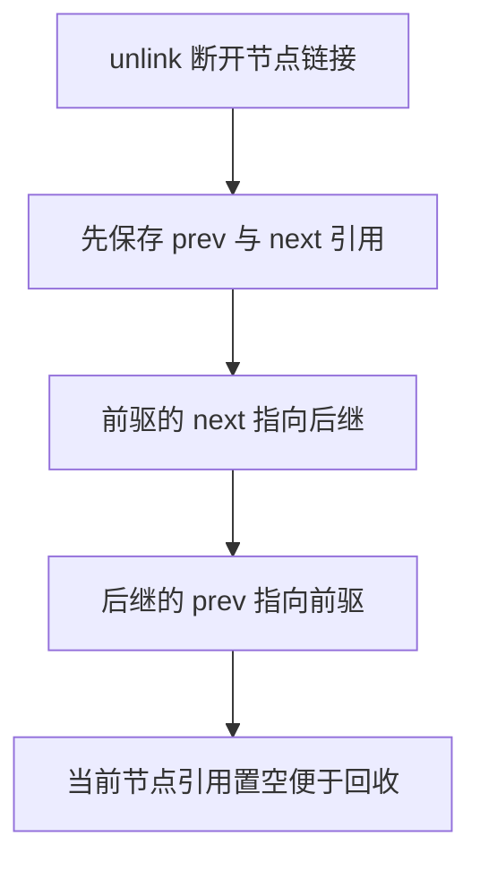

# LRU 实现：断开节点链接

LRU cache 的链表实现一般以编程题形式考察，让你现场写代码，所以得重视起来。动手写增删改之前，先要掌握几个链表基本操作，第一个就是如何断开节点的链接。这个操作将来在淘汰节点、移动节点时反复用到，写不顺的时候先把图画出来，对着图写代码一目了然。

## 先给结论

1. 基于链表的 LRU cache 通常以编程题形式考察，核心结构是双向链表加 HashMap。
2. 断开节点链接的逻辑就两条指针改动：上一个节点的 next 指向当前节点的 next，下一个节点的 prev 指向当前节点的 prev。
3. 两条指头改完，上下游都不再指向当前节点，当前节点即从链表中断开。
4. 节点类包含 prev、next 两个指针和 key、value 两个数据。
5. 断开时可以先取 prev 和 next 两个局部引用，再改指针，避免顺序错乱。



## 是什么

链表中每个节点都有自己的 previous 上一个节点、next 下一个节点，当然还有自己的键和值：

```java
// Node类定义
static class Node {
    Node prev;
    Node next;
    String key;
    Object value;
    public Node(String key, Object value) {
        this.key = key;
        this.value = value;
    }
}
```

LruCache 的构造里会准备容量上限、带 Head 和 Tail 两个哨兵节点的链表，以及一个 HashMap：

```java
// LruCache类构造函数
public LruCache(int limit) {
    this.limit = Math.max(limit, 2);
    this.head = new Node("Head", null);
    this.tail = new Node("Tail", null);
    this.map = new HashMap<>();
}
```

## 深入细节

### 断开节点的逻辑

假设链表中有三个节点，想把中间那个断开。做法是：先找到它的上一个节点，通过 previous 找到上一个节点，上一个节点的 next 指向当前节点的 next；然后再找到它的下一个，当前节点的下一个，它的 previous 应该指向当前节点的 previous。

把上一个节点的 next 跟下一个节点的 previous 都改了，它们的指向就不再指向当前这个节点，当前节点就从列表中断开了。

### 写成 unlink 方法

对照图来写。方法名叫 unlink，link 是链接的意思，unlink 就是断开链接。要给它传一个参数，就是要断开哪个节点，这里用 node 代表当前要断开的节点。

根据上面的分析，断开的逻辑是：先找到它的上一个节点，也就是 node.prev；上一个节点的 next 要指向当前节点的 next，也就是 node.next。再找下一个节点，也就是 node.next，它的 previous 要指向当前节点的 previous，也就是 node.prev。

```java
void unlink(Node node) {
    Node prev = node.prev;
    Node next = node.next;
    prev.next = next;
    next.prev = prev;
}
```

红色箭头都指向同一个目标：上一个节点的 next 指向当前节点的 next。蓝色箭头则把下一个节点的 previous 指向当前节点的 previous。这样 unlink 就写好了。

这是一个链表的基本操作，大家要会。自己对着图一定要能把它弄出来，将来万一让你编程的时候想不起来了，可以拿张纸先画图，画了图之后一目了然。

## 面试怎么答

回答时可以这样组织：

1. 先交代结构：双向链表加 HashMap，链表维护使用顺序，HashMap 做 key 到节点的快速定位。
2. 断开操作：unlink 一个节点只需要两步，前一个的 next 指向后一个，后一个的 prev 指向前一个。
3. 强调先存引用再改指针，防止先把某一端改掉、另一端的引用丢失。
4. 点出这个操作在 LRU 里的用途：淘汰时断开尾部节点、访问时把节点挪到头部，都靠它。

常见追问：

- **问：为什么用双向链表？** 断开和插入都需要同时知道前后节点，单向链表拿不到前驱，没法 O(1) 完成 unlink。
- **问：Head 和 Tail 哨兵节点有什么用？** 让头插、尾删不用判空，边界情况更少，代码更稳。
- **问：断开后要把节点自己的指针置空吗？** 主干逻辑不置空也能完成断开；有的实现会顺手清理，帮助 GC，属于可选优化。

## 常见误区

- **误区一：只改一边指针。** 只改 prev.next 不改 next.prev，链表会残留下一半链接，遍历出错。
- **误区二：边改边取引用。** 先把某一端改掉再去取另一端的引用，容易拿到已经变化的值，先把 prev、next 存起来再改最稳。
- **误区三：这类操作靠背。** 现场画个三段节点的图，两条箭头一画，代码自然就写出来了。
