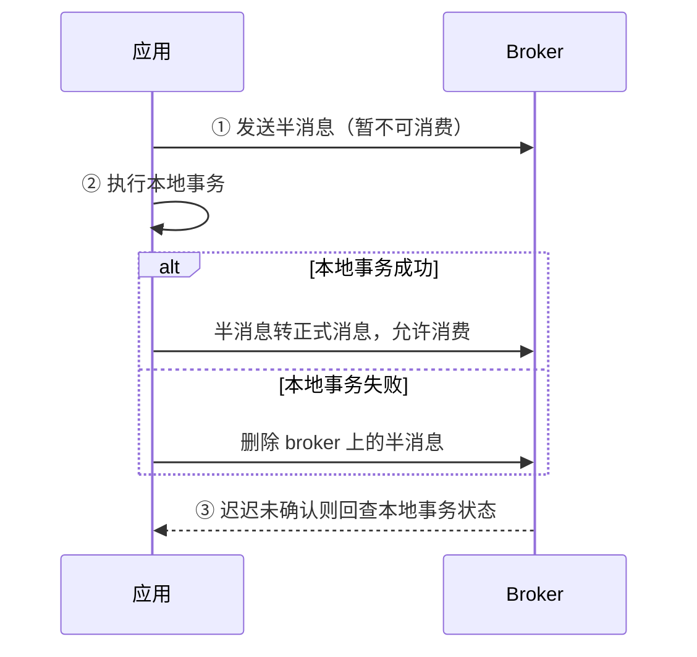

# 分布式事务：消息队列（最终一致性方案）

分布式事务的第三种经典方案是基于可靠性消息的最终一致性方案。面试问分布式事务选型，这道题是分水岭：前面两种（2PC、TCC）是同步方案，性能和保护之间有明显取舍，而这种异步方案在互联网业务里用得最多。答好它的关键，是讲清「为什么可以异步」以及「本地事务和消息投递的原子性怎么保证」。

## 先给结论

1. 第三种方案是基于可靠性消息的最终一致性方案，靠消息中间件（在应用间异步传递消息的中间服务，如 RocketMQ、Kafka，解耦生产与消费）实现。
2. 2PC 和 TCC 都属于同步方案：多一个事务参与者，只要有一个没返回 OK，其他的都得等。
3. 实际开发中更合适、更合理的是异步方案：下单、支付、扣库存、加积分这类操作对实时性要求并不高，只要最终一致、最终保证原子性就可以。
4. 关键点：只要保证「下单操作」和「把消息正确保存到消息中间件」这两个操作的原子性，问题就转变成本地事务与消息投递的原子性。
5. 以 RocketMQ 为例，用事务消息（半消息）加回查机制保证这个原子性；其他中间件有类似办法。

## 是什么

前面的 2PC、TCC 都属于同步方案：多一个事务的参与者，那么只要有一个没有返回 OK 这种信息，其他的都得等。

但实际开发中更合适、更合理的是异步方案。还是下单那个例子：下单操作、支付操作、扣减库存操作、增加积分操作，这四个操作实际上对实时性要求并不高，并不是说当下这四个操作大家都得一块成功。只要最终能保证一致，最终能保证原子性，是不是就可以了？

所以可以利用消息中间件，把下单成功的消息写入消息中间件里，将来支付服务、库存服务、积分服务跟消息中间件打交道，实现一个最终一致性就可以了。

## 深入细节

### 问题转化

看到一个很关键的地方：下单操作，跟把消息正确保存到消息中间件，这两个操作，只要保证它们的原子性就可以了。所以问题就转变成：本地事务（下单操作）跟消息投递（发送到消息中间件）的原子性。

这个具体的解决方案跟你用哪种消息中间件产品相关。

### RocketMQ 的方案

以 RocketMQ 为例。要保证下单（本地事务）跟消息发送是原子的，分几步。

第一步，把消息发给 Broker。Broker 是用来存储 RocketMQ 消息的一个节点。这个消息发过去以后（比如「下单成功」这个消息），它称之为事务消息，或者叫半消息，它是没办法被消费的。其他服务，比如支付服务、库存服务，还看不到这个消息，所以没法消费。

第二步，执行本地事务。

第三步分两种情况。如果本地事务执行成功，就可以把 Broker 里面的这个半消息转换成正式消息，这时候就允许正式消息被消费。如果本地事务执行过程中出问题、失败了，直接把这个 Broker 上的半消息删掉就行了。这样就保证了消息投递跟本地事务的原子性。

还有一种情况：Broker 迟迟收不到这个半消息的 Commit 或者 Rollback 信息，它不知道这个半消息是不是能变成正式消息，也不知道是不是要删除。这时候它有一个很关键的操作：回查本地事务状态。也就是由 Broker 主动调用订单服务，看一下本地事务到底是提交了还是回滚了。如果本地事务完成了，再根据它的实际状态处理：比如看到数据库里有这条订单，就认为成功了，让半消息转成正式消息；如果数据库里连这条订单都没有，说明有问题，把半消息删掉。

### 其他中间件

其他的消息中间件都有类似的办法，大家可以根据自己选择中间件的不同，去查阅它们相应的文档。

这就是第三种方案：基于可靠性消息（也就是消息队列，它能保证消息的完整性、可靠性）实现的最终一致性方案。

## 面试怎么答

回答时可以这样组织：

1. 先对比：2PC、TCC 是同步方案，参与者要互相等；消息队列方案是异步的最终一致性方案。
2. 讲适用场景：下单、支付、扣库存、加积分这类对实时性要求不高的链路，最终一致即可。
3. 讲核心转化：把分布式事务问题降解为「本地事务加消息投递」的原子性问题。
4. 讲 RocketMQ 实现：先发半消息（不可消费），再执行本地事务，成功则提交转正式消息，失败则删除；Broker 未收到确认时回查本地事务状态决定去向。

常见追问：

- **问：半消息是什么？** 发给 Broker 但还不能被消费的消息，等本地事务有结果再转正或删除，避免消息发了但本地事务没成。
- **问：为什么需要回查？** 本地事务执行方可能没给 Broker 回 commit/rollback（比如进程挂了），Broker 主动回查订单服务，按数据库实际状态决定半消息去向。
- **问：最终一致性牺牲了什么？** 牺牲了实时强一致，换取可用性和性能，中间态靠补偿和重试兜底。

## 常见误区

- **误区一：所有分布式事务都该用 2PC 或 TCC。** 对实时性要求不高的链路，异步最终一致性往往更合理，同步方案让参与者互相拖累。
- **误区二：先把消息发出去再执行本地事务。** 半消息先到但不能消费，本地事务有结果才决定它转正还是删除，顺序不能反。
- **误区三：消息队列天然就可靠。** 要靠可靠性消息机制（半消息、回查、重试）才能保证消息与本地事务的原子性，裸发消息会丢会乱。
