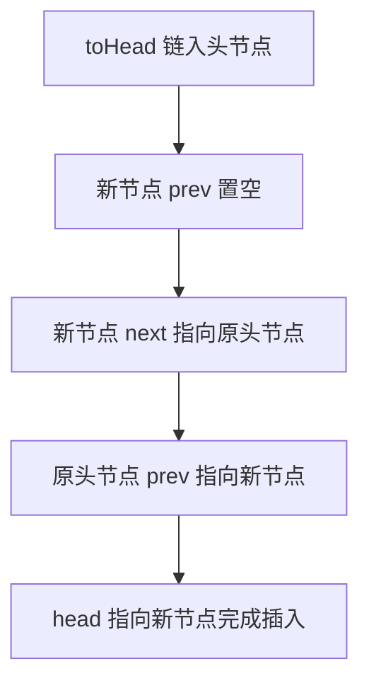

# LRU 实现：链入头节点

断开节点学会了，接着练插入。LRU cache 的插入位置是固定的：新节点总是放在 Head 之后，因为最近用过的要待在头部。这个操作一共改四个指针，顺序还有讲究，写反了会丢引用。上一篇讲断开，这一篇讲链入，两个操作合起来就是 LRU 里「移动节点」的完整套路。

## 先给结论

1. LRU cache 插入节点的位置固定：新节点总是放在 Head 之后。
2. 插入一个节点要改四个指针：新节点的 next、新节点的 prev、原首节点的 prev、Head 的 next。
3. 顺序有讲究：先改新节点自己的两个指针，再通过 Head.next 找到原首节点改它的 prev，最后改 Head.next。
4. 如果先把 Head.next 改掉，再找原首节点就得多绕几次，容易出错。
5. 插入完成后，新节点位于 Head 后方，成为链表中第一个有效节点。



## 是什么

先回顾断开节点：找到上一个节点，把它的 next 指针改一下；再找到下一个节点，把它的 previous 指针改一下。一共改两个指针，就能把中间的节点从链表里断开。

下面是插入节点。对于 LRU cache 来讲，插入节点的位置是固定的：新节点总是放在 Head 之后。原本 Head 链向 Node2，它们之间有链接关系。现在 Node1 是新加的，要把它加到 Head 和 Node2 之间。

一共要改变四个指针。

## 深入细节

### 四个指针

对照图看，红蓝粉绿四条线对应四次改动：

1. Node1 的 next 应该指向原来 Head 的 next，也就是 Node2。红色箭头表示，改第一次。
2. Node1 的 previous 是固定的，直接指向 Head。蓝色，改第二次。
3. 对于 Node2 来讲，原本它的 prev 指向 Head，现在 Node1 插进来了，Node2 的 previous 应该指向 Node1。粉色，改第三次。
4. 最后是 Head，它原本的 next 指向 Node2，现在要把 next 指向 Node1。绿色，改第四次。

### 顺序为什么重要

这个顺序最好按上面这个来。如果你先把 Head 的 next 改成指向 Node1，那再找 Node2 就不方便了：等于先把最后这步做了，想找到 Node2 改它的 previous，就得多找几次才能找到 Node2，相对麻烦。所以先改新节点自身，再借 Head.next 找到 Node2，最后动 Head.next。

### 写成 toHead 方法

写一个方法，把一个节点加入到 Head 之后，叫 toHead。节点通过参数传进来，这里的 node 代表当前节点，对应图上的 Node1。

对照图分四步写。先看 Node1 的 previous，直接指向 Head；然后 Node1 的 next 指向 Head 的 next；第三个是粉色，先找到 Head，通过它的 next 找到 Node2，Node2 的 previous 等于 node；最后改变头节点，Head 的 next 等于 node。

```java
void toHead(Node node) {
    node.prev = this.head;
    node.next = this.head.next;
    this.head.next.prev = node;
    this.head.next = node;
}
```

四步改完，Node1 就正式加入到列表中了，并且它位于头节点后方，成为最近使用的节点。这就是 LRU 里访问一次就把节点挪到头部所依赖的操作。

## 面试怎么答

回答时可以这样组织：

1. 交代位置：LRU 的新节点和被访问的节点都要放到 Head 之后，代表最新。
2. 讲四个指针：node.prev = head；node.next = head.next；head.next.prev = node；head.next = node。
3. 讲顺序：先改自己的两个指针，再借 head.next 找到原首节点改 prev，最后改 head.next；顺序反了会丢引用。
4. 联动上一操作：访问命中时先 unlink 再 toHead，就是 LRU 的「移动到头部」。

常见追问：

- **问：为什么插入要改四个指针而断开只要两个？** 插入要把新节点接入两个方向（自己的 prev/next）并把前后邻居的对应指针改过来；断开只需要把前后邻居互相指过去，被断开的节点不再维护关系。
- **问：head.next.prev = node 这行为什么能找到原首节点？** 这行执行时 head.next 还是原首节点，借它改原首节点的 prev，等下一行才把 head.next 改成 node。
- **问：先改 node.next 再改 node.prev 行不行？** 新节点自己的两个指针互不依赖，先后无所谓；有依赖的是后两步，必须趁 head.next 还没被改的时候找到原首节点。

## 常见误区

- **误区一：插入只改两个指针。** 双向链表插入要改四个：新节点两个，前后邻居各一个。
- **误区二：先改 head.next。** 先改它就找不到原首节点了，顺序必须是先 node、再原首节点、最后 head。
- **误区三：新节点放 Head 前面。** 约定是放 Head 之后，Head 是哨兵，第一个有效节点紧跟它。
