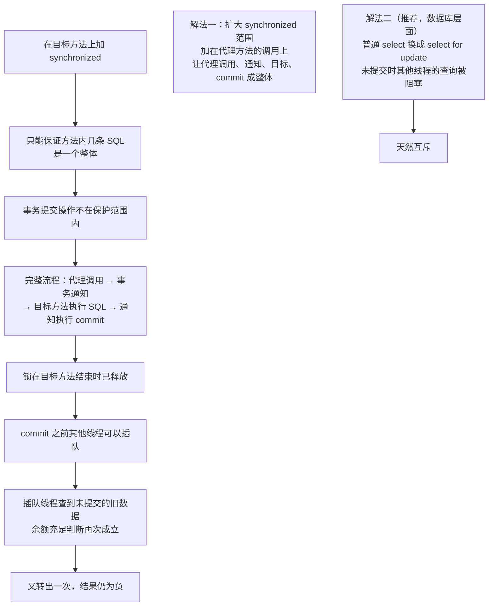

# Spring 事务失效场景八：锁失效

上一篇留下一个伏笔：多线程转账转出了负数，解法是什么？有同学第一反应是加 `synchronized`。这个方向没错，但锁加在目标方法上依然失效，这就是第八种场景：锁失效。它和上一篇是同一个问题的两面，面试连着问「加了锁为什么还不行」时，考的就是事务提交不在锁范围内这个细节。

## 先给结论

1. 在目标方法上加 `synchronized`，只能保证方法内几条 SQL 是一个整体，事务的提交操作不在保护范围内。
2. 事务的完整执行流程是：目标方法执行 SQL，控制权回到事务通知，由通知执行 commit；锁在目标方法结束时已释放，commit 前其他线程可以插队。
3. 插队的线程查到的是未提交的旧数据（余额还是 1000），余额充足判断再次成立，又转出一次，结果还是负数。
4. 解法一：扩大 `synchronized` 范围，加在代理方法的调用上，让代理调用、事务通知、目标方法、commit 成为一个整体。
5. 解法二（推荐，数据库层面）：把普通 select 换成 `select for update`，未提交时其他线程的 `for update` 查询会被阻塞，天然互斥。

## 是什么

上一篇演示了：虽然加了 `@Transactional`，Java 层面上这些代码仍然可能产生指令交错，多线程下有问题。

有同学就提出：事务上没办法保证原子性，那能不能在 Java 语法层面加一把 `synchronized` 锁？加了锁以后，线程一在执行中间这些代码的时候，线程二就不能执行这些代码，这样查询和后续更新就是一个原子整体。来实验一下。

同样的转账代码，加上锁。跑一遍，没出现负数：第一次红色线程转账，执行了两次更新；蓝色线程后执行，查到的是零，所以没有执行更新。逻辑上正确了。但这并不意味着没问题，用 debug 把它暴露出来。

## 深入细节

### debug 暴露：又变成负数

找到事务管理器 DataSourceTransactionManager，在事务提交之前加个断点。debug 运行，停下来，放行。最终输出又变成负数，问题又出现了。

### 为什么锁没保护住

看执行流程。红色线程的查询以及接下来的两次更新，是原子的，没有指令交错，蓝色线程插不进去。但蓝色线程这边，它的查询和两次更新之间，多了一个红色的 commit。为什么这里产生了交错？synchronized 好像没起到保护作用。

问题在于 synchronized 加的位置：它加在了目标对象的方法上。但整个事务的执行，只有目标方法那三条 SQL 语句吗？不是。事务的整个执行流程中还包括最后的 commit 操作，commit 也是事务的一部分。而 synchronized 只保证了这三条 SQL 是一个整体，接下来的 commit 并不在这个 synchronized 的保护之内。

具体执行过程：先是红色线程执行，查到余额一千，充足，进入 if 块执行两次更新。执行完了，目标方法的代码就执行完了，它把锁解开，回到外层的调用者，也就是事务通知。事务通知发现执行这三条 SQL 没有出现异常，接下来就开始准备执行提交操作。

问题就出在这：提交操作还没执行的时候，锁已经释放了（因为 synchronized 只保护三条 SQL）。这时候蓝色线程趁虚而入，也可以执行 transfer 了，它执行到查询，查到的是红色线程还没有提交前的结果，也就是一千。没提交，查到的肯定是旧数据。所以蓝色线程也认为余额充足，继续执行后续两个 update，因此又变成负一千。

### 解法一：扩大 synchronized 范围

让 synchronized 的范围大一些：从执行三条 SQL 到最后的事务提交，作为一个整体用 synchronized 保护，中间不能插队。

怎么扩大？在测试代码这里，把 synchronized 加在代理类的 transfer 方法调用的前后。创建一个 Object 作为锁，在调用 transfer 之前加一把锁，两个线程都加锁。这样 synchronized 的范围就不只包括目标方法的 transfer 调用，还包括代理方法、中间的事务通知，它们都是一个原子整体。

再复现：debug 运行，停在断点，现在全是红色的，蓝色执行不了，因为锁挡着。继续放行，从日志输出能看到红色的从创建事务一直到执行到最后提交事务都是一个整体，蓝色线程不能插队。等红色线程执行完，事务真正提交，数据库里一号账户已经是零了。这时候蓝色线程再运行，查出来的余额还是零，就不会进入 if 条件，不会破坏业务正确性。

所以锁的位置要加对：不能加在目标方法上，要加在代理方法的调用上。

### 解法二：select for update

第二种解决办法是数据库层面的。普通 select 并不具备原子性的保护：select 方法不会阻塞，就算开了事务，其他线程的 select 仍然能运行，查到一些可能不希望看到的旧数据。

如果希望 select 配合事务使用，可以修改查询语句，给它加一个 for update 子句，这样它就可以在数据库层面保证这个 select 的原子性。事务开始后，第一个线程使用 `select for update`，相当于锁住了这条记录，其他线程即使运行相同的 `select for update`，也会被挡住，在数据库层面实现了互斥。

这样改试试：不加锁，只把查询换成 `select for update`。debug 运行，虽然 Java 代码层面产生了指令交错，但第一个线程执行 `select for update` 之后，红色线程还没提交时，蓝色线程的 `select for update` 不能执行，会阻塞住，直到红色提交。蓝色线程再去查询时，查到的是提交之后的结果，问题也解决了。

### 总结

第七种情况：`@Transactional` 并没有保证原子性行为。从数据库层面说，事务原子性只涵盖增删改查，但查询语句只有 `select for update` 子句能真正配合事务，普通 select 不阻塞，所以是 select 用得不对。

第八种情况：用 synchronized 解决，但加在目标方法上并不能保证原子性。目标方法里仅涵盖那几条 SQL，最后的提交操作实际是在事务通知里完成的，加在目标方法上的 synchronized 并不能把通知里的提交操作也保护起来。环绕目标方法的还有 commit 等操作，它们必须被保护起来，但它们并不在 synchronized 的代码块内。

具体解决方法两个：第一种把 synchronized 的范围扩大到代理方法的调用；第二种用 `select for update` 在数据库层面替换掉 select，保证事务结束前 `select for update` 会被阻塞。这种场景推荐从数据库层面来解决。

## 面试怎么答

回答时可以这样组织：

1. 先描述现象：目标方法加 synchronized 后普通跑不出问题，debug 在提交前卡一下，负数又出现。
2. 讲清根因：锁只覆盖目标方法的三条 SQL，commit 在事务通知里执行，锁释放后、提交前有其他线程插队，读到未提交旧数据。
3. 给两个解法：锁加到代理方法调用上，把通知和 commit 包进临界区；或者查询改 `select for update`，让数据库层互斥。
4. 表明倾向：这类场景优先 `select for update`，从数据库层面解决更稳。

常见追问：

- **问：为什么普通跑不出来？** 时序刚好错开时逻辑看起来正确，debug 在提交前暂停人为放大了窗口，问题才稳定复现。
- **问：synchronized 加代理上有什么代价？** 锁粒度粗，吞吐下降，还可能和别的锁顺序死锁，能数据库层解决就不上升到应用层。
- **问：`select for update` 锁的是什么？** 在数据库层面锁住查询涉及的记录，其他线程的 `for update` 查询被阻塞，直到当前事务提交。

## 常见误区

- **误区一：方法上加 synchronized 就万事大吉。** 目标方法只覆盖 SQL，commit 在锁外，锁了个寂寞。
- **误区二：跑一次没复现就是没问题。** 并发问题有时序窗口，没暴露不代表不存在，要主动构造窗口验证。
- **误区三：普通 select 也能配事务用。** 普通 select 不阻塞，会读到未提交旧数据，要互斥就得 `select for update`。
