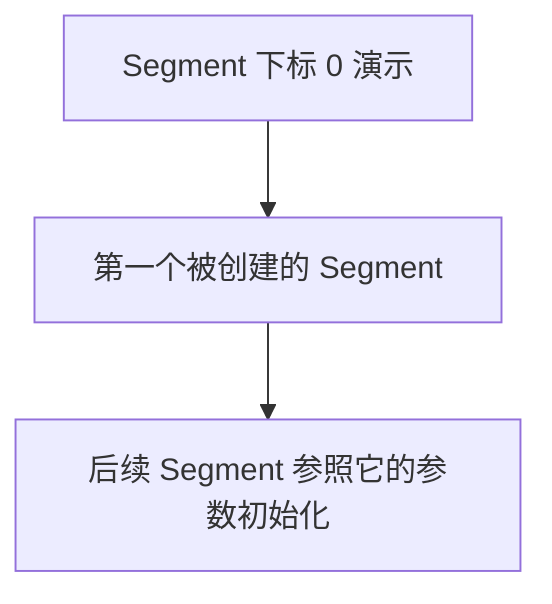

# ConcurrentHashMap v7：演示 Segment[0]

ConcurrentHashMap v7 有一个很少被注意到但很有意思的设计：Segment 数组建好后，其他索引都空着，唯独 0 号位预先放了一个小数组。它不是数据，是原型。所有后续创建的小数组都照它复制：容量、负载因子全部借用。面试聊到这个点，顺带能引出原型模式，是加分项。

## 先给结论

1. Segment 数组创建完之后，其他索引刚开始都是空着的，唯独 0 索引下面有一个已经创建好的小数组。
2. 这个小数组初始容量是 2，作用是提供原型：接下来其他小数组创建时，根据这个原型来创建。
3. 原型的大小由容量除以并发度决定（演示中容量 32、并发度 8，原型大小就是 4）。
4. 之后在任何位置新建的小数组，容量都和原型一模一样，负载因子也一样。
5. 原型自身扩容后，再创建的新小数组会按扩容后的原型创建（比如原型变 8，新小数组也是 8）。这体现了原型模式。

## 是什么

不知道你有没有注意到：Segment 数组创建完了以后，其他的索引其实刚开始都是空着的，唯独 0 索引下面有一个已经创建好的小数组。这个小数组的初始容量是 2。

那这个小数组是用来干嘛的呢？它是为了提供一个原型。接下来其他小数组创建的时候，会根据这个原型来进行创建。

## 深入细节

### 新小数组照原型创建

先把原型内容弄大一点，方便观察：容量设 32，并发度设 8。这样原型的大小就是 4（容量除以并发度）。

接着往其他小数组里放元素。往 6 这个位置放点东西，可以看到：6 这里创建出来的新小数组，它的容量跟原型的容量一模一样，负载因子也一样。

再试一个。来个 B，B 的 Segment 下标是 5，放在 5 这个位置。可以看到 5 位置这个小数组创建出来，大小也是 4。

### 原型变了，新数组跟着变

如果我这个原型的大小在执行过程中改变了呢？40 会放到 Segment 0 这个位置，先放进去。再多放几个：把哈希值固定成 1660，再放一个 123。现在 Segment 0 这个原型的大小已经是 8 了（原型自己扩容了）。

这时如果再来一个元素，需要创建一个新的小数组，它会放到 4 这个位置，创建出来的容量也是 8。所以只要是创建出来的新的小数组，都会以 Segment 0 这个小数组作为原型，把大小、扩容因子全部借过来。

这就是 Segment[0] 的特殊作用，它也体现了设计模式中的原型模式：用一个现成对象作模板，新对象照它创建。

## 面试怎么答

回答时可以这样组织：

1. 先指出现象：Segment 数组初始化时只有 0 号位有一个预建的小数组，其他位是空的。
2. 讲作用：0 号位小数组是原型，其他小数组首次创建时照它设置容量和负载因子。
3. 讲动态效果：原型自身扩容后，之后新建的小数组按新原型创建，演示里原型从 4 变 8，新数组也是 8。
4. 点题：这是原型模式在 JDK 源码里的应用。

常见追问：

- **问：原型小数组初始容量为什么是 2？** 容量除以并发度不足时取最小值 2，0 号位先按这个底数建出来当模板。
- **问：原型模式在这里的好处？** 新建小数组不用逐个推导参数，直接从现成原型复制，逻辑统一、不易出错。
- **问：原型什么时候变化？** 它自己也是一个正常的小数组，有元素进出、负载超标就扩容，之后的新数组按新大小创建。

## 常见误区

- **误区一：0 号位的小数组是特殊数据位。** 它只是原型，不承担特殊存储职责。
- **误区二：所有小数组在初始化时一起建好。** 其他位都是用到才建，且都照 0 号原型建。
- **误区三：原型大小固定不变。** 原型会随自身元素扩容，之后新建数组按扩容后的原型走。
