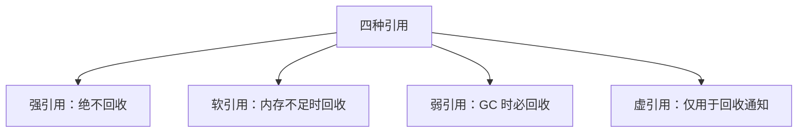

# 四种引用：概述

「对象的引用类型分成哪几类」是 JVM 部分的高频简答题。答「强、软、弱、虚」四类只是及格线，真正加分的是讲清每种引用和回收时机的关系：强引用死活不回收、软引用内存不够才回收、弱引用一 GC 就回收、虚引用只为跟踪回收释放外部资源。再各配一个典型场景，回答就完整了。

## 先给结论

1. Java 对象的引用类型分四类：强引用、软引用、弱引用、虚引用。
2. 强引用：普通赋值即建立，GC Root 引用链能找到就绝不回收。
3. 软引用：内存不足时才回收，第一次 GC 放过，第二次内存还不够才破坏关系释放对象。
4. 弱引用：只要发生 GC 就回收，比软引用更激进。
5. 虚引用：必须配合引用队列使用，本身不决定对象存活，用于对象被回收后释放其关联的外部资源（如直接内存）。



## 是什么

先看强引用。这是大家天天都在用的：只要给普通变量做一个赋值动作，其实就建立了变量和对象之间的强引用。比如 `A a = new A();`，通过赋值运算符建立变量与对象之间的强引用关系。例子中看起来是局部变量，但规则同样适用于成员变量和静态变量，只要用赋值运算符，建立的都是强引用。

强引用的特点：将来内存不够发生了垃圾回收，只要通过 GC Root 引用链找到了你这个对象，那这个强引用关系是不能被破坏的，对象肯定不能被回收。只有强引用找不到这个对象了，它将来才会被回收。

## 深入细节

### 软引用（SoftReference）

软引用的典型用法：

```java
SoftReference a = new SoftReference(new A());
```

从代码能看出软引用跟强引用最大的不一样：它并不是变量直接跟后面的 A 对象建立关系，而是中间加了一道软引用对象。变量先引用软引用，然后通过软引用再包装里面的 A 对象。变量跟软引用之间还是赋值的强关系，但软引用跟对象之间是一种软关系。

软关系和强关系的区别主要在垃圾回收时机：强关系不能被破坏；软关系在垃圾回收时有可能被破坏掉。本来关系建立了，但内存不够了，就会把这个关系断掉，让后面的 A 对象仍然可以被垃圾回收。

具体工作方式：如果一个对象只有一个软引用引用它，首次回收时还是会放过它，先去回收别的对象；如果内存还是不够，第二次又触发垃圾回收，这回发现是软引用的对象，就会把这个关系破坏掉，把后面的对象回收，释放它占用的内存。

注意：软引用回收的时候，仅仅把后面对象的内存回收掉了，软引用自身占用的内存没有被释放，因为变量对软引用还是强关系。如果想释放软引用本身，要配合引用队列来进行释放。

软引用的典型例子是获取反射数据。类对象可以通过类获取它的成员变量、方法信息等等，这些成员变量、方法信息对应的数据都是软引用的数据。将来内存真的不够了，这些数据会被丢弃掉。

### 弱引用（WeakReference）

弱引用的用法：

```java
WeakReference a = new WeakReference(new A());
```

对比可以发现，弱引用跟软引用长得比较像：变量并不直接引用对象，而是先引用弱引用，通过弱引用再间接引用到真正的对象。弱引用对象跟对象之间也是一个弱关系，垃圾回收的时候会把这个关系破坏掉。

它跟软引用的不同之处在于：如果只有一个弱引用引用了这个对象，那只要发生了垃圾回收，就会释放该对象，把对象占用的内存释放掉。软引用是第一次还不会释放，还会放过一次，第二次内存还不够才释放；弱引用是只要垃圾回收了，就会把弱引用的对象回收。

同样，弱引用也需要配合引用队列来释放弱引用自身。

弱引用的典型例子是 ThreadLocalMap 中的 Entry 对象，它的 key 使用了弱引用，内存不够的时候会把 Entry 的 key 占用内存释放掉。

### 虚引用（PhantomReference）

虚引用的用法：

```java
PhantomReference a = new PhantomReference(new A());
```

虚引用跟前面两种不同之处在于：它必须配合引用队列一起使用。

引用队列是干什么的？虚引用 A 和虚引用 B 分别引用 A 对象和 B 对象，使用虚引用的时候就必须给它创建好一个引用队列。将来垃圾回收把 A 对象和 B 对象回收掉了，虚引用本身就会在垃圾回收发生的时候，把这些虚引用加入到引用队列里去。A 和 B 都被回收了，引用它们的虚引用 A 和虚引用 B 就被加入到引用队列中。

加到队列里能干嘛？配合一个叫 Reference Handler 的线程来释放虚引用对象关联的一些外部资源。A 和 B 被垃圾回收，可能只是释放了 Java 堆内存的资源，但它们在使用过程中可能会用到一些外部资源，这些资源不是 Java 占用的，也不是 Java 的内存，可能是直接内存等等。这些内存什么时候释放？肯定得等 Java 对象被垃圾回收掉了，才去释放外部的这些资源。所以需要把这些虚引用对象先放到队列里，先记住哪些对象被回收了，将来从这个队列就知道有哪些对象该释放外部资源。Reference Handler 线程不断从引用队列里把虚引用对象取出来，对它们占用的外部资源进行释放。

虚引用的典型例子是 Cleaner，它可以用来释放 DirectByteBuffer 占用的直接内存。

### 四类汇总

强、软、弱、虚四种引用类型的核心差异就在回收时机：强引用不回收、软引用内存不够才回收、弱引用随 GC 立即回收、虚引用不决定存活只负责回收后的资源清理。

## 面试怎么答

回答时可以这样组织：

1. 先给分类：强、软、弱、虚四种。
2. 强引用：赋值即建立，GC Root 链可达就不回收。
3. 软引用：中间包一层 SoftReference，内存不足才回收，第一次 GC 放过、第二次才释放；反射数据是典型应用。
4. 弱引用：包一层 WeakReference，只要 GC 就回收；ThreadLocalMap 的 Entry key 是典型应用。
5. 虚引用：包一层 PhantomReference，必须配引用队列，对象回收后虚引用入队，由 Reference Handler 线程释放外部资源，如 DirectByteBuffer 的直接内存。

常见追问：

- **问：软引用和弱引用的区别？** 软引用第一次 GC 放过，内存还不够第二次才回收；弱引用只要 GC 就回收。
- **问：虚引用能单独用吗？** 不能，必须配合引用队列，它的价值就在回收后的通知和资源清理。
- **问：软引用自身的内存怎么释放？** 靠引用队列配合清理，光回收被引用的对象不会释放软引用自身。

## 常见误区

- **误区一：软引用和弱引用一样，GC 就回收。** 软引用要等到内存不足且第二次 GC，弱引用一 GC 就没。
- **误区二：虚引用影响对象存活。** 虚引用不影响回收判断，它只在对象被回收后入队做后续清理。
- **误区三：SoftReference 里包的对象被回收后引用对象本身也没了。** 被包对象的内存被回收，但软引用对象自身还在，要额外配引用队列清理。

## 课件配图
> 以下配图取自阶段七课件对应讲义，与上文讲解一一对应，可作为图文对照辅助理解。
**四种引用**（课件讲义图示）


