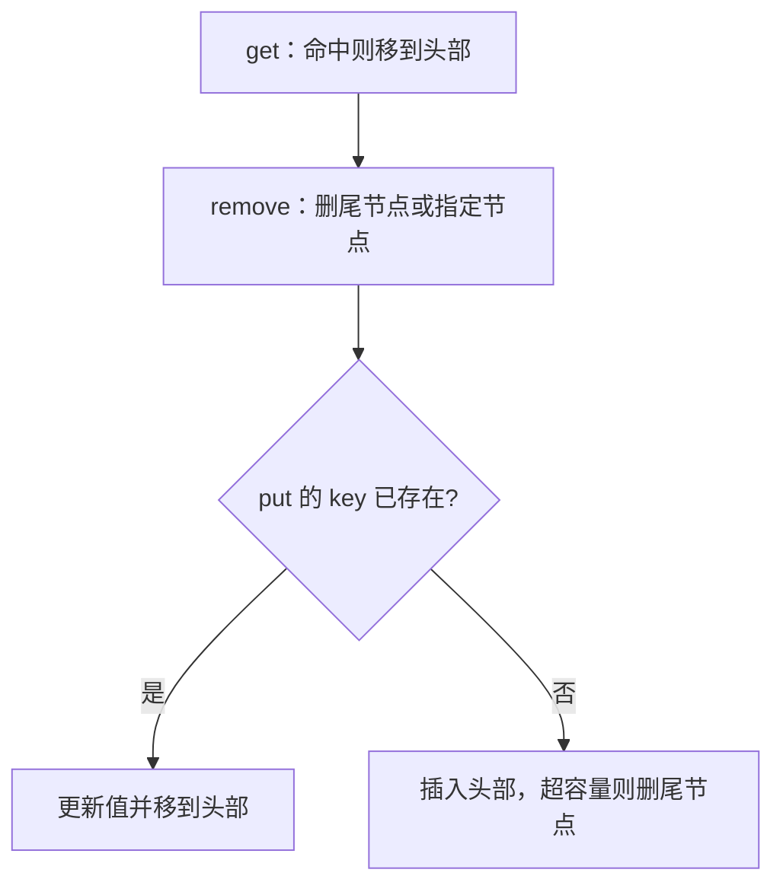

# LRU 实现：删除、查询、新增

前面把 unlink（断开）和 toHead（链入头部）两个链表基本操作练熟了，这篇把它们拼成 LRU cache 的三个核心操作：remove、get、put。写完之后你会发现，凡是访问过的节点都往头部挪、超容就删尾部，LRU 的语义全部落在这几行调用上。这是编程题的标准答案骨架。

## 先给结论

1. LRU cache 的成员：头节点 head、尾节点 tail、元素上限 limit、存 key 到 node 映射的 map。
2. 删除：map.remove(key) 拿到旧 node，再 unlink 断开链表链接。
3. 查询：map 里没找到直接返回；找到就 unlink 加 toHead 移动到头部，返回 node 的 value。
4. 新增：map 里没有就新建 node 并放入 map，有就更新 value；两种情况最后都 unlink 加 toHead 移动到头部。
5. 收尾检查：map 大小超过 limit，就找到最后一个节点（tail.prev），从 map 移除并 unlink 断开。



## 是什么

看 LRU cache 的结构，其实有几项：一个头节点 head、一个尾节点 tail、一个 limit（元素上限，超过就把较老的元素删掉）、还有一个 map 集合存储真正的键值，键是 key，值是每个节点对象。

构造方法里对这些成员做初始化：创建 head 头节点、tail 尾节点，map 是空集合，limit 从参数传进来。传进来的参数如果太小不合理，所以把它的最小值设置成 2，也就是 `Math.max(limit, 2)`。

下面实现各项逻辑。

## 深入细节

### 删除

删除叫 remove，只需要一个 key。要做两件事：把它从 map 里删掉，并且从链表里也删掉。

先用底层 map 的 remove 把 key 删掉，map 的 remove 方法会返回旧的数据，也就是那个 node。根据这个旧 node，再从链表里把它删掉：直接调用 unlink 断开链接就行，因为返回的 node 前后指针都是完整的。

```java
void remove(String key) {
    Node node = map.remove(key);
    if (node != null) {
        unlink(node);
    }
}
```

### 查询

查询要返回查询结果，叫 get。先从 map 里获取 node，但要考虑 key 不在 map 里的情况：没找到就直接返回，不做后续操作。

如果找到了，逻辑是要把它移动到链表头，分两步：先把原来的节点从原本的链表中断开（它可能在中间或者尾部），断开以后把它加入到头部。这两个操作都写好了，直接 unlink 再加 toHead。最后返回 node 里包含的那个 value，因为 get 最终要的是值。

```java
Object get(String key) {
    Node node = map.get(key);
    if (node == null) {
        return null;
    }
    unlink(node);
    toHead(node);
    return node.value;
}
```

unlink 和 toHead 实现好之后，这个逻辑就很清晰了。

### 新增

新增叫 put。需要一个键一个值。先看这个 key 在原本的 map 里有没有：有了就更新，没有才新建。

先去 map 里查一下。如果没有，先创建一个新的节点，把键值都放进去，但它的前后指针先别着急加，待会儿再加；然后别忘了把它存到 map，key 还是这个 key，值包装成 node 对象存进去。

如果有，只需要更新它的值。但有的情况相当于访问了一下、做了更新，更新之后应该把它移动到头节点，所以要从原来的节点位置断开链接，unlink 这个 node。

其实不管是新建出来的节点还是更新的节点，最终都要移动到头节点，因为它们都表示最近使用了，最近使用的节点都应该移入头。所以统一 toHead。

最后一步是检查是不是超过了 limit。现在根据元素个数来限制，看一下当前 map 的大小是不是已经超过 limit。如果超过了，要把最后一个节点删除、断开链接。最后一个节点怎么找？这是双向链表，先找到 tail 尾节点，尾节点的 previous 就是最后一个节点，叫它 last。找到之后，先根据它保留的 key 把它从 map 里删掉，然后 unlink last 断开链接。

```java
void put(String key, Object value) {
    Node node = map.get(key);
    if (node == null) {
        node = new Node(key, value);
        map.put(key, node);
    } else {
        node.value = value;
        unlink(node);
    }
    toHead(node);
    if (map.size() > limit) {
        Node last = tail.prev;
        map.remove(last.key);
        unlink(last);
    }
}
```

### 整体回顾

删除最简单：从 map 里移除然后断开链接。查询分两种情况：map 里没有直接返回；有就断开链接、移动到头部，保证 LRU 逻辑。新增最复杂，也分几种情况：原本没有就创建新节点放入 map；原本有就只更新值；两种情况最后都统一移动到头部；最后检查大小限额，超过就找最后一个节点（尾节点前面的那个），从 map 移除并从链表断开。新增这里其实包括了修改的逻辑。至此 LRU cache 的实现就讲完了。

## 面试怎么答

回答时可以这样组织：

1. 先给结构：双向链表维护使用顺序，map 做 key 到 node 的 O(1) 定位，head/tail 哨兵简化边界。
2. get：查 map，命中就 unlink 加 toHead，返回 value；未命中返回 null。
3. put：不存在则新建并入 map，存在则更新 value；统一 unlink 加 toHead；最后超限删尾（tail.prev），map 和链表同步删。
4. 点出关键不变量：链表头部永远最近使用，尾部永远最久未使用，超容删尾即 LRU 语义。

常见追问：

- **问：为什么 get 命中也要移动节点？** 访问即使用，不移动就无法反映「最近使用」，淘汰会失准。
- **问：put 已存在的 key 为什么要先 unlink 再 toHead？** 它可能躺在链表任意位置，先断开再按头部规则插入，避免重复链接。
- **问：limit 为什么要 Math.max 兜底？** 防止传入过小值把缓存意义抹掉，最小保留 2。

## 常见误区

- **误区一：get 只返回值不调整顺序。** 不调整顺序就不是 LRU，只是普通缓存。
- **误区二：put 新 key 忘了放入 map。** map 和链表必须同步，漏一个都会导致查询不到或内存泄漏。
- **误区三：超限时不删 map 只删链表。** map 里残留的 key 会一直占容量，limit 永远失真。
