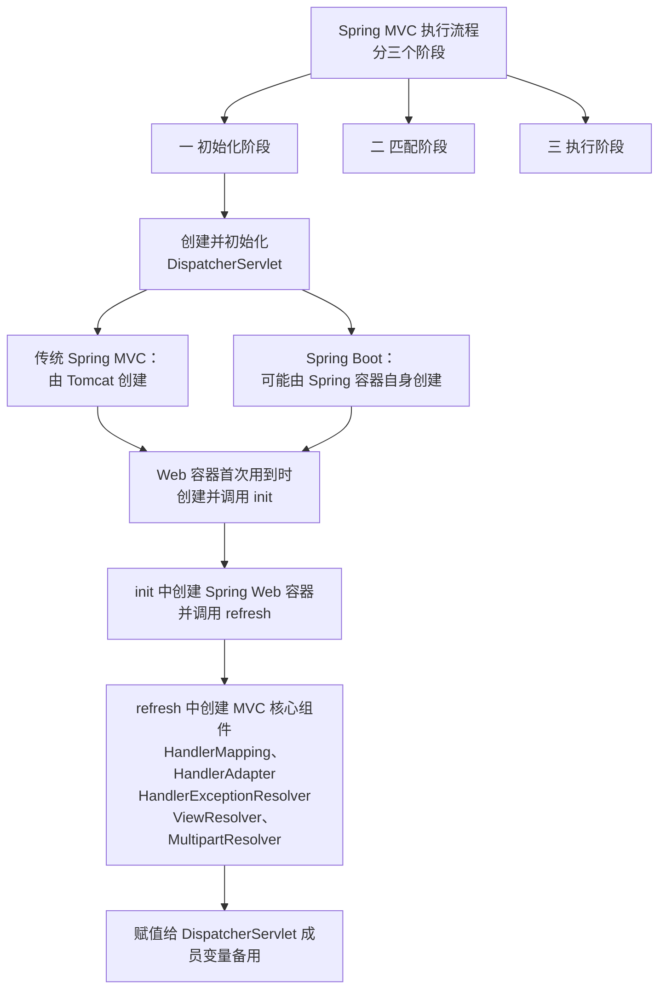

# Spring MVC 执行流程：初始化阶段

「Spring MVC 的执行流程」是 Spring 部分的压轴大题，整个流程比较复杂，一般拆成三个阶段讲：初始化阶段、匹配阶段、执行阶段。这一篇讲初始化：DispatcherServlet 怎么被创建、init 里做了什么、哪些组件在 refresh 时备好。把这些答清楚，后面两个阶段才有落脚点。

## 先给结论

1. Spring MVC 执行流程分三个阶段：初始化、匹配、执行，本篇讲初始化。
2. 初始化阶段主要做的事是创建和初始化 DispatcherServlet，它是 Spring MVC 的核心类。
3. 传统 Spring MVC 整合 Spring 时，DispatcherServlet 由 Web 容器（Tomcat）创建和初始化；Spring Boot 里可能由 Spring 容器自身创建。
4. Web 容器第一次用到 DispatcherServlet 时创建它并调用 init 方法，init 里创建 Spring Web 容器并调用 refresh。
5. refresh 过程中创建并初始化 MVC 核心组件：HandlerMapping、HandlerAdapter、HandlerExceptionResolver、ViewResolver、MultipartResolver，最后赋值给 DispatcherServlet 的成员变量备用。

## 是什么

DispatcherServlet 是 Spring MVC 中一个非常核心的类。它是由谁来创建和初始化的？注意，传统 Spring MVC 跟 Spring 整合的时候，DispatcherServlet 仍然是由 Web 容器，也就是 Tomcat 来创建和初始化的。当然将来到了 Spring Boot 里，DispatcherServlet 就有可能由 Spring 容器自身来创建和初始化了。

整个 Spring MVC 的执行流程比较复杂，这里把它划分成三个阶段，逐一讲解。第一个阶段叫初始化阶段。

## 深入细节

### init 方法做了什么

第一步，当 Web 容器第一次用到 DispatcherServlet 的时候，它就会创建并且初始化它，走 Servlet 的初始化流程，会调用它的 init 方法。这个 init 方法非常重要，调用的时候会创建 Spring 容器：它会找到 Spring 的配置文件，根据这个配置文件来创建 Spring 容器。

Spring 容器创建好了以后，会调用 Spring 容器的 refresh 方法来初始化 Spring 容器。初始化的目的，就是为了创建并初始化一些 Spring MVC 运行时需要的重要组件。

### refresh 创建的组件

这些组件比较多，有 HandlerMapping、HandlerAdapter、HandlerExceptionResolver、ViewResolver，还有一个 MultipartResolver。

大家要注意，除了 MultipartResolver 可能只有一个实例以外，其他组件都有可能同一个类型有多个实例对象存在于 Spring 容器中。

各组件职责：

- HandlerMapping：做请求映射，根据你的请求路径找到一个对应的控制器和它相关的方法来处理这个请求，负责把浏览器的请求映射到 Spring 中一个控制器的方法调用上。
- HandlerAdapter：真正去调用控制器的控制方法来处理请求。将来谁来真正调用和执行控制方法？就是 HandlerAdapter。
- HandlerExceptionResolver：如果在调用控制方法的过程中出现了异常，由它来处理异常。
- ViewResolver：控制器方法执行完毕都会封装成一个 ModelAndView 对象，但这个对象中的视图有可能只包含一个字符串的名称，需要把这个字符串的名字解析成一个视图对象，这个活儿由 ViewResolver 完成。视图对象内部可以根据不同的实现，选择跳转到 JSP 还是跳转到模板引擎，去执行视图的渲染工作。
- MultipartResolver：并不是必须的，它用在文件上传的时候，处理 multipart 格式的表单数据。

### 组件赋值给 DispatcherServlet

容器初始化（refresh）的时候，会把这些重要组件都创建好并且初始化好。等容器初始化完了以后，会把上一步创建初始化好的这些组件，赋值给 DispatcherServlet 中的成员变量，留待后用。

DispatcherServlet 中有 handlerMappings 这么一个集合，里面存储将来所有的 HandlerMapping 对象；还有 handlerAdapters 集合，存储所有的 HandlerAdapter 对象，以此类推。把这些对象创建好了，就复制给 DispatcherServlet 的成员变量，以后它就可以使用了。

至此准备工作就做好了，接下来就可以用来处理请求。初始化阶段完成。

## 面试怎么答

回答时可以这样组织：

1. 先给三阶段划分：初始化、匹配、执行，说明本篇讲初始化。
2. 讲 DispatcherServlet 的创建者：传统整合时由 Tomcat 创建并调 init，Spring Boot 下可能由 Spring 容器自身创建。
3. 讲 init 内容：创建 Spring Web 容器、调用 refresh。
4. 讲 refresh 备好的组件：HandlerMapping（请求映射）、HandlerAdapter（调用控制器）、HandlerExceptionResolver（异常处理）、ViewResolver（视图名解析为视图对象）、MultipartResolver（文件上传，可选）；除 MultipartResolver 外都可能有多个实例。
5. 讲收尾：组件创建好后赋值给 DispatcherServlet 成员变量（handlerMappings、handlerAdapters 等集合），备后续请求处理使用。

常见追问：

- **问：为什么 HandlerMapping 可能有多个？** 不同类型不同配置的映射策略可以并存，容器里同一类型多个实例，DispatcherServlet 用集合统一持有。
- **问：ModelAndView 里的视图为什么只是字符串？** 控制器只返回逻辑视图名，具体渲染方式（JSP、模板引擎）由 ViewResolver 解析出的视图对象决定。
- **问：MultipartResolver 没有会怎样？** 不影响普通请求，只有文件上传场景需要它。

## 常见误区

- **误区一：DispatcherServlet 一定由 Spring 容器创建。** 传统整合时是 Tomcat 创建并调用 init，Spring Boot 才可能由容器自身创建。
- **误区二：组件在每次请求时创建。** 全部在初始化阶段的 refresh 里备好，请求来了直接用。
- **误区三：每种组件只有一个实例。** 除 MultipartResolver 外都可能有多个，DispatcherServlet 用集合存放。

## 课件配图
> 以下配图取自阶段七课件对应讲义，与上文讲解一一对应，可作为图文对照辅助理解。
**Spring MVC 执行流程**（课件讲义图示）

