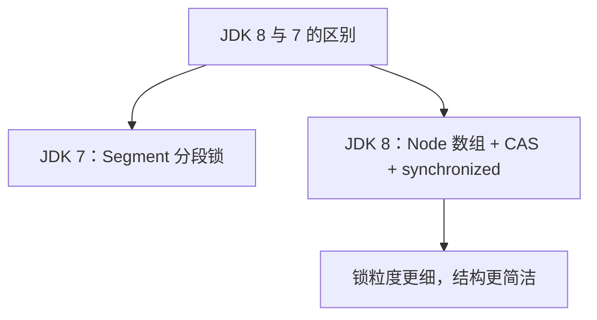

# ConcurrentHashMap v8 与 v7 简单比较

CHM 的版本差异是面试高频追问：「Java 8 的 ConcurrentHashMap 和 7 有什么不一样？」标准答法是从数据结构、初始化时机、扩容时机三个维度对比，每个维度一两句话讲清。这篇把 v7 的分段锁和 v8 的数组加链表放一起对照，看完就能直接组织答案。

## 先给结论

1. v7 结构是 Segment 数组加 HashEntry 数组加链表；v8 去掉了 Segment 数组，直接是数组加链表，链表过长转红黑树。
2. v7 是饿汉式初始化：构造方法一调用，Segment 数组（含 0 号元素）就创建好了。
3. v8 是懒汉式初始化：构造方法调用后对象已创建，但底层数组还没建，第一次 put 时才创建。
4. v7 超过容量的四分之三才扩容；v8 只要满四分之三就扩容（元素个数一到 16 的四分之三即 12，立刻扩容）。
5. 并发控制上，v7 靠 Segment 分段锁，v8 靠 CAS 配合桶头节点的同步控制，扩容时用 forwardingNode 标记。



## 是什么

Java 7 版本的 ConcurrentHashMap，数据结构是 Segment 数组加 HashEntry 数组再加链表。Java 8 版本不一样了，不需要 Segment 数组，直接是数组加链表，当然链表如果过长也会转成红黑树。这是数据结构上的一个不一样。

## 深入细节

### 初始化时机不同

7 版本：底层调整构造方法，构造方法一调用，Segment 数组包括数组的 0 号元素其实已经都被创建出来了，可以看到它是一种饿汉式的初始化。

8 版本：也调用构造方法，ConcurrentHashMap 对象已经创建了，但是它底层那个数组结构还没有创建。底层数组是将来第一次往里面 put 元素时，它才会去创建。因此 8 的初始化可以看成是一种懒汉式的初始化。

这是它们初始化上的不同。

### 扩容时机不同

先看 8 版本的基本结构演示。往里面放一些元素，先放 8 个。8 版本的 ConcurrentHashMap 初始容量也是 16，放了 8 个元素还没有触发扩容。再放几个：放 A、B、C，和这 8 个加起来 11 个元素。A、B、C 和 1、2、3 在容量为 16 的时候，计算出来的桶下标都是 1、2、3，所以它们也变成了三个链表。而且注意到它是尾插法，1A、2B、3C 是尾插的。

那它什么时候扩容？之前 7 版本是超过了容量的四分之三会扩容；而 8 版本是只要满四分之三就会扩容。再来一个 D，元素个数到 12，12 已经是 16 的四分之三了，这时候它就立马扩容。当然扩容之后，重新计算了每个 key 的位置，链表就缩短了，链表就没有了。

### v8 的并发控制

配套的并发机制也换了：v7 靠 Segment 分段锁，一个 Segment 一把锁；v8 不用分段锁，数组的每个桶头节点用 synchronized 控制，配合 CAS 做无锁操作（比如 table 初始化、size 计数）。扩容时会把对应桶标记为 forwardingNode，其他线程遇到标记就知道正在扩容，配合完成迁移。这也是 v8 并发度更细、冲突更低的原因。

### 三方面小结

8 版本和 7 版本在三个方面做了比较：数据结构上、初始化的时机上、扩容的时机上。

## 面试怎么答

回答时可以这样组织：

1. 数据结构：v7 是 Segment 加 HashEntry 数组加链表；v8 是数组加链表加红黑树，去掉了 Segment。
2. 初始化：v7 饿汉（构造即建 Segment 数组）；v8 懒汉（首次 put 才建底层数组）。
3. 扩容：v7 超过四分之三才扩；v8 满四分之三立即扩。
4. 并发控制：v7 分段锁；v8 是 CAS 加 synchronized 锁桶头，扩容用 forwardingNode。
5. 可以补一句索引公式的差异帮助理解：v7 算 Segment 下标用 `hash & (segments.length - 1)`，v8 算桶下标用 `hash & (capacity - 1)`。

```latex
segmentIndex = hash & (segments.length - 1)
```

```latex
bucketIndex = hash & (capacity - 1)
```

常见追问：

- **问：v8 为什么去掉 Segment？** 分段锁粒度还是粗，且 Segment 数组一旦建好不能伸缩；换成桶级控制，冲突只发生在同一个桶。
- **问：v8 尾插法有什么意义？** 扩容迁移时不会把顺序反过来，配合多线程协作迁移，避免 1.7 那种死链问题。
- **问：懒汉初始化有什么好处？** 构造时不分配底层数组，省内存，创建对象更轻。

## 常见误区

- **误区一：v8 也有 Segment。** v8 没有 Segment 数组，并发控制落到桶上。
- **误区二：v7 和 v8 扩容阈值一样。** v7 超过四分之三，v8 满四分之三就扩，语义不同。
- **误区三：v8 第一次 put 前底层数组已存在。** 懒汉式，首次 put 才创建数组。
- **误区四：链表长了在 v7 也会转红黑树。** v7 只有链表，树化是 v8 的特性。
