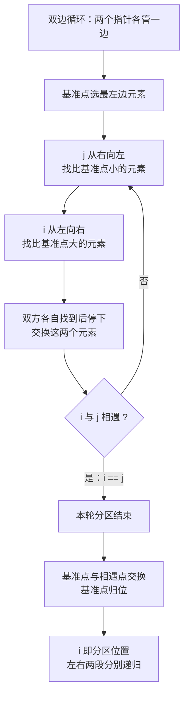

# 快速排序：双边循环分区演示

上一节我们讲了单边循环快排，整个分区过程里只有一个 j 指针，它一路从左向右找比基准点小的元素，找到就交换到 i 边界的位置。这一节来看双边循环快排：同样是分区，这回负责「找目标元素」的指针有两个，分工更细，理解起来也更直观。

## 先给结论

双边循环分区的规则可以概括成五句话：

- 基准点选最左边的元素。
- j 指针从右向左找比基准点小的元素，i 指针从左向右找比基准点大的元素。
- 双方各自找到目标后停下来，交换这两个元素：小的换到左边，大的换到右边。
- i 与 j 相遇（值相等）时，本轮分区结束。
- 最后做一次交换，把基准点与相遇点（也就是 i 或 j）交换，基准点归位，i 即为分区位置。

分区完成后，基准点左边的元素都比它小，右边的元素都比它大，再对左右两段分别递归即可。



## 是什么：两个指针，各管一边

单边循环里，找小的、记录边界、当交换目标这些活儿都压在 j 一个指针身上，i 只负责守住小值区的边界。双边循环把这些职责拆开了：

- j 指针从右向左走，负责找比基准点小的元素。它找到之后不是马上交换，而是先停下来等，等 i 那边也找到目标，两个指针再交换。
- i 指针从左向右走，负责找比基准点大的元素。它同时是小值区的边界。

基准点的选取也和单边循环相反：单边循环选最右边的元素当基准点，双边循环选最左边的元素当基准点。这是两种方案各自约定好的搭配，写代码的时候不要配错。

两个指针都可以看作一条区域的边界：i 是小值区的边界，j 是大值区的边界。随着一轮轮交换，中间未处理区域被不断压缩，两边各自归位。

## 为什么找到之后要交换

j 找到的是小元素，i 找到的是大元素。快速排序分区的要求是小的靠左、大的靠右，而此刻小元素跑在了右边、大元素跑在了左边，位置都是错的。把这两个元素交换一次，小的到了左边，大的到了右边，正好一步满足两边归位的需求，比搬移整个区间高效得多。

交换之后 j 继续向左找小的，i 继续向右找大的，循环往复，中间没归位的区域越来越窄，直到两个指针碰头。

## 深入细节：完整走一遍

以数组 `[5, 3, 7, 2, 9, 8, 1, 4]` 为例，基准点取最左边的 5。

初始状态，i 在索引 0，j 在索引 7。

第一轮，j 从右向左找小：索引 7 的 4 比 5 小，j 停在 7。i 从左向右找大：索引 1 的 3 不比 5 大，继续向右，索引 2 的 7 比 5 大，i 停在 2。交换索引 2 和索引 7，数组变成 `[5, 3, 4, 2, 9, 8, 1, 7]`，7 去了右边，4 来到了左边。

第二轮，j 继续向左找小：索引 6 的 1 比 5 小，j 停在 6。i 继续向右找大：索引 3 的 2 不比 5 大，继续向右，索引 4 的 9 比 5 大，i 停在 4。交换索引 4 和索引 6，数组变成 `[5, 3, 4, 2, 1, 8, 9, 7]`，9 去了最右边，1 来到了左边。

第三轮，j 继续向左找小：索引 5 的 8 不比 5 小，继续向左，迎面遇上停在索引 4 的 i。两个指针相遇，值相等，本轮分区到此结束。

最后一步，把基准点 5 与相遇位置的元素交换。相遇位置在索引 4，那里的值是 1，交换后数组变成 `[1, 3, 4, 2, 5, 8, 9, 7]`。此时基准点 5 归位，索引 4 就是分区位置：左边的 `[1, 3, 4, 2]` 都比 5 小，右边的 `[8, 9, 7]` 都比 5 大。接下来对这两段分别递归，整个数组就有序了。

注意相遇时 i 和 j 的值是相等的，所以最后这次交换与 i 交换还是与 j 交换，结果是等价的，与哪个指针交换都一样。

双边循环的 partition 代码长这样：

```java
// 双边循环法
private static int partition(int[] a, int l, int h) {
    int pv = a[l];               // 基准点取最左侧元素
    int i = l;                    // i 从左向右找大的
    int j = h;                    // j 从右向左找小的
    while (i < j) {
        // j 从右找小的
        while (i < j && a[j] > pv) {
            j--;
        }
        // i 从左找大的
        while (i < j && a[i] <= pv) {
            i++;
        }
        swap(a, i, j);             // 小的换左，大的换右
    }
    swap(a, l, j);                // 基准点与相遇点交换，归位
    return j;                     // j 即分区位置
}
```

## 面试怎么答

面试官问双边循环快排，可以这样有条理地作答。

先说基准点：双边循环一般选最左边的元素作为基准点，这与选最右元素的单边循环（Lomuto）正好相对。

再说指针分工：j 从右向左找比基准点小的，i 从左向右找比基准点大的。i 同时维护小值区的边界，j 维护大值区的边界。两个指针各自找到目标后交换，保证小的在左、大的在右。

然后说结束条件：当 i 与 j 相遇，即两者值相等时，本轮分区结束。注意不是「擦肩而过」，是相遇相等。

最后说归位：结束时要再做最后一次交换，把基准点与相遇位置（i 或 j，此时二者相等）的元素交换，基准点到达最终位置，i 即为分区位置，递归处理左右两段。

如果面试官追问它与经典 Hoare 分区方案的关系，要如实说明：这个教学版本标注了「不完全等价于 Hoare 分区方案」，是指针初始化、相遇判定和返回值上都做了简化的课堂实现，并不是教科书上的 Hoare 原版。知道这个区别，比含糊其辞更能体现理解深度。

## 常见误区

**误区一：把教学版双边循环当成 Hoare 分区原版。** 教材里的双边循环明确标注了不完全等价于 Hoare 分区方案，它在指针起点、相遇条件和返回值上都与经典实现有差异。面试陈述时说「双边循环（课堂版）」或者直接描述规则，不要笼统地等同于 Hoare。

**误区二：基准点选错边。** 双边循环配最左基准点、单边循环配最右基准点，这是两种方案各自的约定。凭感觉混搭，分区逻辑会直接失效。

**误区三：以为 i 和 j 要错身而过才算结束。** 教学版的结束条件是两者相遇、值相等。相遇之后已经没有可交换的错位元素了，中间区域已被压缩到底。

**误区四：漏掉最后一次交换。** 分区结束时基准点还在最左边，必须与相遇位置的元素交换才能归位。少了这一步，i 指向的位置并不是真正的分割点，递归下去排序是错的。

**误区五：记反归位方向。** 小元素换到左边、大元素换到右边，i 守的是小值边界、j 守的是大值边界。讲的时候说顺嘴并不难，难的是写代码时 i、j 的移动条件和边界别写反。
