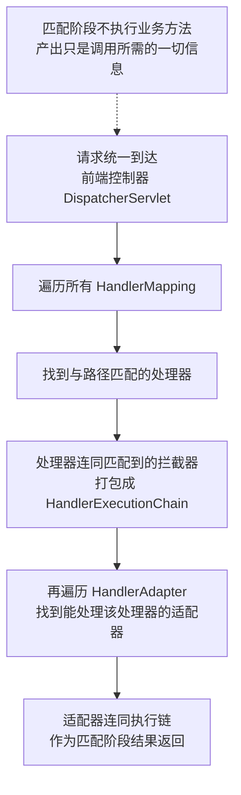

# Spring MVC 执行流程：匹配阶段

Spring MVC 的执行流程分三个阶段：匹配、执行，以及贯穿其中的异常与视图处理。上一篇讲了初始化阶段，DispatcherServlet 及其一堆组件在启动时就绪。这一篇讲匹配阶段：请求已经到达前端控制器，接下来要找到「谁来处理这个请求」，并且把处理请求所需的一切打包好。

## 先给结论

匹配阶段做四件事：

- 请求统一到达前端控制器 DispatcherServlet。
- DispatcherServlet 遍历所有 HandlerMapping，找到与路径匹配的处理器。
- 把处理器连同匹配到的拦截器打包成 HandlerExecutionChain（处理器执行链）。
- 再遍历 HandlerAdapter，找到能处理该处理器的适配器，连同执行链一起作为匹配阶段的结果返回。

匹配阶段不执行业务方法，它的产出是「调用所需的一切信息」，交给执行阶段去用。

## 是什么：前端控制器不处理请求

用户发来的请求首先统一到达 DispatcherServlet。它是整个流程的前端控制器，是所有请求的入口，但它并不负责处理具体的请求。处理请求需要交给处理器对象完成，DispatcherServlet 的职责是找到这个处理器。

找处理器的办法是遍历所有 HandlerMapping。DispatcherServlet 手里有一组 HandlerMapping，逐个询问，借助它们找到与当前请求路径匹配的处理器对象。可以把它理解成查表：拿路径去映射关系里查，查出负责处理它的处理器。

这里有个容易忽略的细节：HandlerMapping 是有多个的，不同实现返回的处理器对象类型也不一样。但一个请求最终只由一个处理器处理，所以规则是谁先匹配上就返回谁的处理器，不会返回多个。日常开发最常用、能识别 @RequestMapping 注解的那个 HandlerMapping 优先级最高，因此绝大多数请求最终拿到的是它返回的处理器。

## 为什么：映射关系要提前建好

路径与处理器的映射关系，并不是请求来了再临时创建，而是在 HandlerMapping 初始化的阶段就建立好了，形态类似一个 Map 集合：key 里包含路径信息，value 是处理器对象。

拿最常用的那个 HandlerMapping 来说，它内部维护的映射大致是这样：左边是 key，可以简单认为是路径信息；右边是 value，就是处理器的一种实现，叫 HandlerMethod。假如系统里有多个 Controller，每个 Controller 有多个方法，这些方法就会对应产生多组映射，每组都带着自己的路径，以及对应的 Controller 对象和方法对象。这些信息被收集成一个个 HandlerMethod，等请求到来时按路径匹配其中一个即可。

提前建好映射，是 Spring MVC 启动相对慢、运行期请求分发却很快的原因之一：启动时把扫描、解析、建表的活儿一次性干完，请求来了只是查表。

处理器对象找到之后，并不会被直接返回，因为信息还不够。请求可能匹配到一些拦截器，这些拦截器也要参与后续执行。于是 HandlerMethod 连同匹配到的拦截器（可能匹配到多个）作为一个整体，组成 HandlerExecutionChain，即处理器执行链。这个执行链里包含了执行阶段所需的全部信息：处理器对象、拦截器，一应俱全。

拦截器之外还有适配器。真正去调用处理器的不是 DispatcherServlet 自己，而是 HandlerAdapter。Spring 提供了多个 HandlerAdapter 实现，不同适配器内部支持的处理器类型并不一样，所以还要遍历 HandlerAdapter，调用它的 supports 方法，判断当前适配器是否支持这种 HandlerMethod。一旦某个适配器表示支持，就不再继续循环，把找到的 HandlerAdapter 连同 HandlerExecutionChain 一起作为结果返回。至此匹配阶段告一段落，进入执行阶段。

## 深入细节：匹配阶段的完整接力

把匹配阶段的接力顺序完整过一遍。

请求到达 DispatcherServlet，它是统一入口，只做分发，不做业务处理。

DispatcherServlet 遍历所有 HandlerMapping。多个 HandlerMapping 之间是竞争关系，谁先匹配谁胜出，返回唯一的处理器对象。识别 @RequestMapping 的那个实现优先级最高，它返回的处理器类型是 HandlerMethod。

HandlerMethod 里封装了两样关键信息：这个处理器属于哪个 Controller 对象，以及对应 Controller 的哪个方法。有了这两样，执行阶段才能通过反射去调用对应的 Controller 方法。

查找用的映射关系在 HandlerMapping 初始化时就已建立。以 /test2 这个请求为例，它进来后与某个 key 匹配上，随即找到该 key 对应的 HandlerMethod，这个 HandlerMethod 会具体定位到是哪个 Controller 的哪个方法。

拿到 HandlerMethod 后，DispatcherServlet 不是直接把它甩给下一步，而是先收集与之匹配的拦截器。拦截器可能匹配到多个，它们与 HandlerMethod 共同组成 HandlerExecutionChain。这个执行链对象才是匹配阶段真正的产出，执行阶段需要的处理器和拦截器都在里面。

最后一步是找适配器。DispatcherServlet 遍历所有 HandlerAdapter，逐个调用 supports 方法询问是否支持当前这种 HandlerMethod。某个适配器表态支持，循环立即停止，该 HandlerAdapter 与 HandlerExecutionChain 作为匹配阶段的最终结果返回。

执行阶段由 HandlerAdapter 负责调用处理器，拦截器则在处理器执行的前后分别执行，这些留到下一篇细讲。

## 面试怎么答

面试问 Spring MVC 执行流程的匹配阶段，按四步答，再补三个细节。

四步：请求统一到达前端控制器 DispatcherServlet；DispatcherServlet 遍历所有 HandlerMapping，找到与路径匹配的处理器；将处理器连同匹配到的拦截器，生成调用链对象 HandlerExecutionChain 返回；遍历 HandlerAdapter，找到能处理该处理器的适配器对象，进入调用。

三个细节：

第一，HandlerMapping 有多个，不同实现返回的处理器类型不同，但一个请求只由一个处理器处理，谁先匹配返回谁。能识别 @RequestMapping 的 HandlerMapping 优先级最高，它返回的处理器是 HandlerMethod 类型。

第二，路径与处理器的映射关系在 HandlerMapping 初始化时就已经建立好，类似 Map 的 key-value，不是请求来了才临时创建。

第三，找到处理器后不是直接返回，而是先匹配拦截器，与处理器一起组成 HandlerExecutionChain；再找到支持该处理器的 HandlerAdapter，适配器与执行链共同构成匹配阶段的结果。

如果被追问为什么需要 HandlerAdapter，可以这样解释：处理器的类型不止一种，不同类型的处理器调用方式不同，适配器的作用就是屏蔽这种差异，让 DispatcherServlet 用统一的方式去调用处理器，通过 supports 方法完成匹配。

如果被追问 HandlerMethod 里有什么，答：它包含处理器所属的 Controller 对象和对应的 Controller 方法，执行阶段通过反射调用。

## 常见误区

**误区一：以为 DispatcherServlet 自己处理请求。** 它只是前端控制器，是请求的统一入口，负责分发，不负责具体处理。具体处理永远由处理器对象完成。

**误区二：以为一个请求会返回多个处理器。** HandlerMapping 虽然是多个，但一个请求最终只由一个处理器处理，规则是谁先匹配返回谁，找到即止。

**误区三：以为路径映射是请求来了才创建的。** 映射关系在 HandlerMapping 初始化时就建立完毕，请求期只是查表。答成「临时创建」会把 Spring MVC 的设计说反。

**误区四：以为找到 HandlerMethod 就算匹配完成。** 找到之后还要匹配拦截器，组装成 HandlerExecutionChain，还要遍历 HandlerAdapter 找到 supports 的适配器，适配器加执行链才是匹配阶段的产出。

**误区五：以为拦截器只有一个。** 一个请求可能匹配到多个拦截器，它们与处理器一起进入执行链，在执行阶段的前后分别生效。
