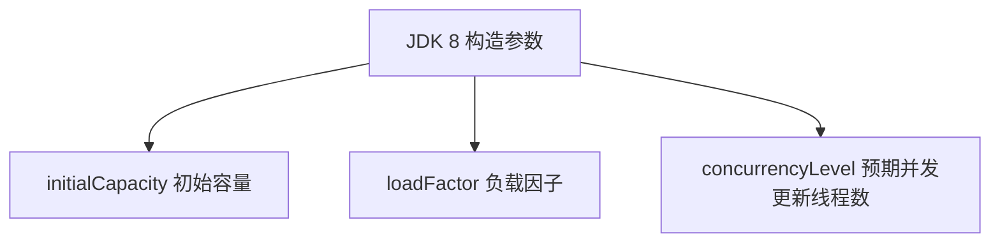

# ConcurrentHashMap v8：构造参数含义

ConcurrentHashMap 的构造方法有两个参数，一个叫 capacity，一个叫 load factor。看名字很容易顺理成章地以为跟普通 HashMap 一样：capacity 是数组长度，load factor 是扩容因子，满了四分之三就扩容。但 ConcurrentHashMap 里这两个参数的含义都变了，用模拟器实际跑一遍就会发现，同样的参数建出来的表和想象的不一样。

## 先给结论

两个参数的准确含义是：

- capacity 不再对应数组长度，而是「假定要往这个 Map 里放多少个元素」。数组最终开多大，由 ConcurrentHashMap 根据这个预期元素个数自行计算，但数组长度仍然必须满足 2 的 n 次方。
- load factor 只在构造时参与计算数组长度，用一次就「退场」。之后的每次扩容都不再参考它，固定按四分之三扩容。

一句话总结：第一个参数代表预期元素个数，第二个参数只在第一次构造时起作用。

## 是什么：capacity 是元素个数，不是数组长度

以 capacity 为 16、load factor 为 0.75 创建 ConcurrentHashMap，初始化完成后随便 put 一个元素，此时观察底层数组的长度。猜是 16 的同学会失望，实际长度是 32。

原因就在于 capacity 的含义变了。这里的 16 不是说数组开 16 长度，而是声明「我将来假定要放 16 个元素」，至于数组开多大，由 ConcurrentHashMap 看着办。当然数组长度还是必须满足 2 的 n 次方，这是老规矩。

那为什么 16 个元素的预期配不出 16 长度的数组？因为放不下。数组长度 16，它的四分之三是 12，装 16 个元素必然超过 12，迟早触发扩容，等于白建。既然 16 不够，就翻倍到 32：32 的四分之三是 24，16 个元素没超过 24，32 够用。所以最终用 32 作为初始长度。

再看两个例子加深印象。把 capacity 改成 12，其余不变。数组长度 16 能不能容纳 12 个元素？还是不能，因为 16 的四分之三恰好是 12，放完 12 个元素正好踩到阈值，照样要扩容，所以依然用 32。那把 capacity 改成 11 呢？16 的四分之三是 12，最多能放下 12 个元素，11 没有超过 12，这一回就按 16 初始化数组。

三个例子串起来就是规律：给定预期元素个数，找一个满足 2 的 n 次方的数组长度，使「数组长度乘以扩容因子」大于预期元素个数，取能满足条件的最小值。

## 为什么：load factor 只用一次

load factor 这个扩容因子，在 ConcurrentHashMap 里只在构造方法被调用时配合计算数组长度，此后的每次扩容都不再用到它，固定按四分之三扩容。

还是用例子说话。capacity 设成 11，load factor 设成 0.5，意思是将来只要元素个数超过数组容量的一半就扩容。按这两个参数创建，数组该开多大？16 肯定不行：16 的一半是 8，将来要放 11 个元素，超过 8，16 兜不住。算下来得是 capacity 等于 7 才行：16 的一半是 8，7 没有超过 8，这样算出来的数组长度才是 16。

创建完之后往里面放元素，验证 load factor 是否持续生效。数组长度是 16，一半是 8。当放到 8 个元素、正好到达容量一半时，并没有触发扩容。原因就是前面说的：load factor 只在构造时用过一次，之后扩容不再参考它，而是按固定的四分之三来。8 个元素离 16 的四分之三（12）还远，继续放，放到第 12 个元素才触发第一次扩容。

这个设计和 capacity 的含义是一套的：构造时用户已经声明了预期元素个数，扩容因子参与把预期换算成初始表长；进入运行期后，元素增长是动态的，再守着用户传入的那个因子反而别扭，不如统一按四分之三处理。

## 深入细节：两组推演

把构造参数的推演完整走两遍。

推演一，capacity 为 16，load factor 为 0.75。数组长度必须是 2 的 n 次方。若取 16，16 的四分之三是 12，预期 16 个元素超过 12，装不下，会立刻陷入扩容；取 32，32 的四分之三是 24，16 小于 24，容纳得下。因此初始数组长度为 32。

推演二，capacity 为 11，load factor 为 0.5。若数组长度取 16，一半是 8，预期 11 个元素超过 8，装不下；要让预期 11 个元素不超一半，capacity 得降到 7 才行，此时 7 小于 8，数组长度取 16。创建之后放入元素，放到 8 个（达到一半）不扩容，因为 load factor 已经用完；继续到 12 个（达到 16 的四分之三）才触发第一次扩容。

两组推演指向同一个结论：capacity 是给 ConcurrentHashMap 的一个「我要放多少元素」的承诺，表长由它和 load factor 在构造时换算一次；之后的扩容节奏与用户传入的 load factor 无关，固定四分之三。

## 面试怎么答

面试问 ConcurrentHashMap 构造参数，核心是答出它与 HashMap 的差别。

第一个参数 capacity，在 ConcurrentHashMap 里不是数组长度，而是预期要放入的元素个数。ConcurrentHashMap 会根据这个个数，结合 load factor，计算出满足 2 的 n 次方的初始数组长度。举例：capacity 传 16、load factor 传 0.75，实际数组长度是 32；传 11、0.75，实际是 16。

第二个参数 load factor，只在构造时参与计算数组长度，之后的每次扩容都不再使用它，固定按四分之三扩容。举例：capacity 为 7、load factor 为 0.5 创建出长度为 16 的表，之后放到 8 个元素（达到一半）并不扩容，要到 12 个（四分之三）才扩容。

如果面试官追问为什么这样设计，可以答：capacity 表达的是预期规模而不是精确容量，并发场景下由内部自行决定表长更合理；load factor 完成初始换算后即失去作用，运行期统一按四分之三控制节奏，逻辑更简单。

## 常见误区

**误区一：把 capacity 当数组长度。** 这是最常见的错。ConcurrentHashMap 的 capacity 是预期元素个数，数组长度由内部换算，且必然大于或等于按元素个数直接推的表长。拿 16 建表拿到 32 的长度，不是 bug，是设计。

**误区二：以为 load factor 全程有效。** 它只在构造时用一次，之后扩容固定按四分之三。设置一个 0.5 就期待运行期按一半扩容，只会失望。

**误区三：忽略 2 的 n 次方约束。** 不管预期多少个元素，最终表长一定是 2 的幂，这是索引计算（位运算取模）决定的，换算结果只会向上取到最近的 2 的幂。

**误区四：直接套 HashMap 的经验。** HashMap 的 capacity 就是表长、load factor 全程有效，两条经验在 ConcurrentHashMap 都不成立。答这道题先讲差别，再讲例子，才不会踩坑。
