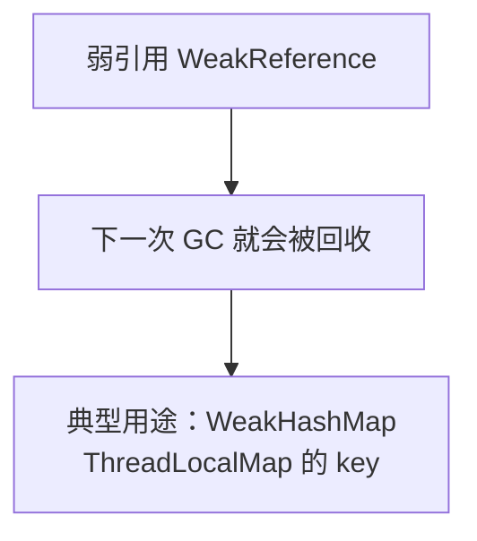

# 四种引用：弱引用与内存泄漏

WeakReference 单独看语义很简单：弱引用不阻止它指向的对象被垃圾回收。但把它放到真实场景里，味道就出来了。我们借用 ThreadLocalMap 的老问题，换一种角度重新看一遍内存泄漏的成因，以及引用队列在其中扮演的角色。

## 先给结论

弱引用相关内存泄漏的成因和收尾可以概括成三点：

- ThreadLocalMap 的 Entry 里，key 是弱引用，value 是强引用。key 能被回收，value 不能，内存因此漏掉一半。
- 想靠垃圾回收把占用释放干净，单靠弱引用做不到，必须借助引用队列追踪被回收的弱引用，再把残留的 value 和 Entry 一起摘掉。
- 清理的办法是：弱引用关联引用队列，key 被回收后对应的 Entry 进入队列，用一个 clean 方法把队列里的 Entry 从数组中置 null，断开强引用，等下一次垃圾回收收尾。



## 是什么：一个模仿 ThreadLocalMap 的简陋 Map

ThreadLocalMap 有个老问题：使用不当可能造成内存泄漏。原因是它的 Entry 中，key 是弱引用，value 不是弱引用。想依赖垃圾回收把占用的内存释放干净是行不通的，垃圾回收只能把 key 占用的内存释放掉。常规解法是正确调用 remove 方法，但学了四种引用之后，可以换一个角度重新审视这个问题。

做法是模仿 ThreadLocalMap 自己实现一个非常简陋的 Map。核心是这个 Entry：它包装了键和值，其中 key 调用 WeakReference 的构造，真正包装成弱引用，用弱引用来引用键；而 value 仍然是强引用。

```java
static class MyWeakMap {
    static ReferenceQueue<Object> queue = new ReferenceQueue<>();
    static class Entry extends WeakReference<String> {
        String value;
        public Entry(String key, String value) {
            super(key, queue);
            this.value = value;
        }
    }
    Entry[] table = new Entry[4];
    public void clean() {
        Object ref;
        while ((ref = queue.poll()) != null) {
            System.out.println(ref);
            for (int i = 0; i < table.length; i++) {
                if (table[i] == ref) {
                    table[i] = null;
                }
            }
        }
    }
    public void put(int index, String key, String value) { table[index] = new Entry(key, value); }
    public String get(String key) { ... }
}
```

Map 本身的实现刻意保持简陋：table 固定大小为 4，put 就是往数组的指定索引处放一个新 Entry，Entry 里包装着键和值；get 就是遍历这个数组，用传入的参数与数组中的 key 比较，相等就返回对应的值，找不到就返回 null；toString 则打印整个 Map 中键值对的状态。

## 为什么：key 是弱的，value 不是

先说 ThreadLocalMap 泄漏的成因。key 用弱引用，是为了避免 key 对象因为被 Entry 持有而永远无法回收，这个设计本身是对的。但 value 没有享受同等待遇，它被 Entry 强引用着。于是出现一个尴尬的局面：key 对象被回收了，Entry 却还活着，Entry 里的 value 也跟着活着，而这时外界已经没有 key 能定位到这个 Entry 了，它成了数据结结里的孤儿，占着内存没人认领。这就是「key 回收了、内存没干净」的泄漏本质。

光有弱引用解决不了这个问题，因为弱引用只负责「不阻止 key 被回收」，不负责「回收之后打扫战场」。打扫战场需要另一件工具：引用队列。

引用队列的规则是：垃圾回收发生时，被回收的弱引用对象本身会被放进关联的引用队列。也就是说，只要 key 被回收，我们就可以从队列里拿到对应的 Entry（弱引用对象本身）。拿到之后，就有机会把 Entry 从 table 里摘掉，连带着断开它与 value 的强引用，让 value 和 Entry 在下一轮垃圾回收中被释放。

具体做法分两步。第一步，给 Map 加一个静态的 ReferenceQueue，Entry 构造时把队列一并传给 WeakReference 的构造方法。WeakReference 支持这种带两个参数的构造，第一个是被弱引用的对象，第二个是引用队列。加上队列后，只要将来 A、B、C、D 这些 key 被回收，对应的 Entry 就会被加入队列。

第二步，写一个 clean 方法。垃圾回收之后，先看队列里有没有东西：定一个 Object ref，循环调用 queue 的 poll 方法去取，取出来的不为空就不断循环。队列里的每个 ref 都是一个被回收 key 所关联的 Entry。接着遍历 table 数组，检查数组当前元素与这个 ref 是否相等，相等就说明这个 Entry 的 key 已经被回收（正因为回收了，它才会出现在队列里），这时把 table 对应索引处置为 null。

把索引处置 null，意味着数组与 Entry 之间的强引用断开了，Entry 连同它强引用的 value，就会在下一次垃圾回收时被回收掉。清理完再打印 Map，可以看到整个 Map 被清成了 null，因为里面的 Entry 全部被清空。

值得注意，ThreadLocalMap 的真正实现并没有用引用队列来解决这个问题，原因是实现成本有点高。引用队列方案更适合理解机制，工程上的 ThreadLocalMap 依赖的是正确使用 remove。

## 深入细节：三轮实验

构造测试数据：创建一个 Map，往四个索引位置放四组键值，分别是 A1、B2、C3、D4。放完先打印，确认数据都在。

第一轮，垃圾回收。回收哪部分对象？外面的 Map 生命周期从这个方法运行一直到方法结束，肯定不能回收；Map 里存的 table 数组是强引用，也不能回收；table 里的 Entry 是弱引用对象，但 Entry 本身被数组强引用，同样不回收；Entry 里的 key 是弱引用，且这些 key 每次都用 new String 创建，保证没有其他地方引用 A、B、C、D 这四个字符串，所以它们能被回收；而 Entry 里的 value 是 1、2、3、4，仍然被 Entry 强引用着，不能回收。

预期回收后：A、B、C、D 四个 key 没了，其余都还在。调 get 验证，四个 key 全部返回 null，因为 key 已被回收，弱引用取不到原对象。但打印整个 Map 会发现：key 确实都变成了 null，value 1、2、3、4 仍然在，Entry 本身也还在。这就是内存泄漏的直观呈现：数据还在结构里，却再也没有 key 能访问到它。

第二轮，加引用队列清理。Entry 构造时传入 queue，clean 方法从队列里 poll。垃圾回收之后调用 clean，队列里确实有东西：回收了四次，A、B、C、D 都被回收，它们关联的四个 Entry 全部进了队列，打印能看到四个 Entry。clean 遍历 table，把与队列中 ref 相等的元素置 null，再打印 Map，整个表被清空，泄漏解除。

第三轮，对照实验，验证清理逻辑跟的是回收而不是位置。把 B 这个 key 改成不用 new String，那么 B 不会被回收，进队列的只有 A、C、D 三个 Entry。清理之后，B 留在了表里，A、C、D 被清掉。这说明清理不是无差别清空，而是精确对应「key 确实被回收了」的条目。

WeakReference 的类签名在 java.lang.ref 包下，继承自 Reference：

```java
java.lang.ref
public class WeakReference<T>
extends Reference<T>
```

## 面试怎么答

面试问弱引用，可以从语义讲到应用。

语义：弱引用不会阻止它引用的对象被垃圾回收。只要一个对象只被弱引用持有，下一次垃圾回收就可能把它回收，回收后弱引用自身的 get 方法返回 null。

经典应用场景：ThreadLocalMap。它的 Entry 的 key 是弱引用，目的是避免 key 对象被长期持有无法回收。但 value 是强引用，所以 key 回收后 Entry 仍然存活，value 也收不掉，形成泄漏。解决办法是使用完 ThreadLocal 后及时调用 remove 方法，把 Entry 从 Map 中显式移除。

进阶一点的问法是引用队列。垃圾回收器回收弱引用对象时，会把弱引用对象本身放入关联的 ReferenceQueue。利用这个机制，可以在 key 被回收后感知到，并把残留的 Entry 从容器中清理掉，具体做法就是轮询队列，把队列中出现的元素在数组里的位置置 null，断开与 value 的强引用，让下一轮垃圾回收完成收尾。

如果被追问 JDK 为什么没在 ThreadLocalMap 里用引用队列，可以答：实现成本比较高，ThreadLocalMap 选择了依赖用户规范使用 remove 的方式来规避泄漏。

## 常见误区

**误区一：以为 key 用了弱引用就不会内存泄漏。** 弱引用只解放 key，不解放 value。Entry 只要还挂在容器里，它强引用的 value 就活着。key 弱引用 + value 强引用这个组合，本身就是泄漏的结构性成因。

**误区二：以为垃圾回收会连 value 一起收掉。** 回收只认引用链。value 被 Entry 强引用，Entry 被数组强引用，链条完好，回收器不会碰它。实验里 GC 之后 value 1、2、3、4 原样健在，就是证据。

**误区三：以为弱引用的 get 永远能取到原对象。** 弱引用的对象一旦被回收，get 返回 null。用它做缓存，必须容忍「取着取着就没了」的可能。

**误区四：以为清理靠 GC 自动完成。** GC 只负责把弱引用对象送进队列，不会帮你把数组里的位置腾出来。不主动 clean，队列里堆再多 Entry，表里该漏的还是漏。
