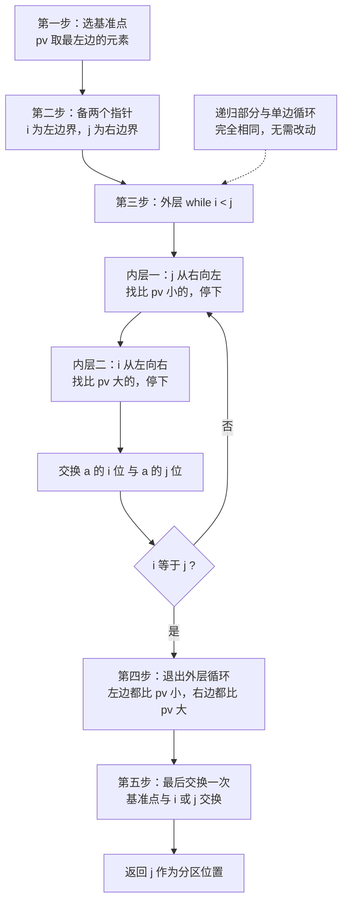

# 快速排序：双边循环分区实现

双边循环的分区逻辑上一篇已经用动画走明白了，这篇落到代码。先说个省事的地方：不管单边循环还是双边循环，递归部分的代码一模一样，直接拿过来用就行，要改的只有 partition 分区方法。

## 先给结论

双边循环 partition 的实现分五步：

- 选基准点：双边循环取最左边的元素，即 `pv = a[l]`。
- 准备两个指针：i 初始为左边界 l，j 初始为右边界 h。
- 外层循环 `while (i < j)`，内部重复两个动作：j 从右向左找比基准点小的，i 从左向右找比基准点大的，各自找到就交换。
- i 与 j 相等时退出外层循环，此时 i 左边都比基准点小，j 右边都比基准点大。
- 退出循环后最后交换一次：基准点与 i 或 j 交换（此时二者相等），返回 j 作为分区位置。

递归部分与单边循环完全相同，无需改动。



## 是什么：分区方法全貌

主函数沿用之前的写法，建数组、打印、调用 quick：

```java
public static void main(String[] args) {
    int[] a = {5, 3, 7, 2, 9, 8, 1, 4};
    System.out.println(Arrays.toString(a));
    quick(a, 0, a.length - 1);
}
```

核心的分区方法如下：

```java
private static int partition(int[] a, int l, int h) {
    int pv = a[l]; // 基准点
    int i = l;
    int j = h;
    while (i < j) {
        // 从右往左找比基准点小的元素
        while (a[j] > pv) {
            j--;
        }
        // 从左往右找比基准点大的元素
        while (a[i] < pv) {
            i++;
        }
        swap(a, i, j);
    }
    swap(a, l, j);
    return j;
}
```

交换是独立的小方法，与单边循环版本通用：

```java
private static void swap(int[] a, int i, int j) {
    int temp = a[i];
    a[i] = a[j];
    a[j] = temp;
}
```

## 为什么：循环条件这样写

基准点取最左，是双边循环的约定，所以 pv 的值来自左边界 l。i 从左边界出发向右找大，j 从右边界出发向左找小，两个指针相向而行。

外层循环写成 `while (i < j)`，是因为分区结束的标志就是 i 与 j 相等。一旦两者相交，说明小的都被扫到了左边、大的都被扫到了右边，中间没有错位元素可交换，本轮分区到此为止。用 `i < j` 作为条件，相等时自然退出。

内层两个 while 分别是两个指针的「找目标」动作。为什么一次比较找不到目标？因为目标不总是紧邻当前元素。比如 j 指向 9，9 比基准点大，不符合「找小」的目标，就要 j-- 看前一个元素；前一个还不小，继续 j--，直到移动到 1，比基准点小，内层循环停下，j 指向的就是比基准点小的值。i 完全相反，a[i] 小于基准点就不断 i++ 找下一个，直到遇到比基准点大的才停下。两个内层循环都退出，意味着双方都找到了目标，此时交换 swap(a, i, j)，小的去左边、大的去右边。

退出外层循环后还差最后一步：基准点此刻还在最左边，要与 i 或 j 交换完成归位。由于退出时 i 与 j 相等，与 i 交换或与 j 交换等价。交换完成，j 指向的索引就是基准点的正确位置，也就是分区位置，直接返回 j，递归时以这个位置把数组切成左右两段。

## 深入细节：拿真实数据走一遍

以数组 `[5, 3, 7, 2, 9, 8, 1, 4]` 为例，pv 取最左的 5，i = 0，j = 7。

第一轮，j 从右向左找小：a[7] 是 4，比 5 小，j 停在 7。i 从左向右找大：a[0] 是 5，不小于 5，i 停在 0。交换 a[0] 与 a[7]，数组变成 `[4, 3, 7, 2, 9, 8, 1, 5]`。

第二轮，j 继续向左找小：a[6] 是 1，比 5 小，j 停在 6。i 继续向右找大：a[1] 是 3，小于 5，i 右移；a[2] 是 7，大于 5，i 停在 2。交换 a[2] 与 a[6]，数组变成 `[4, 3, 1, 2, 9, 8, 7, 5]`。

第三轮，j 继续向左：a[5] 是 8 大于 5，j--；a[4] 是 9 大于 5，j--；a[3] 是 2 小于 5，j 停在 4。i 继续向右：a[2] 是 1 小于 5，i++；a[3] 是 2 小于 5，i++；a[4] 是 9 大于 5，i 停在 4。i 与 j 在索引 4 相遇，交换 a[4] 与 a[4] 等于没换，外层循环退出。

最后一步，基准点 5（还在索引 0）与 j 也就是索引 4 交换，数组变成 `[2, 3, 1, 4, 5, 8, 7, 9]`，返回分区位置 4。基准点左边 `[2, 3, 1, 4]` 都比 5 小，右边 `[8, 7, 9]` 都比 5 大。左右两段继续递归，最终整个数组排好序，输出 `[1, 2, 3, 4, 5, 7, 8, 9]`（这组数据里本来就没有 6）。

跑完在分区结束处加一行打印，把数组和 j 一起输出，就能直观验证每一轮的分区位置是否符合预期。第一轮分区后基准点 5 落在索引 4，与动画演示一致。

还有两个已知问题留在代码里，本篇先补全再解释原因：一是两个内层循环都缺少 `i < j` 条件，都要加上；二是还有一处需要加小于等于的等号条件。为什么加、加了解决什么，下一篇讲。

## 面试怎么答

面试问双边循环快排的代码实现，按步骤答。

递归部分与单边循环（Lomuto）完全一样，差异集中在 partition。第一步选基准点，双边循环取最左元素 `pv = a[l]`。第二步初始化两个指针，i 为左边界，j 为右边界。第三步外层循环 `while (i < j)`，内部 j 从右向左找小（`while (a[j] > pv) j--`），i 从左向右找大（`while (a[i] < pv) i++`），找到就 `swap(a, i, j)`。第四步 i 与 j 相遇相等时退出循环，此时 i 左小、j 右大。第五步循环外做最后一次交换 `swap(a, l, j)`，基准点归位，返回 j 作为分区位置，递归处理左右两段。

如果被问与单边循环的区别，可以答：单边循环选最右为基准、一个 j 指针既找小又当交换目标、i 只守小值边界；双边循环选最左为基准，i、j 各找一头，i 守小值边界、j 守大值边界，相遇后基准点与相遇点交换。两者的递归部分完全一样。

如果被问边界条件，要主动提内层循环需要 `i < j` 的保护，防止指针越界或交错过头，这也是课堂代码留下待补的两个问题之一。

## 常见误区

**误区一：忘记循环外的最后一次交换。** 分区结束时基准点还停在最左边，不与 j 交换就返回，基准点没归位，左右两段并不满足「左小右大」，递归结果全错。这是双边循环特有的收尾动作。

**误区二：内外层循环条件搞反。** 外层是 `i < j` 管相遇，内层两个 while 分别管两个指针找目标。把 i、j 的移动方向写反，或者把找大找小的条件写反，分区直接失效。

**误区三：以为递归部分也要重写。** 单边双边的递归代码一模一样，只有 partition 不同。重写递归属于白费功夫，还容易引入新错误。

**误区四：以为当前版本已经完备。** 这份代码在这组数据上能正确工作，但内层循环缺 `i < j` 保护、另有等号条件待补，属于「先跑通再加固」的中间形态。答题或写生产代码时，要把这两个保护补上。
