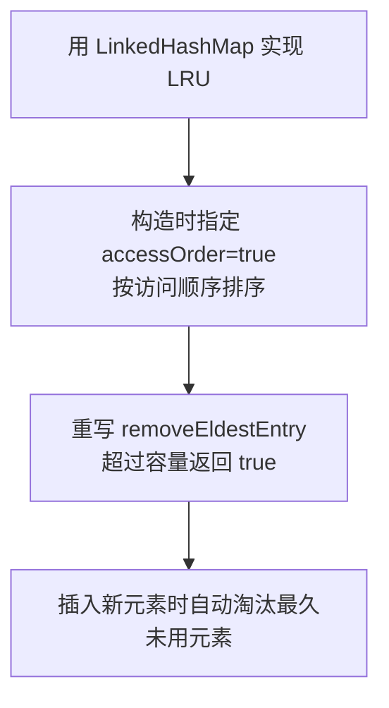

# LRU 缓存：借助 LinkedHashMap 实现

上一篇我们自己用双向链表加 HashMap 实现了 LRU Cache。如果不想自己维护链表，还有一条捷径：让缓存类继承 LinkedHashMap，把它内部的链表借过来用，LRU 的实现能简化到几十行。

## 先给结论

用 LinkedHashMap 实现 LRU 的关键就两点：

- 调用父类的有参构造，并且第三个参数 accessOrder 必须设为 true，元素才会按访问顺序调整位置。
- 重写 removeEldestEntry 方法，告诉父类什么情况下移除最老的元素，通常是 size 超过 limit 时返回 true。

但要知道，面试考察的是对链表实现的熟悉程度，不会满足于这种简单做法。两种都要会，第二种用来理解 API，第一种用来应对面试。



## 是什么：继承 LinkedHashMap

让缓存类继承 LinkedHashMap。LinkedHashMap 没有元素个数上限，limit 得自己控制，所以加一个 limit 字段，构造方法通过参数传进来。

构造里不能调父类的无参构造，要调有参构造。前两个参数大家熟悉：initialCapacity 是初始容量，loadFactor 是负载因子。第三个参数 accessOrder 是重点，它控制 LinkedHashMap 链表中元素的排列顺序，默认值是 false。

```java
public class LruCache2 extends LinkedHashMap<String, Object> {
    private int limit;
    public LruCache2(int limit) {
        super(InitialCapacity: limit * 4 / 3, loadFactor: 0.75f, accessOrder: true);
        this.limit = limit;
    }
```

三个参数的取值有讲究。初始容量建议设成 limit 乘以 4 除以 3，好处是避免扩容：装够 limit 个元素时不会因为触到负载因子而触发扩容，少一次 rehash 的折腾。负载因子选 0.75。accessOrder 一定要设成 true，它才会按访问顺序调整元素位置；保持默认的 false，元素就始终维持插入顺序。

## 为什么：访问顺序决定淘汰顺序

accessOrder 取 false 时，链表按插入顺序保持。插入 1、2、3、4，链表就一直是这个顺序，不管中间有没有访问过。

accessOrder 取 true 时，链表按访问次序调整。还是插入 1、2、3、4，之后访问了 2，2 就会被挪到代表最新的那一端（课程动画里把右边看成头，也就是最新位置），最早放入的元素则留在尾部。将来淘汰时淘汰尾部的元素，就不再按插入顺序淘汰了。这正是 LRU 要的效果：最近访问过的延后淘汰，最久没动的优先淘汰。

光有顺序调整还不够，还得有淘汰动作。LinkedHashMap 的插入流程里留了一个口子：重写 removeEldestEntry 方法，返回 true 表示满足移除条件，父类就会把最老的 entry 移除；返回 false 表示不移除。什么时候该移除最老的 entry？当 Map 中的元素个数超过 limit 时。所以判断很直接：size 超过 limit 返回 true，否则返回 false。具体的移除动作由父类完成，不用自己写。

```java
@Override
protected boolean removeEldestEntry(Map.Entry<String, Object> eldest) {
    if (this.size() > this.limit) {
        return true;
    }
    return false;
}
```

## 深入细节：测试走查

测试代码沿用上一篇的套路，把实现换成 LruCache2：

```java
public static void main(String[] args) {
    LruCache2 cache = new LruCache2(limit: 5);
    cache.put("1", 1);
    cache.put("2", 1);
    cache.put("3", 1);
    cache.put("4", 1);
    cache.put("5", 1);
    cache.get("2");
    cache.put("6", 1);
    cache.put("7", 1);
    System.out.println(cache);
}
```

逐步看输出。刚创建时空空如也。依次放入 1 到 5，缓存按顺序填充。放入第六个元素 6 时，元素个数超过 limit 上限 5，removeEldestEntry 返回 true，最早的 1 被移除。

接着 `get("2")`，因为 accessOrder 设了 true，2 被调到最新的位置，顺序变成 2、6、5、4、3。再放入 7，元素个数再次超过上限，这一回淘汰的是最老的 3；2 因为刚被访问过、调到了前面，幸免于难。最终缓存里剩下 7、2、6、5、4，与手写链表版的输出完全一致。

源码里还带了一个 toString，用于把缓存内容打出来观察顺序：

```java
public String toString() {
    StringBuilder sb = new StringBuilder(capacity: 128);
    sb.append("{");
    sb.append(this.prev == null ? null : this.prev.key);
    sb.append(":");
    sb.append(this.key);
    sb.append(":");
    sb.append(this.next == null ? null : this.next.key);
    sb.append("}");
    return sb.toString();
}
```

提醒一句：这份 toString 是从上一篇手写链表实现里的 Node 搬过来的，LruCache2 自身并没有 prev、next 字段，直接放到这个类里编译不过，看演示时知道它只是借用来说明输出形态即可。

另外注意，以上代码块按课程原稿逐字收录，`InitialCapacity:`、`loadFactor:`、`accessOrder:`、`limit:`、`capacity:` 是原稿中夹带的编辑器参数名提示，并非合法 Java 语法，实际代码里应写作字面量。

## 面试怎么答

面试问 LRU 缓存，先答手写链表版：HashMap 加双向链表，O(1) 查找、O(1) 移动和删除，get 命中后 toHead，put 超容量淘汰尾部，必须双向链表是为了 O(1) 摘除任意节点。这是主答案。

然后可以补一句进阶版：如果不想自己维护链表，可以继承 LinkedHashMap，构造时把 accessOrder 设为 true，再重写 removeEldestEntry，在 size 超过 limit 时返回 true，父类会自动完成访问排序和 eldest 移除。JDK 的 LinkedHashMap 就是这套结构的官方实现。

但要注意，面试官考的就是对链表的了解和熟悉程度，不会满足于 LinkedHashMap 这种简单做法。只答简单版，达不到面试官的预期。两种实现都要会，分工是：手写版应对考察，LinkedHashMap 版体现对 API 的掌握。

## 常见误区

**误区一：accessOrder 忘记设 true。** 默认 false 意味着按插入顺序排列，淘汰退化成 FIFO，先插入的先淘汰，与 LRU 的定义相悖。这是 LinkedHashMap 方案最高频的失分点。

**误区二：不重写 removeEldestEntry。** 只设 accessOrder 不淘汰，缓存没有上限，元素无限增长，LRU 名存实亡。

**误区三：初始容量按 limit 直接给。** 装到 limit 个元素时正好接近负载因子阈值，容易触发一次扩容。按 limit 乘以 4 除以 3 给初始容量，可以避开这次扩容。

**误区四：面试只答 LinkedHashMap 方案。** 考察点在链表。继承加重写的写法确实简洁，但绕开了双指针、哨兵节点、指针改线这些核心考点，答得再熟练也拿不到高分。
