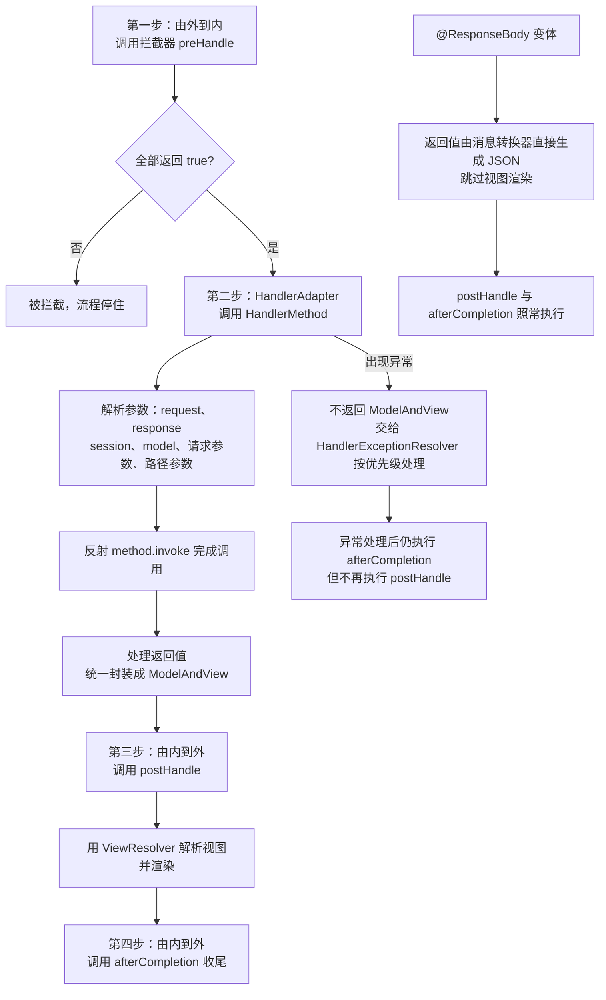

# Spring MVC 执行流程：执行阶段

匹配阶段的产出是一个 HandlerExecutionChain，里面装着所有匹配到的拦截器和处理器对象，另外还选中了一个 HandlerAdapter 负责调用处理器。准备工作就绪，进入最后一个阶段：执行阶段。这一阶段把控制器方法真正跑起来，并把结果变成浏览器能拿到的响应。

## 先给结论

执行阶段的主干是：先由外到内调用所有拦截器的 preHandle，全部放行后由 HandlerAdapter 调用 HandlerMethod，方法参数解析后反射 invoke，返回值统一封装成 ModelAndView；然后由内到外调用 postHandle，处理 ModelAndView，用 ViewResolver 解析视图并渲染；最后由内到外调用 afterCompletion 收尾。

两条分支要记牢：第二步出现异常时不返回 ModelAndView，交给 HandlerExceptionResolver 按优先级处理，异常处理后仍然执行 afterCompletion，但不再执行 postHandle。另有 @ResponseBody 变体：处理返回值阶段直接由消息转换器生成 JSON，跳过视图渲染，但 postHandle 与 afterCompletion 照常执行。

## 是什么：执行链的逐段展开

执行阶段第一步是调用执行链中所有拦截器的 preHandle，顺序是由外到内：先第一个拦截器，再第二个，依次类推。preHandle 有返回值，返回 true 表示放行，继续往后走；返回 false 相当于被这个拦截器拦下，流程在这里停住，不再往后执行。

假设所有 preHandle 都返回 true，流程进入第二步：由 HandlerAdapter 调用 HandlerMethod。这一步并不轻松。虽然已经知道要调用哪个 bean 的哪个方法，但控制器方法的参数非常多样，可能是 request、response、session 这样的对象，可能是 model 模型对象，也可能来自请求参数或路径参数。调用之前必须先解析参数、把参数全部准备好，才能通过反射 invoke：method.invoke 传入 bean 和准备好的参数，完成控制器方法的调用。

调用结束后还要处理返回值。控制器方法的返回值同样多样，可能是字符串，可能是 map 集合，可能是 list 集合，也可能是 @ResponseBody 标注的写法。这些返回值类型都要做相应处理。返回值处理完毕，这一次调用暂时告一段落，接下来分无异常和有异常两种情况。

## 为什么：顺序、封装与解析

preHandle 由外到内、postHandle 由内到外，不是随便定的。拦截器的设计意图就是包裹式分层：外层拦截器先拿到控制权，处理完再交给内层，内层返回后外层再收尾，天然形成「先进后出」的对称结构。preHandle 是入场，从最外层放到最内层；postHandle 是出场，从最内层退出到最外层。两个方向反着来，包裹才完整。

返回值之所以要统一封装成 ModelAndView，是因为控制器方法的返回类型五花八门，下游的视图处理需要一个统一的载体。不管原来返回的是字符串、map 还是其他类型，最终都收敛为 ModelAndView，里面包含模型数据和视图相关信息。下游只面向 ModelAndView 编程，不用为每种返回类型写一套处理。

视图名之所以要解析，是因为方法返回的往往只是视图名称的字符串，而不是视图对象。ViewResolver 视图解析器负责把字符串视图名解析成真正的视图对象；如果方法直接返回的就是视图对象，那就不用解析，直接用。解析出视图后进入渲染，把模型数据按视图实现放到不同位置：JSP 实现下，模型数据被取出放入 request 作用域，随后转发到 JSP 视图，JSP 从作用域中取出模型数据，渲染生成 HTML 返回。

## 深入细节：正常、异常与 ResponseBody

正常流程完整走一遍。

preHandle 由外到内全部返回 true，放行。HandlerAdapter 接手，解析 HandlerMethod 的参数，反射 invoke 调用控制器方法，方法执行完毕后处理返回值，统一封装成 ModelAndView。流程回到拦截器，由内到外调用所有 postHandle：先最里层，再中间层，最后最外层。postHandle 全部调完，处理 ModelAndView。先处理视图：返回的是视图名就交给 ViewResolver 解析成视图对象，直接返回视图对象则跳过解析。视图就位后渲染，以 JSP 为例，模型数据放进 request 作用域，转发到 JSP，JSP 取出数据渲染成 HTML。视图处理完毕还有收尾：回到拦截器，由内到外调用 afterCompletion，全部调完，整个执行流程结束。

异常流程这样走。

第二步 HandlerAdapter 调用 HandlerMethod 时抛出异常，方法不会返回 ModelAndView，而是拿到一个异常对象，由 try-catch 结构捕获。异常不由控制器方法自己处理，而是交给 DispatcherServlet 的成员 HandlerExceptionResolver。它有多个实现，按优先级排序，谁先匹配到这个异常，谁就来处理，最终挑出一个 HandlerExceptionResolver 完成异常处理。异常处理结束后，流程仍然会走最后的 afterCompletion，由内向外逐一调用；但 postHandle 不会再执行，因为出现异常时没有机会走到那一步。

@ResponseBody 变体这样走。

如果控制器方法标注了 @ResponseBody，意味着不跳转视图，直接返回 JSON 数据。在处理返回值的阶段，会检查方法的返回值或方法上是否标注了 @ResponseBody，如果是，就标记 ModelAndView 已经处理完毕，后续不再执行视图渲染，也就是跳过第三步。JSON 结果由 MessageConverter 消息转换器生成，作为最终结果返回。但拦截器的 postHandle 和 afterCompletion 仍然照常执行，不受影响。

无论最终有没有异常，都会执行到拦截器的 afterCompletion 方法，这是执行阶段的固定收尾。

## 面试怎么答

面试问 Spring MVC 执行流程，建议按初始化、匹配、执行三段答，执行阶段是重点。

匹配阶段产出 HandlerExecutionChain（含拦截器和 HandlerMethod）和 HandlerAdapter。执行阶段第一步，由外到内调用拦截器 preHandle，返回 true 放行，返回 false 拦截。第二步，HandlerAdapter 调用 HandlerMethod：先解析参数（request、response、model、请求参数、路径参数等），反射 invoke 调用，再处理返回值。第三步分两种情况：无异常时返回值封装成 ModelAndView，由内到外调用 postHandle，用 ViewResolver 解析视图并渲染；有异常时不返回 ModelAndView，异常被捕获后交给 HandlerExceptionResolver 按优先级处理。最后无论有无异常，都由内到外调用 afterCompletion 收尾。

两个容易被追问的点。一是 preHandle 与 postHandle 的顺序为什么相反：拦截器是包裹式分层，入场由外到内、出场由内到外，形成对称。二是 @ResponseBody 的影响：处理返回值时直接由消息转换器生成 JSON，标记 ModelAndView 已处理，跳过视图渲染，但拦截器的 postHandle 和 afterCompletion 照常执行。

## 常见误区

**误区一：以为 preHandle 返回 false 之后流程还会继续。** 返回 false 表示被拦截器拦下，流程在这个拦截器处停下，后面的调用全部不走。拦截器的「拦截」就体现在这个返回值上。

**误区二：记反 postHandle 的顺序。** preHandle 由外到内，postHandle 由内到外，两个方向相反。答成同向，说明没理解包裹式分层的结构。

**误区三：以为出现异常就不执行 afterCompletion。** 异常时不执行的是 postHandle，afterCompletion 无论有无异常都会由内向外逐一执行，这是固定收尾，常用于资源清理。

**误区四：以为 @ResponseBody 会跳过所有拦截器处理。** 跳过的是视图渲染，不是拦截器。postHandle 和 afterCompletion 照常执行，该做的收尾一步不少。

**误区五：以为返回值直接就是视图。** 返回值先被统一封装成 ModelAndView，再谈视图处理；返回的若只是视图名字符串，还要经 ViewResolver 解析成真正的视图对象才能渲染。把封装和解析两步省略掉，流程是不完整的。
