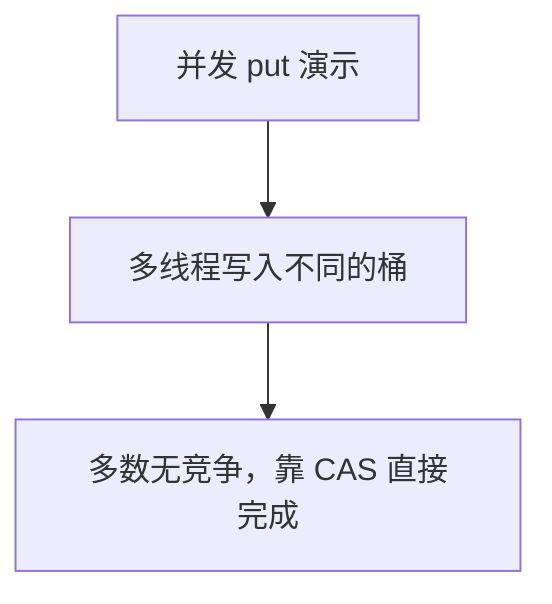

# ConcurrentHashMap v8：演示并发 put

索引计算、扩容、Segment 这些机制前面都拆开讲过，这篇用一个交互式模拟器把它们串起来：多个线程同时往同一个 ConcurrentHashMap 里 put，亲眼看一看锁到底加在哪里、什么时候互斥、什么时候又能并行。

## 先给结论

1.8 版本的 ConcurrentHashMap 把锁加在每个链表头上，而不是整把表加一把锁。由此推出两个可观察的结论：

- 两个线程操作同一个索引（同一个链表），后到的线程会阻塞，等前一个释放锁才能继续。
- 两个线程操作不同索引，各自的锁互不相干，可以并行执行，后一个不必等前一个。

第二点是 ConcurrentHashMap 并发度高的根本原因：只要操作的不是同一个链表，就能并发。

## 是什么：一行一个线程的模拟器

模拟器页面上每一行代表一个线程，借此可以模拟多个线程操作同一个 ConcurrentHashMap，观察冲突情况。

先回顾 1.8 版本的加锁位置：锁加在每个链表头上。假设链表中有一个元素 A，处于链表头的位置。将来如果有其他线程访问的是 10 号索引，那么第一个先到的线程，会给 A 这个链表头的元素加锁。如果这个时候还有其他线程来，发现 A 链表头已经被一个线程占用，它就会阻塞。

注意这个「加在链表头」的设计：锁的粒度是单个链表，不是整张表。一张表有几十上百个索引，各锁各的，冲突才被限制在真正抢同一个位置的线程之间。

## 为什么：同索引才互斥

互斥的根本原因是冲突。两个线程如果落在同一个索引，操作的就是同一条链表，一个改头节点、一个也要改头节点，不加限制就会丢数据、坏结构，所以必须互斥。反过来，两个线程落在不同索引，改的是两条互不相干的链表，彼此的数据没有交集，没有理由互相等待。

模拟器的用法正好把这两件事分开验证。让两个线程往同一个索引放元素，观察阻塞；再让两个线程分别操作不同索引，观察并行。两次实验的差别只有一个变量：索引是否相同。结论也就一目了然。

模拟阻塞还需要一个手法：让持锁的线程慢点走。给 put 操作加一个暂停时间，中间休眠 10 秒，锁被持有 10 秒不释放，另一个线程的阻塞状态就能被稳定观察。不停休眠的话，put 瞬间结束，锁一闪就放，阻塞窗口还没看清就过去了。

## 深入细节：两个实验

实验一，互斥。

线程二和线程三分别要往 10 号索引放 B 和 C 两个元素。故意把 A、B、C 三者的哈希值设成一样，保证它们的索引值都是 10。给线程二 B 的 put 加上 10 秒的休眠，让锁被长时间持有。

先启动线程二的 B 的 put，紧接着同时启动线程三的 C 的 put。结果 C 能成功吗？不行。因为线程二已经获得了 A 这个链表头的锁，线程三的 C 的 put 操作被阻塞住，必须等线程二的 10 秒运行完、锁释放之后，C 的操作才能成功。这就是操作同一个链表时的锁互斥。

实验二，并行。

还是线程二操作 10 号索引，但线程四这次操作的是另一个 4 号索引。线程二加在 10 号索引上的锁，会不会影响线程四的 D？不会。

同样给线程二的 B 的 put 设置 10 秒耗时，与此同时操作 D，D 立刻就成功了，完全不阻塞。因为两个线程操作的并不是同一个索引，可以并行执行。

这正是 ConcurrentHashMap 并发度高的原因：只要操作的不是同一个链表，就可以并发执行，并发性能随之提升。对比整表加锁的方案，同样的多线程 put，大部分情况下线程之间根本不需要互相观望。

## 面试怎么答

面试问 ConcurrentHashMap 的并发 put，可以这样答。

1.8 版本采用数组加链表加红黑树的结构，锁加在链表头（或红黑树根）节点上，粒度是单个 bin，不是整表。put 时先定位索引：索引为空用 CAS 直接写入，不需要加锁；索引非空才 synchronized 锁住链表头节点，进入临界区。

并发行为上，操作同一个索引的线程会互斥，后到的阻塞等待；操作不同索引的线程各锁各的，可以完全并行。这就是它比 HashTable（全表锁）和 1.7 版本（Segment 分段锁）并发度高的原因：锁的粒度细到单个链表，冲突概率大幅下降。

get 操作大多数情况下是无锁的，因为 value 和 next 指针用 volatile 修饰，能保证可见性，读不需要等待写。只有在极端情况下（扩容中读到转发节点）才需要协助。

## 常见误区

**误区一：以为 ConcurrentHashMap 锁整张表。** 那是 HashTable 的做法。1.8 的 ConcurrentHashMap 锁的是单个链表头节点，一张表上可以同时有多把锁在不同索引上生效。

**误区二：以为并发 put 一定互斥。** 只有落在同一个索引才互斥。不同索引的 put 完全并行，这也是演示实验二直接成功的原因。

**误区三：把 1.8 的实现说成 Segment 分段锁。** Segment 是 1.7 的结构，锁加在 Segment 上，粒度是段。1.8 已经改成 synchronized 锁链表头，粒度细到单个 bin，两者不要混讲。

**误区四：以为读操作也要等写锁。** get 基本无锁，靠 volatile 保证可见性。答成「读也要抢锁」，等于否定了它读高性能的设计初衷。
